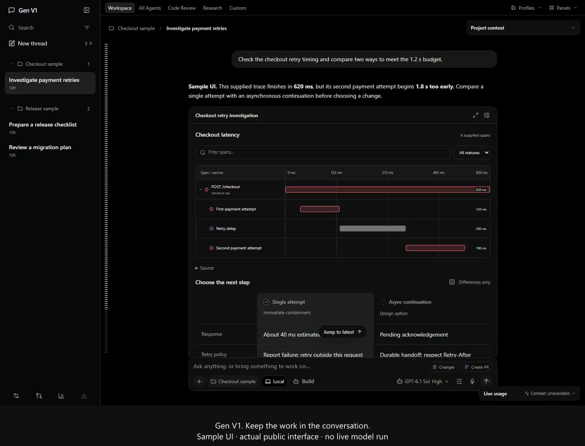
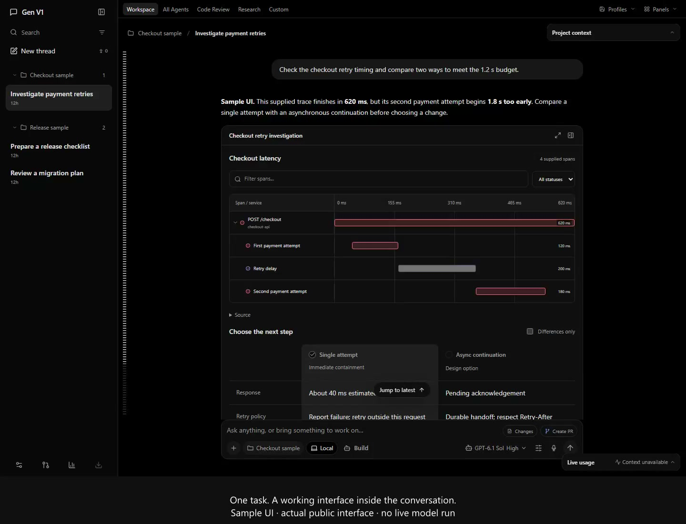
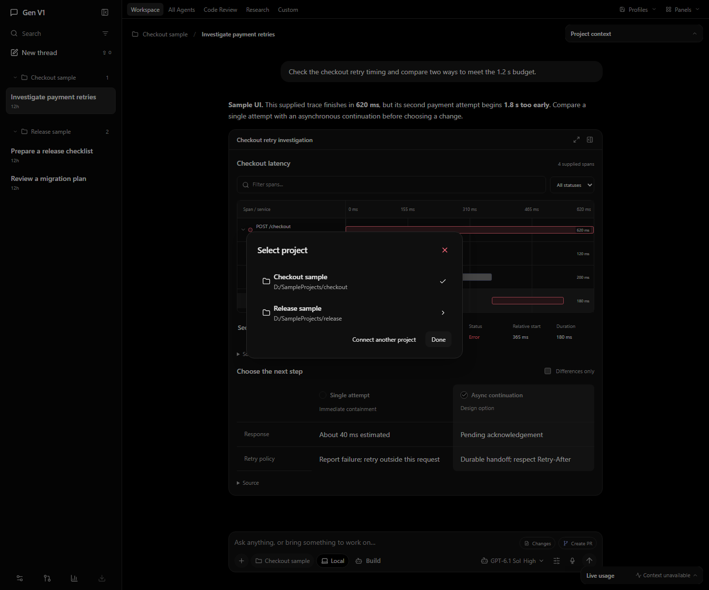

# Gen V1

**A conversation can be a workspace.**

Gen is a local AI workspace for Windows. Talk through a task, explore an interactive view of the work, and return to the conversation with your drafts and decisions intact.

> **Preview status:** the published download and current main branch are v0.6.1. The gallery and demos show the newer 0.6.4 interface under review in [PR #1](https://github.com/Skytuhua/Gen-V1/pull/1).

[Get started](docs/public/getting-started.md) · [Download the current preview](https://github.com/Skytuhua/Gen-V1/releases/tag/v0.6.1) · [Watch the demos](#see-gen-in-motion) · [Explore the features](docs/public/features.md)


*The actual Gen interface with a clearly labeled sample conversation. [About these screenshots and demos](docs/public/media/README.md).*

## Keep the work in the conversation

Some tasks need more than a reply. A trace needs a timeline. A decision needs a comparison. A document needs an editor. Gen brings those working interfaces into the conversation, alongside the explanation and your next message.

- **Work with the task.** A trusted catalog of 48 components supports documents, comparisons, trace investigations, workflows, diagrams and other interactive views.
- **Pick up where you left off.** Conversations, task interfaces, accepted actions and saved state persist. Draft recovery retains newer edits for review.
- **Keep your tools close.** Project navigation and a compact composer surround the conversation. Dark and light themes, model search and reasoning controls keep the workspace familiar.
- **Build a useful skill library.** The pinned original Hermes engine provides the conversation loop, skill tools, `/learn`, background reviews and curation. Inspect saved procedures and their revision history in Settings.
- **Choose your connection.** Nine connection IDs support native subscription or dedicated plan-key routes. Accounts remain separate, and existing tasks retain their selected account. Live verification currently covers the OpenAI route; other integrations need their own account and entitlement checks.
- **Preview the next extension system.** The 0.6.4 update in [PR #1](https://github.com/Skytuhua/Gen-V1/pull/1) adds independently versioned packages through a [public plug-in API](https://github.com/Skytuhua/Gen-V1/blob/cb504d0e392fde9e70883b7b7c2e808e13488b7c/docs/plugin-api.md). That update runs without a plug-in installed.

Optional next-message predictions are off by default. When enabled, **Tab** accepts a suggestion and **Escape** dismisses it; accepting text and sending a message remain separate actions.

## See Gen in motion

### A tour of the workspace · 60 seconds

[](docs/public/media/workspace-tour.mp4)

[Watch MP4](docs/public/media/workspace-tour.mp4) · [WebM](docs/public/media/workspace-tour.webm) · [Transcript](docs/public/media/workspace-tour.md)

### From a trace to a decision · 24 seconds

[](docs/public/media/task-walkthrough.mp4)

[Watch MP4](docs/public/media/task-walkthrough.mp4) · [WebM](docs/public/media/task-walkthrough.webm) · [Transcript](docs/public/media/task-walkthrough.md)

*Both clips are captioned recordings of the actual public browser UI with authored sample data. They show interface behavior, not a live model run or an executed change. If GitHub opens a file page, choose **View raw** or download the clip.*

## A closer look

| Find a model and choose reasoning effort | Inspect saved skills |
| --- | --- |
|  |  |

| A light workspace | Plan and project context |
| --- | --- |
|  |  |

<details>
<summary>Project selection and a narrow window</summary>




</details>

[Browse the gallery and media notes](docs/public/media/README.md)

## Start with the preview

The [current published preview is v0.6.1](https://github.com/Skytuhua/Gen-V1/releases/tag/v0.6.1), an unsigned Windows x64 prerelease. The **0.6.4 source** includes later workspace and plug-in changes; it is not yet a published stable download. The gallery shows that newer source interface.

Read the [setup guide](docs/public/getting-started.md) for installation, provider sign-in and an isolated development profile. The [current release notes and limitations](docs/public/release-notes.md) distinguish source features, published downloads and remaining acceptance work.

## Run from source

The verified development target is **Windows x64**, with **Node.js 24.10.0 or newer**, **pnpm 10.30.3** and **CPython 3.14 with pip**.

```powershell
git clone https://github.com/Skytuhua/Gen-V1.git
cd Gen-V1
pnpm install --frozen-lockfile
py -3.14 -m pip install --no-cache-dir --no-compile --target .harness-hermes-python-deps -r third-party/hermes-agent/runtime-requirements.txt
pnpm desktop:dev
```

These commands run the current main branch. To inspect the newer interface shown in the demos, see the [source-preview instructions](docs/public/getting-started.md#inspect-the-newer-source-preview).

For the browser interface, run `pnpm dev` and open `http://127.0.0.1:5173`. The application host remains on your machine. Model requests go to the provider you connect.

Open **Settings → Providers**, add an account and choose **Connect**. Complete its native sign-in, refresh models and select an available model. See the [full setup and troubleshooting guide](docs/getting-started.md) for exact account, runtime and packaging requirements.

## Local storage, explicit connections

The React interface talks to a local Fastify host. SQLite stores application projections and operation receipts; the original Hermes engine owns its conversation state and skill packages. The Windows Electron shell supervises the same local backend.

Conversations, attachments, credentials and receipts live in local application directories. This does **not** mean model inference is offline: connected providers receive the requests sent to them. Gen does not automatically rotate accounts or fall back to API-key billing.

Host grants and approval checks bound supported file and operation access. Generated-code interfaces run in opaque workers with validated messages and a termination watchdog; this is not a hard operating-system memory quota. Approved native runtimes and project tests execute with local-user privileges.

[Architecture and recovery](docs/architecture.md) · [Connection reference](docs/subscription-connections.md) · [Security and local data](SECURITY.md) · [Plug-in API preview](https://github.com/Skytuhua/Gen-V1/blob/cb504d0e392fde9e70883b7b7c2e808e13488b7c/docs/plugin-api.md)

## Preview boundaries

- OpenAI has recorded genuine signed-in task verification. A model in the picker does not establish live access to every provider.
- Installed upgrade/update acceptance, the broader generation-quality pilot and physical mixed-DPI/multi-monitor acceptance remain open.
- In the 0.6.4 source preview, new native detachment is unavailable. Context and usage tools minimize within the workspace.
- Gemini/Cursor native compaction, the separate OpenCode agent runtime and Meta/Muse access are unavailable.
- Published preview binaries are unsigned. Review the release’s notes and checksums before installing.

Existing installations retain the `GenerativeHarness` storage namespace for compatibility. See [release notes](docs/public/release-notes.md) for the current scope, and the [earlier acceptance report](docs/2026-11-01-product-completion.md) for historical verification.

## Develop and contribute

```powershell
pnpm exec playwright install chromium
pnpm typecheck
pnpm build
pnpm test --maxWorkers=1
```

Read [CONTRIBUTING.md](CONTRIBUTING.md) for focused tests and review expectations. Report ordinary bugs in [Issues](https://github.com/Skytuhua/Gen-V1/issues); follow [SECURITY.md](SECURITY.md) for sensitive findings. [Windows CI](https://github.com/Skytuhua/Gen-V1/actions/workflows/ci.yml) and the [changelog](CHANGELOG.md) provide build and version context.

## License and attribution

**Gen’s first-party source is proprietary and currently unlicensed for redistribution.** Source availability does not grant an open-source license. Read [LICENSE](LICENSE) before using or redistributing it.

Third-party code retains its own terms and notices:

- [Nous Research Hermes Agent](third-party/hermes-agent/README.md): retained original source, pinned hashes and MIT notice.
- [T3 Code](third-party/t3code/README.md): identified adapted account/interface code, pinned source and MIT notice.
- [Third-party notices](THIRD_PARTY_NOTICES.md): attribution and reference-material distinctions.
- Other dependencies are pinned in [package.json](package.json) and [pnpm-lock.yaml](pnpm-lock.yaml).

Gen V1 is an independent project. Provider names and marks belong to their respective owners.
