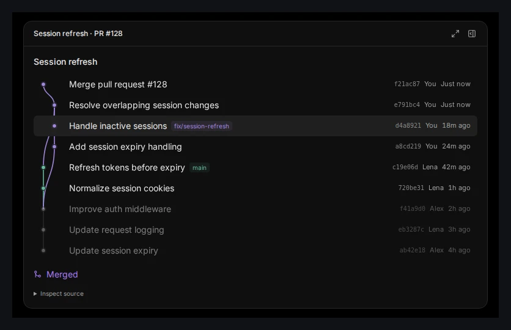
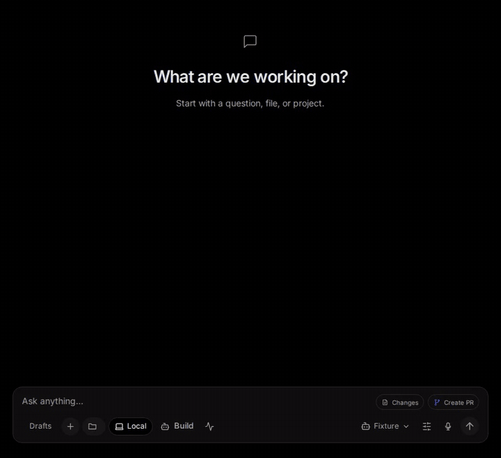
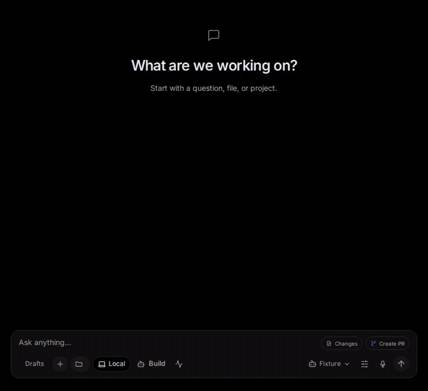

<div align="center">

<p><strong>GEN V1 · WINDOWS PREVIEW</strong></p>

# AI answers you can work with

Ask for a study plan, a trip itinerary, or a comparison. Gen V1 puts a checklist, a set of options, or an interactive plan right in the conversation so you can start using it.

**[Watch the launch video](docs/public/media/gen-v1-launch.mp4)** · **[Download the Windows preview](https://github.com/Skytuhua/Gen-V1/releases/tag/v0.6.1)** · **[Run from source](#run-from-source)**

<a href="docs/public/media/gen-v1-launch.mp4"></a>

</div>

## See Gen in action

### Turn a deadline into a study plan

Ask for a checklist that fits 30 minutes a night. Check off the first sessions without copying the plan to another app.



[Watch the study plan video](docs/public/media/launch-study-plan.mp4)

### Choose a laptop without comparing three tabs

Ask Gen to put sample laptops side by side. Sort by price, then by weight, and select the one you want to shortlist.



[Watch the laptop comparison video](docs/public/media/launch-laptop-comparison.mp4)

### Make a weekend plan, then change it

Ask for a Saturday itinerary with a backup for rain. Open the backup to see the details, then ask Gen to move it to the morning in the same thread.

[Watch the weekend itinerary video](docs/public/media/launch-weekend-trip.mp4) · [See the GIF](docs/public/media/launch-weekend-trip.gif)

<details>
<summary><strong>Developer examples</strong></summary>

- [Review a pull request from conflict to merge](docs/public/media/launch-pull-request.mp4). The fixture simulates the checks and merge; nothing is sent to GitHub.
- [Sort a release checklist](docs/public/media/launch-interactive-table.mp4) or [follow progress alongside a conversation](docs/public/media/plan-workflow.gif).

</details>

These are recordings of the actual Gen browser interface using scripted responses and sample data. They are not live model runs. [Transcripts, stills, and how to reproduce the recordings](docs/public/media/launch-demos.md).

## What makes Gen different

Gen combines **task interfaces embedded in the working thread, a local host that keeps their state, and a runtime that keeps the conversation tied to its selected account.** [See how that compares with other tools](docs/public/media/launch-demos.md#how-this-compares).

- **Useful controls, not just a visual answer.** Gen renders typed tables, timelines, and review tools with the trusted component catalog. A selection or other supported edit belongs to the task, so it isn't lost in a screenshot or pasted transcript.
- **A record of what actually happened.** The local host records accepted commands and keeps execution separate. Retried commands can return the same receipt, and interrupted work stays visible rather than being automatically repeated.
- **One agent engine, multiple provider paths.** Gen runs the pinned Hermes engine locally and routes model calls to the thread's selected account. Gen does not silently rotate accounts or fall back to API-key billing. Model requests still go to the connected provider.
- **The host owns consequential actions.** Model output can propose an action, but does not grant its own access. Resource grants, validation, and required approval remain host-controlled.

[Architecture and recovery](docs/architecture.md) · [Provider support and limits](docs/subscription-connections.md) · [Plug-in API](docs/plugin-api.md)

## Get started

### Try the Windows preview

**[Download v0.6.1 for Windows x64 →](https://github.com/Skytuhua/Gen-V1/releases/tag/v0.6.1)**

The published download is an **unsigned prerelease**. Read its notes and compare the installer with `SHA256SUMS.txt` before running it. The source tree includes newer workspace and plug-in changes than the installer. The [demo notes](docs/public/media/launch-demos.md) identify which source was recorded.

[Installation and provider sign-in](docs/public/getting-started.md) · [Release status and known limits](docs/public/release-notes.md)

### Run from source

Use **Windows x64**, **Node.js ≥ 24.10.0**, **pnpm 10.30.3** and **CPython 3.14 with pip**.

```powershell
git clone https://github.com/Skytuhua/Gen-V1.git
cd Gen-V1
pnpm install --frozen-lockfile
pnpm build:credential-lease
py -3.14 -m pip install --no-cache-dir --no-compile --target .harness-hermes-python-deps -r third-party/hermes-agent/runtime-requirements.txt
pnpm desktop:dev
```

Protected credential evidence on Windows also requires Visual Studio C++ Build Tools to build the Node-API helper. Desktop packaging builds it automatically. Credential files must belong to the current user and grant access only to that user, SYSTEM and Administrators; the helper refuses broader access.

For the browser interface, use `pnpm dev` and open `http://127.0.0.1:5173`. Open **Settings → Providers**, add an account and choose **Connect**, then refresh models and select an available model.

Use the [development setup guide](docs/public/getting-started.md#develop-from-a-fresh-checkout) to create a separate data directory before sign-in and startup. See the [full setup reference](docs/getting-started.md) for runtime and packaging details. Repository access and use remain subject to [LICENSE](LICENSE).

<details>
<summary><strong>Current preview boundaries</strong></summary>

- OpenAI has recorded live task verification. Other provider routes need their own entitlement and inference checks.
- Installed upgrade/update acceptance, the broader generation-quality pilot and physical mixed-DPI/multi-monitor acceptance remain open.
- On desktop, conversations can detach into pinned windows. Canvas panel detachment is unavailable; context and usage tools minimize within the workspace.
- The composer can browse installed skills. Binding a selected skill to a new message is unavailable.
- Gemini/Cursor native compaction, the separate OpenCode agent runtime and Meta/Muse access are unavailable.
- Generated-code interfaces use opaque workers, validated messages and a termination watchdog. This is not a hard operating-system memory quota. Approved native runtimes and project tests execute with local-user privileges.
- Existing installations retain the `GenerativeHarness` storage namespace for compatibility.

Read [release status](docs/public/release-notes.md), [security and local data](SECURITY.md), and the [historical acceptance report](docs/2026-11-01-product-completion.md) for the scope behind these statements.

</details>

## Find your way

| I want to… | Start here |
| :--- | :--- |
| Install Gen and connect an account | [Getting started](docs/public/getting-started.md) |
| Explore what the workspace can do | [Feature tour](docs/public/features.md) |
| Understand the current preview | [Release notes and limitations](docs/public/release-notes.md) |
| Understand the host and recovery model | [Architecture](docs/architecture.md) |
| Build a workspace extension | [Plug-in API](docs/plugin-api.md) |
| Report a security issue privately | [Security policy](SECURITY.md) |
| Make a useful contribution | [Contributor guide](CONTRIBUTING.md) |

## Contribute to Gen

Good contributions start with a clear problem. A reproducible bug, a better explanation, an accessibility improvement or a focused fix can all make Gen better.

**[Read the contributor guide →](CONTRIBUTING.md)**

[Report a bug](https://github.com/Skytuhua/Gen-V1/issues/new?template=bug_report.yml) · [Suggest a feature](https://github.com/Skytuhua/Gen-V1/issues/new?template=feature_request.yml) · [Improve the docs](https://github.com/Skytuhua/Gen-V1/issues/new?template=documentation.yml)

Coordinate source changes with the maintainer before starting; the current first-party license does not grant general modification or redistribution rights. The guide explains setup, focused checks and what makes a pull request easy to review.

### Contributors

<a href="https://github.com/Skytuhua"></a>

Created and maintained by [Skytuhua](https://github.com/Skytuhua). [View the contribution history →](https://github.com/Skytuhua/Gen-V1/graphs/contributors)

## License and acknowledgments

**Gen’s first-party source is proprietary and currently unlicensed for redistribution.** Source availability does not grant an open-source license. Read [LICENSE](LICENSE) before using or redistributing it.

Gen builds on the work of [Nous Research Hermes Agent](third-party/hermes-agent/README.md) and identified [T3 Code](third-party/t3code/README.md) components, with retained source provenance and MIT notices. Other retained integrations and dependencies keep their own terms; see [third-party notices](THIRD_PARTY_NOTICES.md), [package.json](package.json) and [pnpm-lock.yaml](pnpm-lock.yaml).

<div align="center">

<sub>Gen V1 is an independent project. Provider names and marks belong to their respective owners.</sub>

</div>
