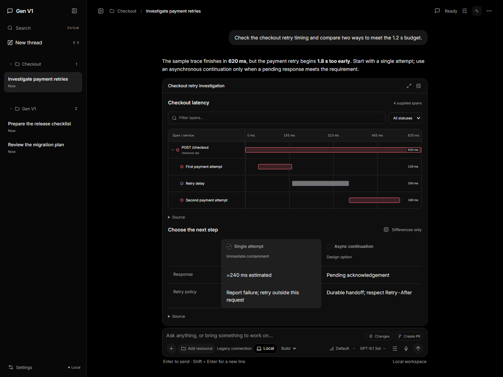
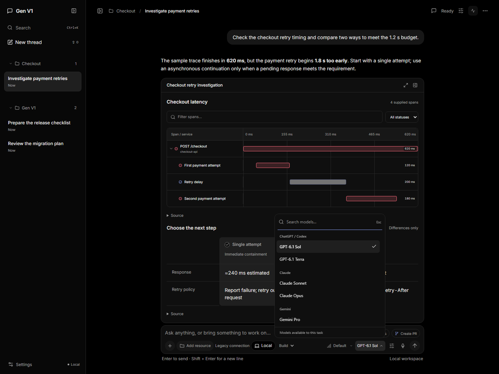
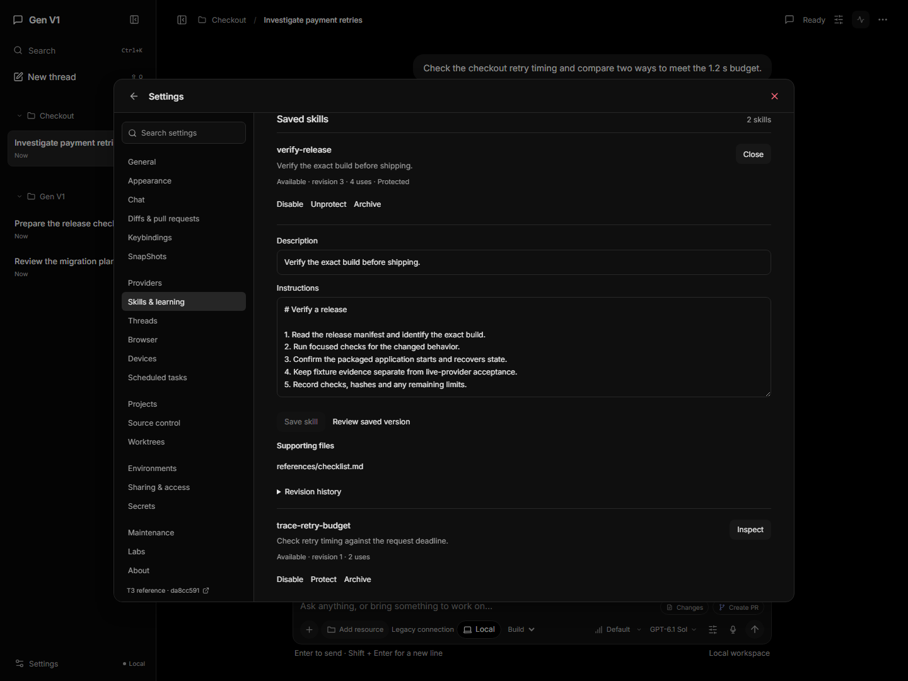
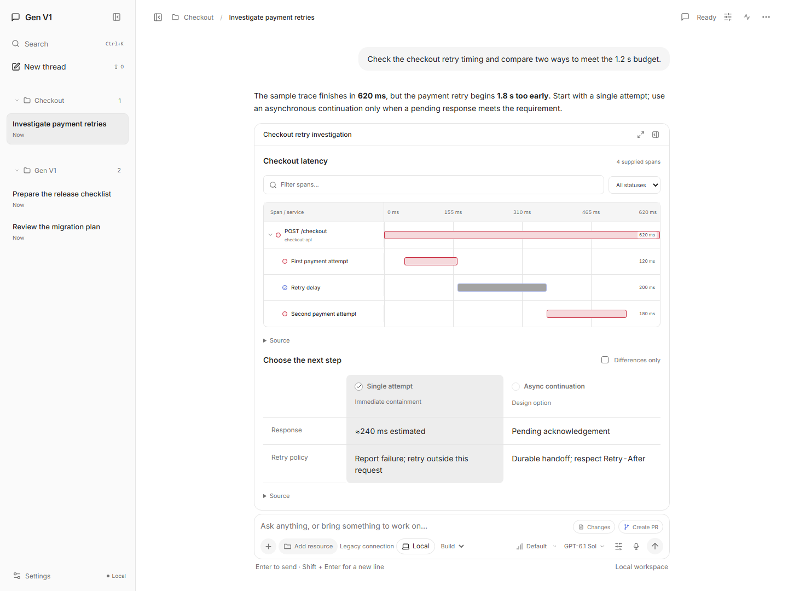

# Gen V1

A local AI workspace that turns conversations into useful, persistent working interfaces.

[](#status)
[](docs/getting-started.md)
[](LICENSE)

[Getting started](docs/getting-started.md) · [Download beta](https://github.com/Skytuhua/Gen-V1/releases/tag/v0.6.1) · [Architecture](docs/architecture.md) · [CI](https://github.com/Skytuhua/Gen-V1/actions/workflows/ci.yml) · [Contributing](CONTRIBUTING.md)



*Actual application screenshots with [curated sample data](docs/screenshots/README.md). They demonstrate the interface, not live access to every provider.*

## Work where the conversation happens

Gen V1 combines a focused chat interface, task-specific views and a native desktop shell. A task can become a trace investigation, a comparison, an editable document or a review surface, then continue from the state you saved.

| Capability | What it does |
| --- | --- |
| Working interfaces | A trusted catalog of 48 components covers documents, comparisons, diagnostics, workflows and other task views. |
| Durable work | Conversation history, artifacts, accepted actions and saved state survive restart. Draft recovery preserves newer edits. |
| Original Hermes engine | Copied, pinned Hermes source runs the primary conversation loop, skill tools, `/learn`, background reviews and curation. |
| Subscription connections | Nine connection IDs route through native SDKs, CLIs, OAuth or dedicated plan keys. Saved accounts stay separate; existing tasks retain their account. |
| Composer predictions | Optional ghost text suggests a next message. **Tab** accepts, the normal send shortcut sends, and **Escape** dismisses. Off by default. |
| Native desktop | Detachable chats, artifacts, Plan and Usage views share one owned local backend. A separate browser surface keeps remote content apart from application privileges. |

Generated apps execute in opaque workers with validated DOM messages and a termination watchdog. Local file changes and supported operations retain explicit approval and resource boundaries.

## A closer look

| Model selection | Learning and skills |
| --- | --- |
|  |  |

<details>
<summary>Light workspace</summary>



</details>

## Run from source

The verified development target is **Windows x64** with **Node.js 24.10.0 or newer**, **pnpm 10.30.3** and **CPython 3.14 with pip**.

```powershell
git clone https://github.com/Skytuhua/Gen-V1.git
cd Gen-V1
pnpm install --frozen-lockfile
py -3.14 -m pip install --no-cache-dir --no-compile --target .harness-hermes-python-deps -r third-party/hermes-agent/runtime-requirements.txt
pnpm desktop:dev
```

For the browser interface, run `pnpm dev` and open `http://127.0.0.1:5173`. The backend stays on your machine.

Use **Settings → Providers → Add account → Connect**, finish the native sign-in, then refresh models and select one. See [setup and connection instructions](docs/getting-started.md) for isolated profiles, browser-only sign-in and packaging.

## Status

Gen V1 is a beta. The preceding 0.6.0 development milestone passed **1,040 application checks**, **14 packaged native checks**, and genuine packaged OpenAI/Hermes task and restart verification. [The acceptance report](docs/2026-11-01-product-completion.md) records the exact scope and observed recovery case. The [0.6.1 prerelease](https://github.com/Skytuhua/Gen-V1/releases/tag/v0.6.1) records verification of the Gen V1 publication build separately.

- **OpenAI** has genuine signed-in task verification. The other provider integrations still need their own live account and entitlement checks.
- Installer upgrade acceptance, the broader generation-quality pilot and physical mixed-DPI/multi-monitor acceptance remain open.
- Gemini/Cursor native compaction, the separate OpenCode agent runtime and Meta/Muse access are not currently available.
- Screenshots use sample data. Automated checks and screenshots do not establish production reliability or universal provider support.

Release assets are unsigned Windows beta builds. Existing application data continues to use the `GenerativeHarness` storage namespace for compatibility.

## Develop and contribute

```powershell
pnpm typecheck
pnpm test
pnpm build
```

See [CONTRIBUTING.md](CONTRIBUTING.md) for focused tests, browser checks and the review process. Report ordinary bugs through [GitHub Issues](https://github.com/Skytuhua/Gen-V1/issues); use the [security reporting guidance](SECURITY.md) for sensitive findings.

## Architecture and attribution

The React frontend talks to a local Fastify host. SQLite owns application projections and receipts; the original Hermes engine owns source skill packages and its primary conversation state. Selected native adapters supply model text through an authenticated local bridge. Read the [architecture guide](docs/architecture.md) for execution and recovery boundaries.

Project-owned source is governed by [LICENSE](LICENSE). Third-party code retains its original terms and notices:

- [Nous Research Hermes Agent](third-party/hermes-agent/README.md): retained original source, pinned hashes and MIT notice.
- [T3 Code](third-party/t3code/README.md): adapted account/settings code with its pinned source and MIT notice.
- [Third-party notices](THIRD_PARTY_NOTICES.md): attribution and reference-asset distinctions.
- Other runtime dependencies are pinned in [package.json](package.json) and [pnpm-lock.yaml](pnpm-lock.yaml).

Gen V1 is an independent project. Provider names and marks belong to their respective owners.
