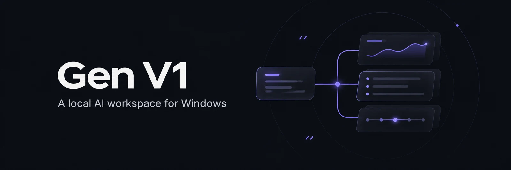
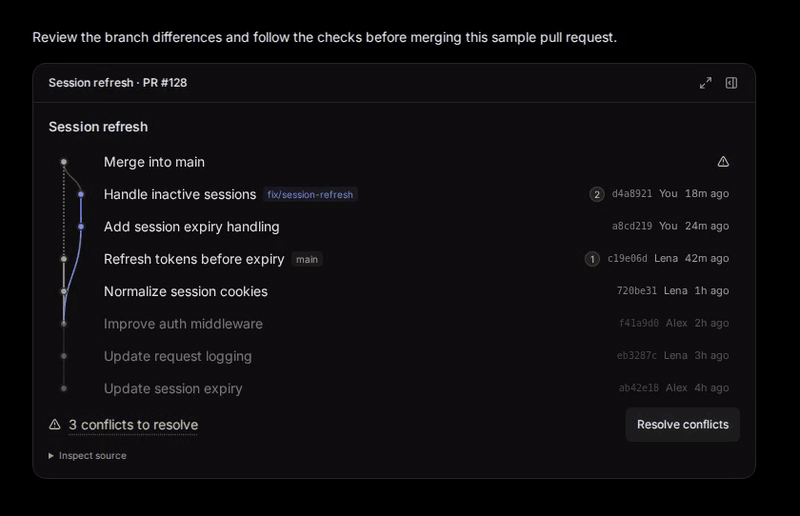
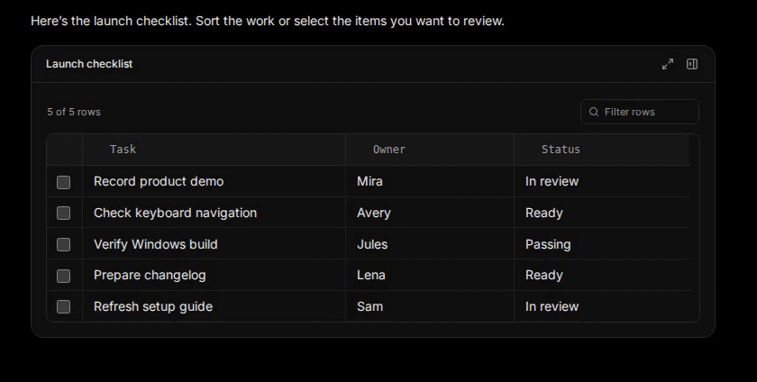

<div align="center">



# Turn a conversation into a workspace

Gen V1 gives AI work a place to live. Inspect a pull request, sort a release checklist, or review a document without losing the conversation behind it.

**[Download the Windows preview](https://github.com/Skytuhua/Gen-V1/releases/tag/v0.6.1)** · **[Watch the demos](#see-gen-in-action)** · **[Run from source](#run-from-source)**

[Getting started](docs/public/getting-started.md) · [Feature tour](docs/public/features.md) · [Changelog](CHANGELOG.md)

</div>

## See Gen in action

### Review a pull request from conflict to merge



Inspect the competing changes, resolve the conflicts, and see the checks before you choose Merge. **The merge and checks in this demo are simulated. No GitHub repository was changed.**

### Work through a release checklist



Sort and select rows in the table right inside the conversation. The checklist stays in the thread, so you can keep discussing the work as you review it.

### Keep the plan beside the conversation


Follow a structured plan as the discussion continues, or [see how a document review looks](docs/public/media/document-workspace.png).

These are recordings of the Gen browser interface with authored sample data, not live model runs. [Still images, video links, and recording notes](docs/public/media/launch-demos.md).

## What makes Gen different

- **Work in the conversation.** A trusted component catalog turns reading into doing: inspect a timeline, compare alternatives, or make decisions in a document and its accompanying discussion.
- **Return to the same work.** Gen keeps conversations, task interfaces, drafts, and recorded actions in local application storage.
- **Connect the model you want to use.** Inference goes to your supported provider. Existing tasks retain their selected account; Gen does not silently switch accounts or fall back to API-key billing.
- **Extend the workspace.** Reviewable skills and the versioned [plug-in API](docs/plugin-api.md) give you more surfaces without changing the core app.

OpenAI has recorded live task verification. Other provider routes need their own entitlement and inference checks. [See the connection reference](docs/subscription-connections.md).

## Get started

### Try the Windows preview

**[Download v0.6.1 for Windows x64 →](https://github.com/Skytuhua/Gen-V1/releases/tag/v0.6.1)**

The published download is an **unsigned prerelease**. Read its notes and compare the installer with `SHA256SUMS.txt` before running it. The source tree includes newer workspace and plug-in changes than the installer. The [demo notes](docs/public/media/launch-demos.md) identify which source was recorded.

[Installation and provider sign-in](docs/public/getting-started.md) · [Release status and known limits](docs/public/release-notes.md)

### Run from source

Use **Windows x64**, **Node.js ≥ 24.10.0**, **pnpm 10.30.3** and **CPython 3.14 with pip**.

```powershell
git clone https://github.com/Skytuhua/Gen-V1.git
cd Gen-V1
pnpm install --frozen-lockfile
pnpm build:credential-lease
py -3.14 -m pip install --no-cache-dir --no-compile --target .harness-hermes-python-deps -r third-party/hermes-agent/runtime-requirements.txt
pnpm desktop:dev
```

Protected credential evidence on Windows also requires Visual Studio C++ Build Tools to build the Node-API helper. Desktop packaging builds it automatically. Credential files must belong to the current user and grant access only to that user, SYSTEM and Administrators; the helper refuses broader access.

For the browser interface, use `pnpm dev` and open `http://127.0.0.1:5173`. Open **Settings → Providers**, add an account and choose **Connect**, then refresh models and select an available model.

Use the [development setup guide](docs/public/getting-started.md#develop-from-a-fresh-checkout) to create a separate data directory before sign-in and startup. See the [full setup reference](docs/getting-started.md) for runtime and packaging details. Repository access and use remain subject to [LICENSE](LICENSE).

## Built around your working state

The React interface and Windows Electron shell share a local Fastify host. SQLite stores application projections and operation receipts; the pinned original Hermes engine owns conversation state and source skill packages.

- **Explicit connections.** Conversations, credentials and receipts live in local application directories. Connected providers receive model requests; inference is not offline.
- **Account continuity.** Tasks retain their selected account. Gen does not automatically rotate accounts or fall back to API-key billing.
- **Host-owned permissions.** Grants, validation and approvals bound supported file and operation access. Learned text and model output do not grant permissions.
- **Reviewable extension boundaries.** Plug-in API v1 supports independent packages with declared capabilities and durable state. [Explore the API →](docs/plugin-api.md)

<details>
<summary><strong>Current preview boundaries</strong></summary>

- Installed upgrade/update acceptance, the broader generation-quality pilot and physical mixed-DPI/multi-monitor acceptance remain open.
- On desktop, conversations can detach into pinned windows. Canvas panel detachment is unavailable; context and usage tools minimize within the workspace.
- The composer can browse installed skills. Binding a selected skill to a new message is unavailable.
- Gemini/Cursor native compaction, the separate OpenCode agent runtime and Meta/Muse access are unavailable.
- Generated-code interfaces use opaque workers, validated messages and a termination watchdog. This is not a hard operating-system memory quota. Approved native runtimes and project tests execute with local-user privileges.
- Existing installations retain the `GenerativeHarness` storage namespace for compatibility.

Read [release status](docs/public/release-notes.md), [security and local data](SECURITY.md), and the [historical acceptance report](docs/2026-11-01-product-completion.md) for the scope behind these statements.

</details>

## Find your way

| I want to… | Start here |
| :--- | :--- |
| Install Gen and connect an account | [Getting started](docs/public/getting-started.md) |
| Explore what the workspace can do | [Feature tour](docs/public/features.md) |
| Understand the current preview | [Release notes and limitations](docs/public/release-notes.md) |
| Understand the host and recovery model | [Architecture](docs/architecture.md) |
| Build a workspace extension | [Plug-in API](docs/plugin-api.md) |
| Report a security issue privately | [Security policy](SECURITY.md) |
| Make a useful contribution | [Contributor guide](CONTRIBUTING.md) |

## Contribute to Gen

Good contributions start with a clear problem. A reproducible bug, a better explanation, an accessibility improvement or a focused fix can all make Gen better.

**[Read the contributor guide →](CONTRIBUTING.md)**

[Report a bug](https://github.com/Skytuhua/Gen-V1/issues/new?template=bug_report.yml) · [Suggest a feature](https://github.com/Skytuhua/Gen-V1/issues/new?template=feature_request.yml) · [Improve the docs](https://github.com/Skytuhua/Gen-V1/issues/new?template=documentation.yml)

Coordinate source changes with the maintainer before starting; the current first-party license does not grant general modification or redistribution rights. The guide explains setup, focused checks and what makes a pull request easy to review.

### Contributors

<a href="https://github.com/Skytuhua"></a>

Created and maintained by [Skytuhua](https://github.com/Skytuhua). [View the contribution history →](https://github.com/Skytuhua/Gen-V1/graphs/contributors)

## License and acknowledgments

**Gen’s first-party source is proprietary and currently unlicensed for redistribution.** Source availability does not grant an open-source license. Read [LICENSE](LICENSE) before using or redistributing it.

Gen builds on the work of [Nous Research Hermes Agent](third-party/hermes-agent/README.md) and identified [T3 Code](third-party/t3code/README.md) components, with retained source provenance and MIT notices. Other retained integrations and dependencies keep their own terms; see [third-party notices](THIRD_PARTY_NOTICES.md), [package.json](package.json) and [pnpm-lock.yaml](pnpm-lock.yaml).

<div align="center">

<sub>Gen V1 is an independent project. Provider names and marks belong to their respective owners.</sub>

</div>
