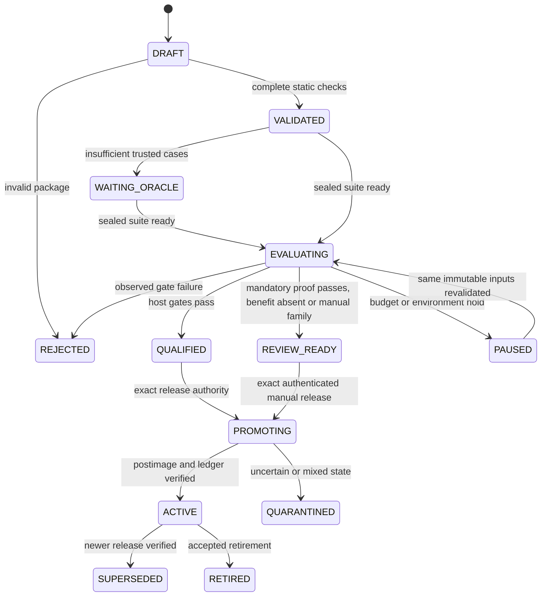
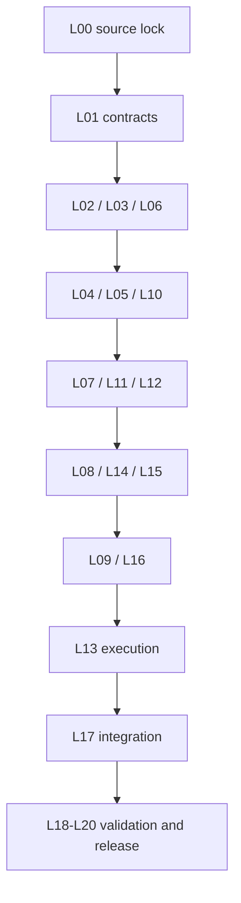

# Gen-V1 L-Series: Controlled Skill Learning and Reusable Workflows

**Implementation plan, version 1.0. Research cut: 2026-11-18.**

**Goal:** Add automatic skill drafting, tested skill updates, failure-derived regression candidates, deterministic work orders, compatibility tracking, model qualification, demonstration capture, and measured maintenance to the existing Gen-V1 harness. Models produce bounded proposals. Host code decides admission, scheduling, evaluation status, release, execution permissions, and recovery from explicit rules.

**Program identity:** `L00` through `L20`. This is a separate program from M01 through M17. Reuse completed M-series owners and extend missing integration seams. Do not renumber, reopen, or claim completion of an M task through this plan.

**Architecture:** Keep the embedded original Hermes skill package filesystem and native ledger canonical. Keep the existing Store, effect ledger, background scheduler, runtime router, verification services, promptfoo integration, and UI. Add typed coordination records and narrow adapters around those owners. Do not introduce a second active skill database, scheduler, model gateway, memory store, evaluation engine, or arbitrary workflow language.

**Technology:** Existing TypeScript, Zod, Node SQLite, original Python Hermes wrapper, React, Vitest, Playwright, and pinned promptfoo. No new production package dependency. No blanket Hermes upgrade.

**Implementation repository:** `https://github.com/skytuhua-org/Gen-V1`

**Inspected baseline:** `db3c0cf6ca675e70f396ff0011abe88be216fc0c`.

**Suggested repository destination for this plan:** `docs/implementation/learning/2026-11-18-controlled-learning-plan.md`.

**Review focus:** Native skill calls currently bypass host effect admission; source batches and native ledger writes are not one durable transaction; candidate content must never become authority; evaluator cases must remain independent of candidate authors; background budgets need pre-dispatch reservations; selected skill references need real runtime admission; pinned content must still obey current revocation; parallel implementation must not edit shared integration files concurrently.

## 0. Instructions to the implementation coordinator

Read this entire plan before assigning work. The coordinator owns sequencing, integration, and evidence. Workers implement one assigned task at a time. They may choose local variable names and private implementation details that do not change an interface or behavior. They may not choose another storage system, evaluator, runtime, policy default, model account, task scope, permission boundary, dependency, workflow primitive, or acceptance threshold.

Every requirement marked **fixed** is a decision already made by this plan. A missing backend, unavailable credential binding, changed source contract, unsupported platform, incomplete observation, or unknown external outcome is a recorded hold. It is not permission to substitute another implementation. Use the blocking report in section 15. Do not ask an implementation worker to resolve architecture by judgment.

Work against an isolated branch based on the current accepted post-M integration commit. L00 records that actual execution base and checks it against the inspected baseline. Do not reset current main to the research commit. Do not overwrite user changes. Changes since the research cut require the specific seam checks in L00, not an automatic rewrite of this plan.

This document is a specification and research audit. It does not assert that new code, live model evaluations, platform tests, or production activation have already happened. Historical M-series reports are evidence at their own revisions, not acceptance of this program.

## 1. Scope, outcomes, and release boundaries

### 1.1 Required capabilities

| Capability | Required result | Task ownership |
|---|---|---|
| Automatic skill creation and update | Evidence-triggered drafts; immutable candidate bytes; native pending entry; independent evaluation; policy-bound release; rollback | L02-L10, L17-L20 |
| Failure-to-regression capture | Failure records become deduplicated case proposals; only trusted oracles enter active suites | L04, L06, L11 |
| Typed work orders | Closed-schema work order compiles into an immutable DAG; existing host tools execute it with current permissions | L01, L12, L13 |
| Compatibility tracking | Exact skill, tool schema, runtime, environment, model, and recipe identity; invalidation on mismatch | L07, L09, L10 |
| Model qualification | A receipt certifies a particular model/profile/runtime/skill/task-family combination; new jobs use explicit approved bindings | L05, L07, L14 |
| Demonstration capture | Explicit recording of authorized action receipts produces a draft typed procedure; no raw credential or coordinate replay | L15 |
| Consolidation and retirement | Evidence-linked maintenance proposals, dependency checks, reversible retirement, bounded storage retention | L16 |

### 1.2 Release order

The task waves form one implementation DAG. Complete L00-L19, including inactive code for later capabilities, before the first production activation. The following are activation stages of that integrated implementation, not independently schedulable task subsets. L20 records a separate gate/canary decision for each stage.

**Release A:** Enable the three read-only seed families and the initial qualification path. Automatic creation and updating are eligible only for managed, project-scoped text skills. Failure proposals may be collected, but model proposals cannot become accepted oracles.

**Release B:** Enable typed workflow execution, accepted failure regressions and additional explicitly selected model qualifications after their live backend/role gates pass. Consequential actions continue to require their existing exact approvals. A skill release never grants those approvals.

**Release C:** Enable explicit demonstration recording and consolidation/retirement proposals after their capability gates pass.

All seven capabilities are required by this program. A worker cannot omit later code or describe a limited Release A activation as full L-series completion. A missing platform/backend can leave a later stage disabled without inventing an alternative architecture.

### 1.3 Explicit limits

The first release does not train model weights, publish skills to an external marketplace, automatically install software, mutate arbitrary user-maintained skills, run an unrestricted curator, create a general Python workflow executor, change model/account mid-run, or infer that a task succeeded from an assistant's final message. No background execution continues after application shutdown without the existing separately proven service capability.

Automatic release is restricted to registered read-only families and managed text packages. Executable scripts, new tools, network permissions, setup commands, provider changes, arbitrary browser mutations, and workflow authority changes are outside automatic release. Those changes remain reviewable drafts with an exact reason. This boundary is implemented in code, not solely in prompts.

## 2. Verified baseline and existing owners

### 2.1 Source locks

| Component | Immutable revision inspected | Decision |
|---|---|---|
| Gen-V1 main | `db3c0cf6ca675e70f396ff0011abe88be216fc0c` | Implementation substrate; recheck changed consumed seams in L00 |
| Embedded Hermes in Gen-V1 | `c627ec84664d43e0b18b95d9d86d8963747d56c7` | Retain original files and source-owned writers |
| Current upstream Hermes inspected | `4ae451d4126327c871fd084e60c045dec0c85911` | Reference for fixes and tests; no engine upgrade in L-series |
| Anthropic skills | `e4bb5d960d87126ff3b3a8af1a104b7db67560ba` | Copy selected skill-creator assets; adapt bounded prompts |
| Agent Skills reference | `83021e2be457a9b6679148719c1f6074f0ad975e` | Port conformance cases; retain current production parser |
| AgentMemoryRepo | `8798cb26c817d451a5ed6cba0ad8d9eca8d5ec3e` | Reference only; no reusable scheduler or learning runtime found |
| Devin CLI | `37d6de3de0a3c45f218f9cb982791e49f4c87607` | Release tooling, not published agent runtime; do not copy |
| Devin marketplace | `5e03294303858569af796325ad05e86526df4d05` | MIT validator inspected; reference only because M13 owns this boundary |

The embedded Hermes manifest is `third-party/hermes-agent/UPSTREAM_MANIFEST.json`. It identifies 742 retained upstream files. Do not change that manifest to claim a newer engine while retaining older bytes.

### 2.2 Source findings that change the design

| Observed source condition | Consequence for implementation |
|---|---|
| `preferences.ts` defaults `learningEnabled:true`, `learningApproval:false`, `learningInterval:10`, `skillCurator:true` | Existing learning is not globally off. L03/L17 must prevent two writers and define migration explicitly. |
| `Service.reviewAfter` skips the legacy learner when source Hermes is present | Keep the production source-owned path. Do not make `LearningCoordinator` another primary learning engine. |
| Worker `$library.tool` goes through `sourceTool` before ordinary `onTool` | Add real host admission/settlement around native execution. Do not rely on legacy `skill_manage` registry coverage. |
| `tests/hermes-multi-original.test.ts` can create native skills while `onTool` throws | Existing native behavior confirms the integration gap. Update this test to require native admission. |
| `HermesSourceLibrary` already captures packages, native revisions, expected descriptors, pending proposals and mutation intents | Extend this bridge. SQLite is a projection and coordination store, not the canonical skill content owner. |
| Native batch rollback restores files on ordinary failure but does not provide crash-atomic filesystem plus ledger commits | Add read fencing, durable intent, postimage verification, and explicit uncertain-state recovery. |
| Native scanners and pending-file persistence can fail open in the embedded version | Require complete scan result and pending readback before accepting a draft or mutation. |
| `skill_view` can run readiness/setup even when preprocessing is disabled | Evaluation, static reads, and managed runtime views must use capture/inspect and frozen bytes, never native setup. |
| Native curator can archive directly; dry-run relies partly on prompt behavior | Exclude managed packages at the mutation boundary. Do not invoke the native autonomous curator for managed learning. |
| M10 coordinator/scheduler exist, but production has no idle executor and REVIEW has no fork API | Add a finite MAINTENANCE consumer. Do not claim a native fork or enable blocked background command backends. |
| `resolveNewTaskProfile` and `RequestBudget` exist but are not fully wired in production | Wire these helpers for captured learning jobs. Reserve concurrent calls before dispatch. |
| `RequestBudget.admit()` checks; `reconcile()` increments later | A shared budget without reservations can oversubscribe. L05 must add reservation semantics. |
| `RuntimeStartInput.admittedSkillGuidance` is not consumed and Service rejects supplied skills | Implement the actual admission-to-runtime path in L09. A schema or picker is not runtime support. |
| Promptfoo is already pinned and host-bound, with inline JSON and assertion restrictions | Extend that host binding for durable learning jobs. Do not import Claude CLI evaluators. |
| Existing `packages/ui-catalog/workflow.ts` is a display schema | L12/L13 add a closed typed dispatcher over existing execution owners. Do not pretend there is an existing executable workflow engine. |

Native background usage after foreground settlement may be dropped because runtime observations retain the old run ID while Service requires the current run. This is a source-derived risk, not a reproduced production incident. L05 gives every auxiliary request a durable job/occurrence owner so accounting does not depend on that foreground projection.

### 2.3 Owner map

| Existing file or subsystem | Reuse contract |
|---|---|
| `packages/storage/store.ts` | Sole host database writer; `command`, `internal`, event sequence, receipts, entity records; synchronous transaction callbacks only |
| `packages/runtime-hermes/library.ts` | Canonical source RPC, snapshot/capture, expected descriptors, proposals, original revisions, source mutation coordination |
| `packages/runtime-hermes/worker.py` | Wrapper around original Hermes handlers; canonical lock and source custody; modify wrapper only |
| `packages/runtime-hermes/index.ts` | Native source transport, `$library.tool` broker, task runtimes |
| `packages/core/tool-authority.ts`, `tool-effects.ts` | Host owner/grant validation, registered schemas, effect intent, observed outcomes, recovery |
| `packages/core/background-work.ts`, `durable-wakeups.ts` | One maintenance scheduler, leases, cancellation, foreground preemption, recovery, background UI |
| `packages/runtime/request-scheduler.ts` | Per-provider/account scheduling, static new-task profile selection, budget accounting |
| `packages/runtime/model-only.ts` and runtime adapters | Fresh bounded model-only calls; extend purpose explicitly |
| `packages/integrations/index.ts`, `apps/server/integration-host.ts` | Existing promptfoo and host-native model provider; extend trusted background binding |
| `packages/core/project-verification.ts`, `verification-executor*.ts`, `verification-gate.ts` | Approved recipes, actual execution observations, environment/source digests, assessment |
| `packages/core/agent-work.ts` | Typed child work, role grants, budgets, results, cancellation; no new agent supervisor |
| `packages/skill-catalog/*`, `packages/contracts/skill-invocation.ts` | Catalog custody, immutable references, admitted untrusted guidance |
| `packages/core/project-memory.ts` | Existing knowledge and source deletion/tombstone semantics; reference, do not replace |
| `packages/core/browser-consent.ts`, `desktop-control.ts` | Current interactive authority and driver evidence; recording does not create future replay permission |
| `apps/web/src/SkillLibrary.tsx`, `BackgroundWork.tsx` | Extend existing screens with candidate and job state |
| `evals/project-memory-study.ts`, `evals/runner.ts`, `scripts/research-baseline.ts` | Fresh paired study methodology, command receipts, source locks and reports |

All referenced existing paths are relative to the repository root. New paths below are explicitly marked as new. Historical document labels do not override this source inventory.

## 3. Fixed architecture decisions

| ID | Fixed decision | Reason and implementation consequence |
|---|---|---|
| D01 | Native Hermes packages and native ledger remain canonical | Host records point to exact native identities; never treat a projected numeric revision as a native revision ID. |
| D02 | Managed learning is project-scoped | No cross-project automatic reuse, source search, candidate promotion, or evidence disclosure. |
| D03 | Models emit proposals only | Authors have no tools/files; critics have bounded evidence; neither can write packages, cases, policy, approvals, or release records. |
| D04 | One native writer through an admitted wrapper | Generic source handlers, curator, package editor, rollback and pending acceptance must all honor managed-name fencing. |
| D05 | Immutable replay payload and native-rendered package | Normalize replay text once, materialize with the original writer on the target platform, then seal raw output bytes. No fuzzy replacement or reconstruction of replay text from CRLF output. |
| D06 | Automatic creation/update uses a standing narrow policy | A user configures one project/family policy through the existing authenticated command path. Routine eligible releases do not require repeated approval. |
| D07 | Policy grants only managed library mutation | No external operation, tool access, account choice, setup, or project write permission comes from a skill or a release receipt. |
| D08 | Separate proposal and native execution paths | Author/critic use the existing ephemeral Pi model-only path. Qualification executes the real Hermes runtime through the frozen package adapter. Unsupported bindings return a hold; no provider fallback. |
| D09 | Existing M10 MAINTENANCE orchestration | No new timers, service supervisor, cron engine or native conversation fork. |
| D10 | Existing promptfoo plus M06 for action evidence | Promptfoo evaluates text outcomes; real workflow actions require observed M06/host receipts. |
| D11 | Three case partitions with separate custody | Development may produce one bounded revision; validation checks the single selected immutable candidate; final holdout is consumed once and never used to tune that lineage. |
| D12 | Host computes all gates and aggregates | LLM preference is advisory; unknown observations remain unknown; every logical cell has one selected terminal attempt and all attempts remain in reliability/cost accounting. |
| D13 | Immutable run pins with live revocation | Content stays pinned for a run, but current policy/source access/disabled flags are checked again before use and effect dispatch. |
| D14 | Closed workflow schema | No arbitrary shell/Python/JavaScript expressions in workflow JSON. Host binds approved recipe and tool IDs. |
| D15 | No speculative infrastructure | No vector database, graph database, new message broker, model training service or additional parser. |
| D16 | Learning may yield `NO_CHANGE` | No quota of improvements and no instruction to manufacture a skill after every task. |
| D17 | No automatic deletion or consolidation release | Maintenance proposes, measures and can retire through explicit policy; destructive deletion is not part of L-series. |
| D18 | Unknown mutation outcomes are quarantined | Do not retry an uncertain native batch or roll back an external action automatically. |
| D19 | Initial auto-release families are read-only | Executable and effectful workflows can be drafted and verified but require existing operation grants at execution. |
| D20 | Existing user preferences are preserved as stored history | Controlled projects override legacy automatic review/writes at runtime; disabling the new feature cannot revive a bypass for managed names. |

### 3.1 Managed identity and package shape

Use native name `gvl-<projectKey>-<familyKey>`, where `projectKey` is the first 12 lowercase hex characters of SHA-256 over the host profile ID, project ID and canonical physical project identity encoded through existing `digest`. `familyKey` is a registered lowercase ASCII kebab-case identifier of 1-40 characters. The total is at most 57 characters. Detect collisions against the full identity; a collision is `LEARNING_ID_COLLISION`, never an alternate generated name.

Store managed skills in the existing canonical Hermes skill root using the original writer. Do not make a new runtime skill root. A project registry maps the full identity to the native name. Existing unrelated names are never adopted merely because their description looks relevant. Importing an existing skill is an explicit `learning.skill.adopt` command that captures its full preimage and creates a managed copy under the deterministic name. The original remains outside automatic learning. Protected or bundled source content cannot be silently relabeled as managed.

Automatic packages contain exactly one `SKILL.md` and at most eight files under `references/` or `assets/`, with extensions `.md`, `.txt`, or `.json`. UTF-8 only. No symlinks, hard-link aliases, executable mode bits, path traversal, absolute paths, NUL bytes, ambiguous case variants, device names, runtime interpolation, setup hooks, dependencies, or scripts. Every referenced local file must exist inside the captured package. `SKILL.md` is at most 24 KiB; each support file at most 8 KiB; total raw content at most 64 KiB. All limits use bytes, not JavaScript character count. The proposal envelope is at most 192 KiB to allow JSON escaping; the raw package still obeys 64 KiB.

Use the original frontmatter parser, then enforce the managed profile. Name must equal the registered directory name; managed descriptions are 1-60 characters after trimming because the embedded writer enforces a 60-character prompt budget for new/changed descriptions. The broader standard permits 1024 characters. Compatibility, when present, is at most 500 characters; metadata is a string map. Managed generated names use ASCII even though the broader standard admits Unicode names. Port and document the broader conformance tests without restricting unrelated user skills accidentally. `allowed-tools` is a claim, never permission. Automatic packages cannot add it; adopted packages with it are draft-only until the operator removes it or explicitly reviews them.

The host injects provenance metadata before sealing, hashing, scanning and evaluating the candidate. Release applies those exact sealed bytes without later metadata changes. A model cannot set `managed`, project ownership, trust, approval, source ID, native ledger revision, qualification ID, or policy fields in frontmatter. Reject such keys rather than silently accepting model authority claims. Release IDs and final native revision IDs belong in host/native receipts, not post-evaluation edits to SKILL.md.

The automatic-package frontmatter allowlist is exactly `name`, `description`, `license`, `compatibility`, and `metadata`. Model-authored metadata permits only `summary` and `tags`, each a string of at most 200 characters; the host adds `genv1_project`, `genv1_family`, `genv1_lineage`, `genv1_source_digest` and `genv1_managed_version` before sealing. Reject all other keys, including dependencies, environment/credential requests, setup, aliases and allowed-tools. Reject `${HERMES_SKILL_DIR}`, `${HERMES_SESSION_ID}`, and inline exclamation-mark/backtick shell expansion syntax anywhere in automatic content. These are profile restrictions, not claims that arbitrary prose has no malicious instructions.

### 3.2 Policy and defaults

Add host flags `learning.controlledV1`, `learning.workflowV1`, `learning.demonstrationV1`. Register them in the existing host flag registry. Default all three false. They are host configuration, not writable model tools or Store preference patches. Controlled learning requires existing protected effect and authority flags; workflow execution also requires its consumed M03/M06/M09 gates. Missing prerequisites produce a hold with the exact flag/gate name.

Each project has a versioned authenticated `LearningPolicyV1`. Mode is `OFF`, `DRAFT_ONLY`, or `AUTO_QUALIFIED`. Initial persisted mode is `DRAFT_ONLY` when the user first enables the project, otherwise `OFF`. Automatic release requires an explicit mode change through the existing authenticated host command path. This is configuration of the product's standing policy, not permission required to implement this plan.

| Mode | Draft/evaluate | Authenticated manual release | Automatic release |
|---|---|---|---|
| OFF | No new work; cancel queued work and reconcile dispatched effects | Denied; exact recovery/rollback commands remain separately scoped | Denied |
| DRAFT_ONLY | Allowed for enabled families within limits | Allowed only with complete mandatory proof and exact command commitment | Denied |
| AUTO_QUALIFIED | Allowed | Same mandatory proof | Only qualified READ_ONLY_TEXT families after the canary stage is AUTO_ENABLED |

The initial canary stage DRAFT_REVIEW overrides automatic release even when policy mode is AUTO_QUALIFIED. It does not prohibit an authenticated manual release. Policy enrollment writes the existing per-project/profile `backgroundIdleOptIn` in the same command transaction; do not leave M10 admission waiting for a nonexistent second opt-in command. Turning policy OFF prevents new learning occurrences without deleting a separately owned background opt-in used by another feature.

The fixed policy exposes only these editable selections: enabled registered family IDs, exact existing model profile bindings, mode, and lower budget limits. The UI cannot raise the hard limits below. The initial author, critic and evaluator profiles copy the same currently selected, available, supported account/model/thinking configuration at policy creation. Display and store that exact binding. Do not pick a cheaper model by name or choose a provider for the user. L14 permits an additional explicitly selected profile after qualification, only for new jobs.

| Limit | Fixed maximum/default |
|---|---|
| Active learning jobs | One per project; two globally, still subject to existing provider/account limits |
| Trigger debounce | 60 seconds after accepted settlement; use existing wakeup scheduler |
| Repeated-success trigger | Three distinct accepted task runs of one family within seven days, each with its family success oracle |
| Failure trigger | One observed terminal assertion/tool failure creates a case proposal; three matching failures within seven days may request a skill revision |
| Author attempts | At most two candidate revisions per trigger lineage; one model call per revision; no invalid-JSON repair call |
| Critic calls | At most one advisory analysis call per revision; optional comparison is off by default |
| Active candidate | One unfinished candidate per project/family; only unsealed signals coalesce; terminal dispositions free the slot |
| Candidate TTL | Seven days; expiry cancels queued evaluation and cannot release |
| Policy-bound release authority TTL | Five minutes; one exact mutation; no reuse after dispatch |
| Evaluation deadline | 30 minutes per occurrence; checkpoint between cells; never extend silently |
| Project budget per rolling 24 hours | 512 dispatched model calls, 2,000,000 reserved input tokens, 256,000 reserved output tokens |
| Per model call | 90-second deadline; input <=96 KiB; output <=192 KiB; max output tokens 8192 |
| Concurrency within evaluation | At most two model requests using existing scheduler; foreground admission preempts at a safe boundary |
| Retained open candidates | At most 20 per project, including paused drafts; excess triggers become coalesced summaries, not more jobs |
| Maintenance cadence | Once per seven wall-clock days while the host is active; missed intervals coalesce to one due occurrence |
| Native text trial | At most four actual model requests/native iterations; 180-second whole-trial deadline; no consequential tools |
| Demonstration session | Ten minutes, 100 events, 256 KiB total sanitized event data |
| Work order | 32 total nodes; AGENT_READ count <=24 and <=remaining M09 parent capacity; eight dependencies per node; two concurrent nodes; one explicit host repair edge per template, traversed once |

Token budgets are admission bounds, not a claim of measured spend. Reserve a conservative tokenizer upper bound using the exact wire prompt if an approved tokenizer is unavailable; use UTF-8 byte count as an explicitly labeled upper bound, never as reported tokens. Reserve 8192 output tokens unless the node has a smaller fixed cap. A request with unreported usage retains its reservation until the rolling budget expires. If any model adapter cannot enforce its output limit or confirmed cancellation/teardown, it is ineligible for background work.

No currency budget is fabricated. Store provider-reported cost or null. Quality promotion may use bounded reservations when token usage is unreported; a token/cost efficiency claim requires complete comparable measurements. Report reserved bounds and measured usage in separate fields.

## 4. Reuse manifest and licensing instructions

### 4.1 Files to keep using in embedded Hermes

Keep original files under `third-party/hermes-agent/upstream/` byte-identical. Reuse `tools/skill_manager_tool.py`, `tools/skill_manager_guards.py`, `tools/skill_manager_batch.py`, `tools/skills_tool.py`, `tools/skill_linter.py`, `tools/skills_guard.py`, `tools/skill_ledger.py`, `tools/skill_usage.py`, and `tools/write_approval.py` through the current worker wrapper. Reuse `agent/background_review.py`, `agent/curator.py`, and `agent/curator_backup.py` as references and for unaffected legacy behavior, not as the managed release policy.

Before finalizing these exact retained paths, L00 compares the embedded manifest. A missing path is a source-drift hold, not permission to download the latest equivalent. The current upstream `skill_manager_scan.py` is reference-only because its dependencies differ from the retained engine. Implement the mandatory scanner invocation in the Gen-V1 wrapper and preserve upstream provenance.

### 4.2 Pristine assets to vendor

L00 creates `third-party/skill-learning/UPSTREAM_MANIFEST.json`, `NOTICE.md`, and two pristine source subdirectories before L06 starts. L05 reads those merged assets and owns adaptations only. These are research/prompt/test assets, not a second runtime. Do not vendor an entire repository.

| Source at the locked commit | Destination below `third-party/skill-learning/` | SHA-256 |
|---|---|---|
| Anthropic `skills/skill-creator/LICENSE.txt` | `anthropic-skill-creator/LICENSE.txt` | `bc6b3af2f331cbc7fb0da1344efb2cbe5877a31498b4d70dbc7000f3405a1362` |
| Anthropic `skills/skill-creator/agents/grader.md` | `anthropic-skill-creator/agents/grader.md` | `57134da0c1a4eea33fbd74a1c9c44aa814f07d6bc64de303edb586f941e5d21a` |
| Anthropic `skills/skill-creator/agents/comparator.md` | `anthropic-skill-creator/agents/comparator.md` | `fe1fc9787c495d864c5d6eada47396478572325fde1b33a96d78bf4b849b7a3e` |
| Anthropic `skills/skill-creator/agents/analyzer.md` | `anthropic-skill-creator/agents/analyzer.md` | `bf68f4cac5a56c673a928c2e6d619586c5b93ea364026ab37547772cb45a663a` |
| Anthropic `skills/skill-creator/references/schemas.md` | `anthropic-skill-creator/references/schemas.md` | `8e8876180a8989b406a4d3edddf875b04cdfd5805cc8616686d552b11ce4455f` |
| Agent Skills `skills-ref/LICENSE` | `agentskills-ref/LICENSE` | `58d1e17ffe5109a7ae296caafcadfdbe6a7d176f0bc4ab01e12a689b0499d8bd` |
| Agent Skills `skills-ref/tests/test_parser.py` | `agentskills-ref/tests/test_parser.py` | `362cc3be360e9a7b1bbe61d78cbd1ec2433971a6448eb7808c21f78f132285c2` |
| Agent Skills `skills-ref/tests/test_validator.py` | `agentskills-ref/tests/test_validator.py` | `daafa296fffd05be21dbd451d93d81ea4155ab6386934a5a522c3483aee6a7e4` |
| Agent Skills `skills-ref/tests/test_prompt.py` | `agentskills-ref/tests/test_prompt.py` | `f324cf101f21f5924618a14c48e4f79c6f93bc34895d159ceb171bee7197a419` |

These selected subtrees have Apache-2.0 licenses. Preserve their license files and applicable attribution. Record source URL, full commit, source path, Git blob ID, SHA-256, bytes, destination, license path/digest, disposition, and modification status for every item. Originals are immutable. Adaptations live under `packages/core/skill-learning-prompts/` or normal tests, with an upstream attribution header and modification note. Agent Skills documentation has a separate CC-BY-4.0 license; do not copy its prose into shipped assets as if it were Apache code.

### 4.3 Fixed adaptations and rejected imports

Adapt Anthropic grader to evidence-linked advisory findings; comparator to `A`, `B`, `TIE`, `NEITHER`, or `INDETERMINATE`; analyzer to development-only suggestions. Required correctness and policy gates precede any preference score. Host measures usage. Models cannot copy executor-written metrics as authoritative.

Port the 15 parser, 21 validator, and four prompt cases from the Agent Skills snapshot into existing tests, preserving each upstream test name in a conformance mapping. Where Hermes intentionally differs, record `SUPPORTED`, `MANAGED_PROFILE_RESTRICTION`, or `UNSUPPORTED` with an assertion. Do not suppress a failing conformance case or claim full standard compliance from the managed subset.

Do not import Anthropic `run_eval.py`, `run_loop.py`, `improve_description.py`, `utils.py`, `quick_validate.py`, `package_skill.py`, `aggregate_benchmark.py`, or its standalone review server. The source assumes Claude CLI behavior, includes weaker/different validation, can treat missing accounting as zero, and uses a repeatedly evaluated test split for selection. Reuse concepts through existing Gen-V1 owners. `references/schemas.md` is illustrative Markdown, not executable JSON Schema.

Devin's documented skills and dynamic workflows inform product behavior. The inspected CLI repository explicitly publishes release automation rather than agent source. The marketplace is separately MIT-licensed, but its plugin validator duplicates M13 and is not needed here. AgentMemoryRepo provides a documented memory format and one skill, not a published dreaming/scheduler/evaluator implementation. Do not describe these projects as code sources for functionality they do not publish.

## 5. Components and file ownership

The following paths are **new** unless explicitly described as existing. Keep each responsibility in its assigned file. New files are consumers of existing owners, not replacements.

| New file | Responsibility | Owning task |
|---|---|---|
| `packages/contracts/skill-learning.ts` | Strict learning policy, evidence, candidate, job, evaluation and release schemas | L01 |
| `packages/contracts/skill-workflow.ts` | Work order, node, binding, compiled plan and execution schemas | L01 |
| `packages/core/skill-learning.ts` | Facade and finite dispatch into component services | L17 |
| `packages/core/skill-learning-store.ts` | Immutable coordination records and transition helpers over Store | L02 |
| `packages/core/skill-learning-evidence.ts` | Source cuts, sanitized views, lineage and invalidation | L02 |
| `packages/runtime-hermes/learning-source.ts` | Host native bridge, captured candidate source and exact release operations | L03 |
| `packages/core/skill-learning-scheduler.ts` | Typed M10 maintenance consumer and trigger dedupe | L04 |
| `packages/core/skill-learning-model.ts` | Bounded role calls and durable request observations | L05 |
| `packages/core/skill-learning-prompts/author.md` | Fixed candidate-only author instructions | L05 |
| `packages/core/skill-learning-prompts/grader.md` | Adapted advisory evidence review | L05 |
| `packages/core/skill-learning-prompts/comparator.md` | Adapted anonymous advisory comparison | L05 |
| `packages/core/skill-learning-prompts/analyzer.md` | Adapted development-only improvement analysis | L05 |
| `packages/core/skill-learning-cases.ts` | Case proposals, trusted oracles, partition custody and consumption | L06 |
| `packages/core/skill-learning-evaluation.ts` | Paired evaluation adapter and host gate calculation | L07 |
| `packages/core/skill-learning-promotion.ts` | Policy-bound release, reconciliation and rollback | L08 |
| `packages/core/skill-learning-invocation.ts` | Managed skill admission and immutable run pins | L09 |
| `packages/core/skill-learning-compatibility.ts` | Fingerprints, capability mismatches and qualification invalidation | L10 |
| `packages/core/skill-learning-failures.ts` | Failure fingerprinting and regression case proposals | L11 |
| `packages/core/skill-workflow-compiler.ts` | Pure deterministic compiler and validation | L12 |
| `packages/core/skill-workflow-executor.ts` | Closed host dispatcher using M09/M06/tool effects | L13 |
| `packages/core/skill-learning-qualification.ts` | Exact model/profile qualification and selection receipts | L14 |
| `packages/core/skill-learning-demonstrations.ts` | Explicit sanitized receipt recording and draft conversion | L15 |
| `packages/core/skill-learning-maintenance.ts` | Consolidation proposals, retirement and retention | L16 |
| `apps/server/skill-learning-routes.ts` | Owner-bound read projections only | L17 |
| `apps/web/src/SkillLearningReview.tsx`, `skill-learning.css`, `skill-learning-api.ts` | Existing Skills UI child views and typed reads/commands | L17 |
| `evals/skill-learning-study.ts`, `evals/fixtures/skill-learning-v1.json` | Frozen study and evidence collection | L18 |
| `scripts/verify-learning-plan.ts` | Contract/source-lock/coverage checks for this program | L00, extended only by coordinator |

Shared existing integration files are coordinator-owned: `packages/core/service.ts`, `packages/contracts/index.ts`, `packages/core/capability-flags.ts`, `packages/core/host-flags.ts`, `apps/server/hermes-service.ts`, `apps/server/integration-host.ts`, `packages/integrations/index.ts`, `packages/core/background-work.ts`, runtime purpose plumbing, `apps/web/src/SkillLibrary.tsx`, browser suite registry, package scripts and top-level build configuration. The native bridge worker is the sole editor of `worker.py`, `library.ts`, and `runtime-hermes/index.ts` during its assigned wave. Later edits to those files are applied by the coordinator after that wave merges.

The coordinator also owns integration edits to `packages/core/tool-effects.ts`, `host-effect-authenticator.ts`, `agent-work.ts`, `packages/runtime-hermes/broker.ts`, `packages/runtime/request-scheduler.ts`, and `packages/capabilities/*`. Native transport owns the frozen snapshot adapter in L03; L05/L07/L09 submit later accounting, evaluation and admission wiring as serial integration patches. No parallel worker edits these common owners directly.

Each task below lists its exact test file. Test fixtures belong beside that test or in `tests/fixtures/skill-learning/`. Do not make workers concurrently append to one shared fixture or schema barrel.

## 6. Contracts, persistence, and authority

### 6.1 Common schema rules

Use Zod `strictObject`, discriminated unions and explicit maxima. Reject unknown keys. Export inferred types and JSON Schema through the existing contracts conventions. Do not use an unbounded `Record<string, unknown>` as a persisted learning payload. Common ID strings are 1-200 characters; SHA-256 is exactly 64 lowercase hex characters; native revision IDs are opaque bounded strings, never cast to numbers; timestamps are ISO UTC strings generated by the host. Enums in this plan are closed.

Use existing `digest` for canonical structured commitments and raw SHA-256 for file bytes. File manifests sort paths by code-point order, include raw byte length, raw SHA-256 and executable/type status, and hash the complete sorted manifest. Preserve CRLF/BOM differences in raw bytes. Normalized display text cannot replace a byte commitment.

Define these shared records first:

```ts
type LearningMode = 'OFF' | 'DRAFT_ONLY' | 'AUTO_QUALIFIED';
type LearningRole = 'author' | 'critic' | 'evaluator';
type SourceKind = 'accepted-input' | 'message' | 'tool-effect'
  | 'verification' | 'skill-version' | 'project-memory' | 'demo-event';
type SourceRefV1 = {
  kind: SourceKind;
  id: string;
  revision: string;
  digest: string;
};
type LearningScopeV1 = {
  profileId: string;
  projectId: string;
  physicalProjectDigest: string;
  workspaceId: string | null;
  accountId: string | null;
};
type NativeExpectedV1 = {
  documentHash: string | null;
  fileHashes: Record<string, string>; // bounded to 9 managed package files
  enabled: boolean;
  protected: boolean;
  state: string; // validate against the retained native states in L00
  tip: string | null;
};
type LearningHoldV1 = {
  code: LearningErrorCode;
  component: string;
  missingRefs: string[]; // max 16
  evidenceRefs: string[]; // max 16
  message: string; // max 1000, sanitized
};
```

The bounded native `state` is an adapter contract, not an invitation to invent an enum. L00 copies the exact retained native states into the source-lock adapter fixture; L01 derives validation from that fixed fixture. New unexpected states are holds.

Project-scoped records match `profileId`, `projectId`, `physicalProjectDigest` and account binding. Their `workspaceId` records source provenance and is not a grant transferable to another workspace. A new invocation in the same physical project may use another workspace only after current host workspace/resource admission and compatibility capture. Run pins bind that invocation's actual workspace. A different project, profile or account cannot reuse the record automatically.

### 6.2 Required records

Every record below includes `version:1`, immutable ID, scope, creation time and creator kind `host` or `authenticated-user`. Model output has a separate untrusted schema. Mutable lifecycle records additionally have integer `revision`, `updatedAt`, and append-only transition references. Mutations use expected revision CAS.

| Record | Required fields beyond common fields |
|---|---|
| `LearningPolicyV1` | mode; enabledFamilyIds <=16; three exact `ModelExecutionProfileV1` bindings; limits not above section 3; authorityRevision; host authentication tag; source-retention policy; controlledProjectLatch |
| `LearningFamilyV1` | familyId; displayName <=80; fixed input/output schema digests; eligibility predicate ID; deterministic oracle ID/version; registered recipe IDs <=8; workflow template ID or null; autoReleaseClass `READ_ONLY_TEXT` or `MANUAL_ONLY`; package name mapping |
| `LearningEvidenceCutV1` | sourceThreadId/runId/epoch; accepted input IDs <=16; start/end Store sequence; source refs <=128; effect IDs <=64; check IDs <=32; prior skill pins <=8; sanitized payload <=64 KiB; sanitizer version; source digest; completeness flags; observed limitations <=16 |
| `LearningSignalV1` | trigger `REPEATED_SUCCESS`, `REPEATED_FAILURE`, `EXPLICIT_CAPTURE`, `DEMONSTRATION`, `COMPATIBILITY_CHANGE`, or `MAINTENANCE`; familyId; sourceCutIds <=16; dedupeKey; first/last observed times; occurrence count; scheduling state |
| `LearningCandidateV1` | familyId; lineageId; attempt 1 or 2; nativeName; nativePendingId nullable until durable staging; original base expected descriptor or null; base package digest or null; immutable desired package manifest/digest; payload witness ID; sourceCutIds <=16; policyDigest; authorProfileDigest; compatibilityDigest; candidate state; hold or null; expiresAt |
| `LearningCandidatePayloadV1` | candidateId; ordered normalized-LF native replay inputs; exact native-rendered UTF-8 raw output text preserving BOM/newlines, raw manifest and target platform; replay payload digest; native pending payload digest including host marker; no arbitrary execution/provider fields |
| `LearningCaseProposalV1` | proposalId; familyId; input artifact refs <=8; sourceCutId; failure/demo fingerprint; observed error category; proposed expectations <=16, explicitly untrusted; state |
| `LearningCaseV1` | stable caseId; groupId; familyId; partition; mandatoryRegression boolean; sanitized input refs; trusted oracleId/version/digest; trusted expected value/artifact refs; environment fixture digest; reproduction receipt or null; acceptedBy; acceptedCommandId; supersedes or null |
| `LearningSuiteV1` | suiteId/version; familyId; ordered case IDs; partition commitments; oracle registry digest; protected holdout allocation ID; seed; suiteDigest; owner; state |
| `LearningEvaluationV1` | immutable target CANDIDATE/candidateId or RELEASE/releaseId; lineageId; tested/base package digests and explicit baseline kind NONE/INCUMBENT; suiteDigest; policyDigest; execution profile/fingerprint; planned cell IDs; cell receipts; all-attempt counts; aggregate; host gate results; holdout consumption; budget observations; status |
| `LearningReleaseV1` | candidateId; nativeName; prior and observed post descriptors; original source revision IDs; evaluationId/digest; policyDigest; compatibilityDigest; effectInvocationId; native correlation IDs; idempotency key; state; reconciliation evidence; previous release ID or null |
| `LearningRunPinV1` | current host run owner; inputId; catalog reference; releaseId; native source revision; exact package digest; selected entry/support handles; policy/authority generation; qualificationId; expires with run |
| `LearningQualificationV1` | exact family, skill package, runtime, provider, account binding, model, thinking, tool schema, environment and recipe identities; suite/evaluation IDs; decision; expiry; invalidation reason |
| `LearningJobV1` | existing BackgroundWork ID and occurrence key; stage; scope; source cut/candidate/suite IDs; captured policy/profile revisions; lease generation; budget reservation IDs; checkpoint; status/hold |
| `LearningRequestReservationV1` | requestId; job/occurrence/role; exact binding; reserved input/output upper bounds; dispatched flag; observed usage or null; observation source; cleanup state; reservation timestamps |
| `LearningDemonstrationV1` | recording owner; consent generation; allowed surface/target IDs; start/end; sanitized ordered receipt refs; limit counters; capture state; source event digest |
| `LearningMaintenanceV1` | managed identities; observation window; eligible verified outcomes; dependency refs; proposed consolidation/retirement; measured comparison; disposition |
| `LearningWorkflowRunV1` | compiled work-order digest; current owner; exact inputs/pins/compatibility; ordered node IDs; overall state; cancellation generation; effect/child/verification refs; budget and cleanup state |
| `LearningWorkflowNodeV1` | workflowRunId; nodeId; committed input/output digests; state `PENDING`, `READY`, `DISPATCHED`, `SUCCEEDED`, `FAILED`, `BLOCKED`, `CANCELLED`, or `UNKNOWN`; attempt count; effect/work/check refs; observed result and teardown status |
| `LearningCanaryV1` | project/policy scope; stage `DRAFT_REVIEW`, `AUTO_ENABLED`, or `PAUSED`; three distinct reviewed seed-family decision IDs; authenticated review/advance command IDs; revision; invalidation reason |
| `LearningReleaseMonitorV1` | releaseId; first 20 verified invocation IDs and observed required assertion outcomes; all excluded cancelled/provider-error IDs; policy/custody violation refs; disable/rollback decision receipt |
| `LearningLineageV1` | familyId; kind CANDIDATE_AUTHORING or RELEASE_REQUALIFICATION; releaseId nullable only for authoring; frozen sourceCutIds/sourceDigest; author attempt IDs <=2; selected candidate ID or null; current finite stage; validation/holdout evaluation IDs; final disposition; immutable selection receipt |
| `LearningHoldoutAllocationV1` | evaluationId; suiteId/digest; lineageId; exact evaluation target; profile/fingerprint; ordered fresh group IDs; state; first dispatch time; cell/attempt IDs; consumed reason |
| `LearningFamilyInvocationV1` | familyId/contract digest; authenticated command ID; accepted input ID and strict typed input digest; current owner; selected release ID or explicit NONE; final observed output ref/digest; deterministic oracle receipt; execution profile digest |
| `LearningWorkflowTemplateV1` | familyId; canonical strict template bytes/digest; registry digest; source candidate or supplied template ref; authenticated admission command; exact required role/tool/recipe/skill identities; status |

Use these exact Store entity kinds: `learningPolicy`, `learningFamily`, `learningEvidenceCut`, `learningSignal`, `learningCandidate`, `learningCandidatePayload`, `learningCaseProposal`, `learningCase`, `learningSuite`, `learningEvaluation`, `learningRelease`, `learningRunPin`, `learningQualification`, `learningJob`, `learningRequestReservation`, `learningDemonstration`, `learningMaintenance`, `learningWorkflowRun`, `learningWorkflowNode`, `learningCanary`, `learningReleaseMonitor`, `learningLineage`, `learningHoldoutAllocation`, `learningFamilyInvocation`, `learningWorkflowTemplate`. Freeze all of them in L01. Do not put complete source transcripts, credentials, environment values, or holdout expected outputs in general event summaries.

Immutable record helpers must reject an existing ID with different bytes. `Store.put` is an upsert and does not enforce immutability by itself. Mutable state transitions write their new revision and audit event in one Store transaction. Do not await inside a Store callback. Network/model/filesystem work occurs between durable intent and durable settlement transactions.

Native pending payload is the source-owned proposal artifact. The immutable candidate payload in Store is a bounded custody witness used for evaluation and exact comparison, not a second active skill library. On release, verify both witness and current native pending payload against the same digest. No refresh may silently update a candidate's original base or desired bytes.

### 6.2a Closed lifecycle and observation contracts

Freeze these unions in L01. A worker cannot add a status to make an error look successful. Domain-specific outcomes and existing M02/M10 enums remain distinct and are mapped explicitly.

| Field | Exact values |
|---|---|
| Signal scheduling | COLLECTING, SEALED, QUEUED, CONSUMED, DISCARDED |
| Lineage stage | AUTHOR, STATIC, DEVELOPMENT, SELECTED, VALIDATION, HOLDOUT, DECIDED, PAUSED, CLOSED |
| Candidate state | DRAFT, VALIDATED, WAITING_ORACLE, EVALUATING, QUALIFIED, REVIEW_READY, PAUSED, PROMOTING, ACTIVE, QUARANTINED, SUPERSEDED, RETIRED, REJECTED, CANCELLED, EXPIRED, DISCARDED |
| Lineage final disposition | NO_CHANGE, INVALID_PROPOSAL, DEVELOPMENT_FAILED, VALIDATION_FAILED, HOLDOUT_FAILED, QUALIFIED, REVIEW_READY, DISCARDED, CANCELLED, EXPIRED; null before decision |
| Case proposal state | PROPOSED, AWAITING_ORACLE, AWAITING_REPRODUCTION, ACCEPTED, REJECTED, SUPERSEDED |
| Suite/template state | DRAFT, SEALED, INVALIDATED, RETIRED |
| Holdout allocation | RESERVED, CONSUMED, INVALIDATED; first attempted dispatch consumes the whole allocation |
| Evaluation state | PLANNED, RUNNING, PAUSED, PASSED, FAILED, INCOMPLETE, CANCELLED, INVALIDATED |
| Release state | PREPARED, PROMOTING, ACTIVE, SUPERSEDED, DISABLED, QUARANTINED, RETIRED, FAILED_NO_EFFECT |
| Job stage | AUTHOR, CRITIC, DEVELOPMENT, VALIDATION, HOLDOUT, PROMOTE, MAINTENANCE, QUALIFY |
| Job status | QUEUED, RUNNING, PAUSED, SUCCEEDED, FAILED, CANCELLED, CLEANUP_PENDING |
| Reservation cleanup | NOT_DISPATCHED, LIVE, CLEANUP_PENDING, CONFIRMED |
| Qualification decision | QUALIFIED, FAILED, INCOMPLETE, STALE, REVOKED; candidate release-benefit state is separate |
| Workflow run | PENDING, RUNNING, SUCCEEDED, FAILED, BLOCKED, CANCELLED, UNKNOWN, CLEANUP_PENDING |
| Demonstration state | RECORDING, SEALED, CANCELLED, REVOKED, LIMIT_REACHED |
| Maintenance disposition | PROPOSED, ACCEPTED, REJECTED, APPLIED, STALE |
| Purge disposition | NOT_REQUESTED, LEARNING_COPIES_PURGED, PURGE_INCOMPLETE_NATIVE_HISTORY |

`LearningExecutionContextV1` is host-only and contains `jobId`, `backgroundWorkId`, `occurrenceKey`, `leaseGeneration`, `scope`, `policyRevision`, `policyDigest`, `authorityRevision`, `profileDigest`, `deadline`, and `abortGeneration`. Every async stage validates it against current Store state before dispatch and authoritative settlement. Resume creates a new context; an old closure cannot settle the new occurrence. Late request-bound usage/cleanup observations still attach to their original request as historical accounting, even when stale context forbids state advancement.

`LearningCellV1` contains stable `cellId`, partition, caseId/groupId, arm BASELINE or CANDIDATE, repetition 1 or 2, pairedCellId, candidate/base/package digests, executionProfileDigest, `selectedAttemptId:null|string`, and planned state. `LearningAttemptV1` contains attemptId, cellId, pairAttempt 1 or 2, native session identity, start/end, status from section 8.2, observed output/artifact digest, assertion receipts, all provider request observation IDs, effect/check IDs, measured token totals or null, reserved bounds, and cleanup state. Case count is derived from the sealed manifest, never from a hardcoded 16.

`LearningGateResultV1` is a strict object with gateId from STATIC, SOURCE, AUTHORITY, COMPATIBILITY, ISOLATION, COMPLETENESS, FUNCTIONAL, REGRESSION, POLICY, BENEFIT, ACCOUNTING; outcome PASS, FAIL, HOLD, or NOT_APPLICABLE; reasonCode; evidenceRefs <=32. Only BENEFIT and ACCOUNTING may be NOT_APPLICABLE when the exact quality/manual rules permit. `aggregate` contains planned/selected cell counts, attempted/superseded counts, status counts, complete comparable pairs, baseline/candidate required failures, measured median totals or null, all-attempt request/token costs, and selected objective result QUALITY, EFFICIENCY, or NO_MEASURED_BENEFIT. No LLM writes these fields.

Job checkpoints contain only completed cell IDs, next deterministic cell index, selected candidate ID, suite/allocation digest, and pending effect IDs. Release records contain the authenticated commitment/nonce state, expected prior effect state, native intent and pending IDs, reconciliation proof digest, and `cancelRequested`/`revokedAt`. Read fences derive from persisted release state and are reconstructed before catalog or workers start. They are not a separate mutable registry.

Freeze method result unions too: source validate returns VALID with replay/rendered manifests and scan receipts or HOLD with `LearningHoldV1`; stage returns STAGED with nativePendingId/payloadDigest or HOLD; release/reconcile return VERIFIED_APPLIED, VERIFIED_NO_EFFECT, or UNKNOWN with pre/post descriptors, native receipt refs and proof digest. Model returns VALID, NO_CHANGE, INVALID_OUTPUT, or HOLD with observation refs. Evaluation returns evaluationId plus state/host gate refs. Promotion returns releaseId plus release state and effect receipt refs. No API returns a success boolean without the corresponding observations.

### 6.3 Public commands and read routes

All mutations use existing `/api/commands` dispatch, command ID dedupe, authenticated local owner checks and receipts. Do not add write-capable read routes or accept arbitrary host paths.

| Command | Caller and exact behavior |
|---|---|
| `learning.policy.set` | Authenticated user only; expected policy revision, project ID, mode, enabled registered families, captured existing profiles and lower limits; changes invalidate outstanding release authorities |
| `learning.capture` | Authenticated user only; accepted source run IDs and registered family ID; creates one bounded source cut and deduped signal |
| `learning.family.run` | Authenticated user/current task entry point; registered familyId, strict typed input and skill selection NONE or exact releaseId; creates a family invocation before native dispatch; supports new-skill baseline runs without an existing skill |
| `learning.skill.adopt` | Authenticated user only; exact existing native reference and target family; creates a managed-copy candidate, never rewrites the original |
| `learning.candidate.cancel` | Authenticated user only; exact candidate revision; cancels queued/running work and retains observed receipts |
| `learning.candidate.release` | Authenticated user only for `MANUAL_ONLY` or draft review; exact candidate/evaluation/policy/base digests; still requires structural, custody and compatibility gates; cannot waive known safety failures |
| `learning.case.accept` | Authenticated oracle owner only; exact proposal/input digest plus host-registered oracle and expected values; cannot execute proposed code |
| `learning.case.reject` | Authenticated user only; reason code; preserves dedupe tombstone |
| `learning.suite.seal` | Authenticated oracle owner only; familyId, exact accepted case IDs/digests and partition/group commitments; enforces minimums/disjointness and creates immutable suite/allocation inventory |
| `learning.release.rollback` | Authenticated user, or fixed canary rollback rule; exact current release and verified previous release; native CAS and current compatibility required |
| `learning.workflow.start` | Authenticated user/current task entry point; compiled plan digest, typed input, current owner; tool grants are independently checked |
| `learning.workflow.template.accept` | Authenticated user only; exact candidate/template and registry digests, explicit family mapping and declared identities; pure compilation must pass; creates a SEALED template, never new tool authority |
| `learning.workflow.cancel` | Current authenticated owner; exact run ID; no undo claim |
| `learning.demo.start`, `learning.demo.stop` | Authenticated owner only; explicit current surface/target scope; stopping seals a sanitized draft source cut |
| `learning.maintenance.accept` | Authenticated user only; exact consolidation/retirement proposal; referenced checks and current dependencies required |
| `learning.canary.review` | Authenticated user only; exact final seed-family evaluation/decision digest; records review and disposition `RELEASE_MANUALLY`, `KEEP_FOR_REVIEW`, or `DISCARD`; cannot waive mandatory gates |
| `learning.canary.advance` | Authenticated user only; exact policy/canary revision and all three distinct reviewed seed-family decision IDs; enters AUTO_ENABLED only when structural/live/platform gates pass |

Add owner-bound GET projections under `/api/learning/projects/:projectId/`: `policy`, `candidates`, `candidates/:id`, `evaluations/:id`, `releases/:id`, `qualifications`, `case-proposals`, `workflows/:id`, `demonstrations/:id`, `maintenance`. Every lookup checks scope before resolving an ID, paginates at 50 and caps at 200 per request. Candidate author endpoints never return validation/holdout expected outputs. No general `readFile`, artifact path or SQL query endpoint.

### 6.4 Native bridge and private release authority

Introduce a host-only `LearningReleaseAuthority` constructed by `SkillLearningPromotion` after all policy/gate checks. It is an in-process branded value carrying a persisted authenticated commitment. The serializable commitment contains release ID, candidate/package/base digests, native schema digest, policy/authority revision, exact project/profile/account scope, native name, one-use nonce and five-minute expiry. Extend the existing authenticator's finite domain union with `learning-policy` and `learning-release`, then sign/verify those distinct domains. Do not fabricate an `ApprovalV1` with actor `user`. The inspected production key-custody implementation is win32-only. Protected release on another OS stays `LEARNING_PREREQUISITE_BLOCKED` unless the existing M02 owner supplies a separately proven custody implementation. Do not add a plaintext or test-key fallback in L-series.

The native source worker is reached only through the existing trusted transport. Add private RPCs `skills.learning.capture`, `skills.learning.validate`, `skills.learning.stage`, `skills.learning.release`, and `skills.learning.reconcile`. None appear in model tool schemas, plugin tools, native skills tool registry, or generic integration calls. `release` accepts a host-vouched commitment and immutable payload witness, not a model boolean named `approved`. The capture extension reuses the existing locked byte-capture helpers but returns strict UTF-8 raw text preserving BOM/newlines, byte length, file type/mode and raw hash. Keep the legacy display-normalized capture DTO unchanged. Its normalized text alone cannot reconstruct an exact pin or rollback package.

Register separate effect identities `hermes.native.skills_list.v1`, `hermes.native.skill_view.v1`, `hermes.native.skill_manage.v1`, and `harness.learning.release.v1`. Bind the actual original native schema digest. Never use the legacy TypeScript skill schema digest for a native call. Add the finite executor binding `skill-library` to the existing authority registry for these library-owned mutations. It is internal only for the exact registered IDs and cannot launch project tools, arbitrary paths, network calls or setup. `harness.learning.release.v1` is host-only with role `learning`; ordinary model invocation of it is denied before effect dispatch. Existing operation approval rules for every other binding remain unchanged.

`ToolEffectLedger` remains the effect owner. Its existing `admit` owns the Store transaction and exposes `extraPut`; promotion calls it outside any outer Store transaction and co-writes intent/CAS/fence in that callback. L08 extends this same class with `settleWithEvidence({invocationId,expectedState,outcome,state,providerReceiptRef,evidenceCommitment,extraPut})` and `reconcileWithEvidence(...)`. The first accepts only PREPARED/DISPATCHED; the second accepts only UNKNOWN_EXTERNAL_OUTCOME and requires a host-verified native reconciliation proof bound to the exact invocation and expected prior state. Both own one Store transaction and run synchronous co-writes exactly once. Duplicate identical evidence is a no-op; conflicting evidence holds. Existing generic settle behavior is unchanged. Never write tool-effect rows directly or nest Store transactions. A deduped admit does not run `extraPut` again and never authorizes a second native dispatch.

The release facade checks standing-policy authority and uses the private adapter. It does not weaken the generic `invoke` route to allow arbitrary model-provided policy grants. Native reads/writes coming through `$library.tool` acquire real owner/epoch/policy admission and settle a receipt. For managed targets, model `skill_manage` is converted into a candidate proposal or denied; it never applies directly. Explicit user editing of a managed skill also goes through candidate/release handling so evaluation is not bypassed silently.

Use native actor `agent` for automatic releases and honest `user` only for actual authenticated manual actions. Explicitly pass supported native `task_id`/`session_id` to the native manager under its trusted approved-replay context, or use verified pre/post ledger capture to correlate entries. Merely placing those fields in the current `apply_skill_pending` payload is insufficient because the retained flat adapter drops them.

All paths to managed content must obey the boundary: source skill tools, host skill commands, pending acceptance, import, rollback, native curator, generic file/process tools and aliases. Managed-qualified action runs require a proven M03/M06 execution profile whose writable/readable roots exclude the canonical managed library except admitted opaque guidance handles. TRUSTED_HOST and unrestricted process spawn are ineligible. Generic bounded file tools receive no grant covering the managed root. Existing explicitly approved but unconfined legacy processes, including repository test launch paths, can still alter user-owned files outside this guarantee; detect such edits and invalidate affected releases. Do not claim that argument validation confines arbitrary shell code or that the application controls the operating-system owner. With no proven backend, action execution remains blocked while tool-free text learning can be tested.

## 7. Lifecycle algorithms

### 7.1 Capture and trigger

At accepted task settlement, inside the existing synchronous Store transaction, record a deduped signal intent with source run/epoch/accepted input IDs. After commit, the scheduler materializes the bounded evidence cut and registers a MAINTENANCE occurrence. Add a transaction-safe admission-record helper to the existing background coordinator, analogous to the existing wakeup record helper, so settlement never opens a nested Store transaction.

Collect exact immutable source revisions, effect states/IDs, tool schema digests, verified check receipts, accepted inputs and original skill pins. Exclude raw secrets, authentication fields, cookie values, private keys, unbounded logs, unrelated messages and other projects. Use existing secret heuristics plus a strict field allowlist and sensitivity classification. If uncertain source content cannot be safely included, exclude it and record `SOURCE_REDACTED`; if the oracle needs excluded material, hold the candidate. A regex is not proof that arbitrary prose is secret-free.

Only a family-registered deterministic oracle can count a success. “Done”, a skill view count, a native use bump, a merged PR label or a model critique is not a success oracle. Failed and unknown effects stay visible in the source cut. A task with unknown external outcome cannot become a positive example.

Before dispatch, `learning.family.run` seals a `LearningFamilyInvocationV1` binding the registered strict input schema, validated typed input, accepted input ID, owner and selected release or explicit NONE. After actual output arrives, the host applies that family's deterministic oracle to the bound input/output and stores its receipt. Only this observed PASS can count toward the repeated-success trigger. Ordinary untagged chats emit no automatic family success; the model cannot classify a conversation into a family. `learning.capture` may collect evidence but cannot retroactively invent a missing structured input/output oracle. Initial skill creation uses three explicit NONE family invocations, so it does not depend on an already qualified skill.

Signal dedupe key is `digest({scope, familyId, trigger, sortedSourceRunIds, sourceDigest})`. Equivalent failures use their normalized host fingerprint, with individual occurrences retained. Never create one new job per transcript message or tool callback. Coalesce references only into an unsealed signal before author dispatch. Freeze sourceCutIds/sourceDigest when committing the author request. Later events go to the next signal and never change an existing candidate's source/evaluation commitment. A terminal rejected/discarded/expired candidate releases the one-unfinished-candidate slot.

Extend M10 with one finite host executor key `learning.v1`, resolved from a host-owned LearningJob. It uses `capacityOwner:REQUEST`; M10 skips its outer model permit only for this registered key. The actual model broker acquires the existing per-provider/account permit for every provider request. Other idle executors retain their existing behavior. Admit each finite learning occurrence with existing `AT_UTC` wakeups through a new transaction-safe `admitRecord` helper. Atomically claim the per-project one-job/global two-job occupancy and persist occurrenceKey/lease generation before delivery. CLEANUP_PENDING retains occupancy. `execute` receives the host delivery context, not only the work record.

A finite successful/failed occurrence settles the actual M10 outcome and its one-shot wakeup; it never stays RUNNING for an interval redelivery. For learning.v1, ordinary foreground admission sets a durable yieldRequested flag and stops starting new native trials; it does not abort an already-started trial. Let that trial settle under its 180-second cap while per-request foreground priority lets foreground calls run between its requests. Override the existing M10 unconditional idle abort only for this finite key. At the safe trial boundary, settle the old finite work with a paused-learning checkpoint and confirmed teardown. Resume creates a new work/occurrence with resumeOfJobId, same immutable evaluation and a new context. Explicit cancel/deadline/shutdown still force abort; an interrupted dispatched trial becomes INCOMPLETE and any used holdout remains consumed, with no automatic replay. Weekly maintenance uses the existing wall-clock due calculation to admit one finite occurrence, coalescing missed intervals. No new timer/scheduler.

Map a completed finite stage to M10 SETTLED/SUCCEEDED, an observed failed stage to SETTLED/FAILED, and a safe yield/budget pause to SETTLED/CANCELLED with a structured reason and LearningJob PAUSED. That closes the finite work, not a successful native trial. The delivered one-shot occurrence retains its checkpoint receipt. Forced cancel is SETTLED/CANCELLED with the actual incomplete/cancelled evaluation evidence. Unconfirmed teardown retains UNKNOWN/CLEANUP_PENDING and occupancy until the recorded pending outcome can settle. Do not invent a PAUSED value in the existing BackgroundOutcome enum.

### 7.2 Authoring and staging

The author receives: fixed family contract; current managed package or explicit absent baseline; permitted development evidence; current compatibility requirements; package limits; and one allowed output schema. No tools, filesystem, source search, validation cases, holdout data, evaluator internals, credentials, policy-edit API or production package writer are exposed.

Author result is exactly one of:

```ts
{ version: 1, result: 'NO_CHANGE', reason: string, evidenceRefs: string[] }
{ version: 1, result: 'CANDIDATE', reason: string, evidenceRefs: string[],
  files: { path: string, text: string }[] }
```

Reason <=1000 characters; evidence refs <=16 and must resolve within its input cut. Files obey section 3. An invalid/oversized/refused/truncated result is `INVALID_OUTPUT`, consumes the call budget, and does not trigger a free repair loop. The second allowed revision may follow a valid development failure, not bypass a malformed-output limit.

Host reconstructs the complete desired package and injects fixed provenance. Normalize author replay text to LF, remove a leading BOM, and retain that normalized replay payload. Materialize it once through the pinned original writer in a disposable same-platform Hermes home outside every live discoverable root, with no credentials/model/tools/setup. Capture the resulting raw bytes through the private raw capture extension, then seal, lint, scan and evaluate that native-rendered package. This handles the original writer's Windows newline translation. Never decode CRLF output and feed it back as replay input, which could produce CRCRLF. Release replays the retained LF payload and must reproduce the sealed target-platform raw digest.

Strictly decode each sealed manifested file first. Call original `scan_file` for each file through a read-only path facade providing `.name`, `.suffix`, and `.read_text()` from the captured bytes; record one completed scan against each path and SHA-256. Aggregate with the original scanner's findings/verdict semantics and record scanner/native version. Do not use a successful `scan_skill()` return as completeness proof: native `scan_file` can catch a read/decode error and return no findings. Reject facade/read/encoding/scan errors and missing completion rows. A scanner warning requiring judgment produces `REVIEW_REQUIRED`; only clean, complete scanner results can auto-release. Native linter severity error blocks. Its missing version/author/metadata.hermes and shell-style convention warnings are recorded advisory for the managed profile; do not add forbidden frontmatter to silence them. Host reference/path/schema/size restrictions remain blocking. Static reading uses the capture extension, never `skill_view`.

Translate full package into native operations deterministically: create/update root, remove obsolete support paths in sorted order, then write changed support paths in sorted order. Never use fuzzy patch matching. With eight old and eight new support files, one root operation plus eight removals plus eight writes is 17 operations, below the native limit 20. Rename is removal plus write. If native constraints reject a valid-looking operation list, hold it; do not split release into multiple independently active batches.

Before staging, persist a `hermesIntent` with candidate ID, original base, replay/pending payload digests and lineage. Add host-only marker `harness_learning_candidate` to the native pending payload. Under the canonical lock, search pending records for that marker: one exact match returns its existing ID; zero matches stages once; multiple/conflicting matches quarantine. Immediately read back the returned record and compare full payload digest before storing its eight-hex nativePendingId. Native stage_write generates that ID internally, so crash recovery must find the durable marker rather than assume the host received the ID. Never blindly call stage_write again after a lost response. Candidate files remain invisible to production native discovery until release.

Pending absence proof requires strict complete enumeration/read/JSON validation of the pending directory under the lock. Existing `list_pending` skips unreadable records and `get_pending` can return None on malformed data; those results cannot prove absence. Any incomplete scan or unreadable candidate record holds staging. Create once only after verified complete absence. Evaluation requires a non-null, readback-verified nativePendingId and an exact sealed payload witness.

The lineage dispatcher is fixed: AUTHOR attempt 1 -> STATIC -> DEVELOPMENT. Run every development case and mandatory development regression once through the native text profile. If static/parse fails or author returns NO_CHANGE, close without another author call. If the only blocking outcome is an observed development assertion failure, permit one critic call and AUTHOR attempt 2 using development-only evidence. Attempt 2 follows the same static/development gates. A development pass selects that attempt immediately; do not create another candidate to seek a better score. Record the selected ID/digest immutably, then run VALIDATION and, only after all required candidate validation assertions pass, HOLDOUT. No author call is allowed after selection or validation exposure. Validation failure closes the lineage without consuming holdout. No tie-breaker is needed because only one development-passing attempt is selected. Critic findings cannot replace the host oracle. A new trigger is a new lineage and needs a fresh holdout allocation.

### 7.3 Candidate states



Cancellation/expiry is terminal only before promotion dispatch intent. Once PROMOTING, record cancelRequested/revocation and continue reconciliation; never clear the fence by calling a possibly applied mutation cancelled. Verified applied bytes settle physically applied but DISABLED when authority is revoked; mixed/uncertain results remain QUARANTINED. Source deletion/policy revocation/compatibility loss pauses an earlier draft/evaluation and disables an active release. REVIEW_READY means all mandatory functional/policy/custody proof passed, but measured benefit is absent or family is manual-only. Only an exact authenticated command may waive the benefit requirement. Invalid scanner/policy results never enter REVIEW_READY. Candidate content never changes in place; a new attempt has a new ID/digest linked to the same lineage. ACTIVE describes a verified release, not proof that every future task will succeed.

### 7.4 Promotion, crash handling, and recovery

Promotion is a coordinated protocol, not one transaction spanning SQLite and native files.

1. Re-read candidate, pending payload, suite/evaluation, policy, qualification, source access and current base capture. Require exact matches, current scope, no unresolved effects, clean static scan, complete host gate receipts, current flags and unexpired authority. An automatic release also requires `AUTO_QUALIFIED` and family class `READ_ONLY_TEXT`.
2. Call `ToolEffectLedger.admit` outside an outer Store transaction. Its synchronous extraPut CASes QUALIFIED, or manually authorized REVIEW_READY, to PROMOTING and writes release intent/private commitment/fence in that same existing transaction. Admit the exact effect as DISPATCHED. A duplicate admission inspects its existing intent and never dispatches twice. Commit before native dispatch.
3. Under the existing canonical worker lock, recheck base descriptor and policy/name fence. Apply the deterministic native operation list once through the original manager with honest actor/correlation metadata. Preserve original locks/read-before-write guards. No direct TypeScript file writes to active packages.
4. Capture actual postimage under the same canonical custody rules. Verify desired package digest, metadata, every file, source ledger revisions and native correlation. Require a native ledger history consistent with the successful release. Refresh host projection only from this verified source capture.
5. Call `settleWithEvidence`, or `reconcileWithEvidence` if the effect is UNKNOWN, using the verified proof. Its single transaction settles the effect, consumes authority, records native receipts, moves candidate/release to ACTIVE and marks the previous release SUPERSEDED through the synchronous co-write. If authority was revoked after dispatch, settle the physical result but keep it DISABLED. Unfence only selectable valid results. Remove pending only after verified host settlement, using idempotent cleanup.
6. If any response is lost, process dies, native result is `success:false` after dispatch, rollback reports failure, or ledger/capture does not match, retain intent and fence. Map the effect to `UNKNOWN_EXTERNAL_OUTCOME` where its outcome is uncertain. Do not remove intent merely because native JSON says false.

Recovery compares exact original preimage, desired postimage and native ledger/correlation. Use this table without choosing another branch:

| Observed state | Recovery action |
|---|---|
| Desired postimage and valid corresponding native ledger, host settlement missing | Complete host settlement idempotently after rechecking current policy; if revoked, record completed mutation but keep release disabled |
| Original preimage, no matching native mutation/partial ledger evidence, dispatch provably never happened | Settle `FAILED_NO_EFFECT`, clear fence, require a new release authority for another attempt |
| Original preimage but dispatch/ledger evidence is ambiguous | Keep `QUARANTINED`; no automatic retry |
| Desired bytes but missing/inconsistent ledger | Keep `QUARANTINED`; do not invent native history; operator-visible repair required |
| Mixed bytes, unexpected bytes, missing files, changed flags or changed owner | Keep `QUARANTINED`; preserve preimage/observations; no blind overwrite |
| Source deleted or custody changed | Disable admission; preserve sanitized metadata and existing effect outcome; never recreate from a retained summary |

`FAILED_NO_EFFECT` is a release reconciliation result, not a new M02 effect enum. The effect settles `FAILED` only with proof of no uncertain effect. A crash-recovered successful release with revoked policy is physically recorded as applied but is not selectable. Never equate library rollback with rollback of external work already performed using a skill.

This version's verified protocol covers process interruption with observed filesystem state. The retained native writer does not provide full power-loss durability across package files, blobs, directory entries and ledger. Do not label a readback as a durable cross-filesystem commit. On every cold host start, before catalog/admission/background workers become available, revalidate every active managed release against native raw capture/ledger/authority. A missing or inconsistent postimage is quarantined, including after an OS/power failure. There is no automatic reconstruction of native history. Stronger power-loss guarantees require a separately reviewed native persistence change.

| Persistent state | New admissions | Already admitted pin |
|---|---|---|
| PROMOTING for this name | Hidden/blocked until reconciliation | May read only its frozen prior bytes while current source/policy authority remains valid; never canonical bytes |
| QUARANTINED | Hidden/blocked | Stop further reads/effects and cancel dependent runs; recovery inspection is owner-only |
| SUPERSEDED | Not selected for new runs | Frozen old pin remains usable only while its current compatibility/source/authority checks pass |
| DISABLED, RETIRED, revoked or source deleted | Blocked | Stop reads/effects and cancel affected runs |

Reconstruct these fences from Store before native catalogs, persisted skill indexes, caches or workers load managed content.

Rollback uses the same original native writer, pre/post CAS protocol, effect ledger and read fence. It restores an exact previous qualified package only if that package still passes current compatibility/source access and the current target matches the release being rolled back. If the prior package is incompatible, disable selection and report `ROLLBACK_INCOMPATIBLE`; do not choose another ancestor.

### 7.5 Runtime admission and pins

For every explicit managed skill selection, Service validates `SkillReference`, resolves current release and qualification, checks profile/project/account/workspace authority, snapshots package content and creates `LearningRunPinV1` before accepting the run. Wire `RuntimeStartInput.admittedSkillGuidance` into the actual production runtime path. Reject raw model-provided skill paths, names used as authority, substituted digests and nonpersonal scope on this personal host path.

Managed native `skill_view` resolves only to a run's admitted captured package. Read support files through opaque handles, not canonical mutable paths. Do not execute setup, shell expansions, template variables or dependency installation during managed views. A later active release does not change an existing run's pinned bytes. A revoked/disabled/source-deleted release stops further reads and effects even for a pinned run. Already sent model context cannot be unsent; cancel the affected run and record that limit rather than claim revocation erased its memory.

The three seed families always execute inside the exact `LEARNING_TEXT_V1` native profile defined below, including ordinary explicit family invocations. Selecting a seed skill in a broader full-tool conversation does not reuse that qualification; route the registered family invocation through this bounded profile or return INCOMPATIBLE. Candidate and released skill admission share one frozen guidance renderer. The candidate-only evaluation entry point is private and cannot make an unreleased package discoverable to user tasks.

For deterministic work orders, the host selects the skill through family/template mapping. For ordinary free-text tasks, the user may explicitly select a skill; optional native discovery must still filter managed entries to the current project and admit the exact chosen reference before delivering content. Filter managed names/descriptions before `skills_list`, native catalog construction, system-prompt skill indexes, persisted `.skills_prompt_snapshot.json`, LRU caches and index-delta hints. Include captured project/policy/authority generation in cache keys; invalidate on project switches or revocation. Filtering only `skill_view` is insufficient. Apply wrapper filtering around original catalog/prompt/index APIs without editing the retained engine files. An LLM may not infer a task family and thereby grant itself a managed workflow or permission. Legacy unmanaged skills retain their existing behavior, clearly outside L-series qualification.

## 8. Evaluation, qualification, and budgets

### 8.1 Cases and oracles

Use three partitions: `DEVELOPMENT`, `VALIDATION`, `HOLDOUT`. Split by source-task/failure-family group, not individual prompt. Equivalent variants, repeated traces, demos from one session and minor paraphrases share a group. A group appears in only one partition per lineage. Do not place copied train answers into hidden cases.

Each active suite needs at least six development groups, eight validation groups and eight fresh holdout groups. Seed families use exactly 6/8/8 groups. Register case and oracle digests before any evaluated candidate starts. A model may propose inputs and possible assertions, but cannot accept an oracle or change expected outputs. `learning.case.accept` validates a host-registered oracle and an authenticated owner. Do not automatically turn a model's diagnosis into the expected result.

Accepted failure regressions whose inputs/answers have been shown to authors live in DEVELOPMENT with `mandatoryRegression:true`. They are additional mandatory candidate checks and never count as unseen validation/holdout evidence. Include every active mandatory regression in development gating before selection and repeat that fixed regression gate before release; dedupe identical case IDs without dropping distinct assertions. Before a regression is activated, replay its sanitized fixture against the captured pre-fix baseline and require the intended deterministic assertion to fail. Setup/provider errors, skipped assertions or a changed trigger are not reproduction. If reproduction is unavailable, keep AWAITING_REPRODUCTION. Counts for all partitions and regression gates come from the sealed manifest, including suites larger than the 6/8/8 seed example.

Keep validation and holdout expected data behind a host-only repository API. Author/critic development calls receive no direct/indirect file handles to it. The evaluated worker receives only its test input and permitted resources, never expected output, hidden test source, evaluator process environment or holdout storage. Use the existing confinement capability for action evaluation. If that confinement is unavailable, action-family qualification is blocked. A textual instruction not to read tests is insufficient.

The development dispatcher in section 7.2 selects one immutable candidate before validation. Final holdout is allocated only after that candidate's validation gate passes. Holdout is consumed by one candidate/profile/fingerprint evaluation; rejected/cancelled/partially observed allocations cannot be reassigned for tuning. Same-evaluation checkpoint completion may continue undispatched cells under a new occurrence after safe preemption; uncertain dispatched cells are not replayed. Authors receive only a final eligibility status and opaque failure category, not item-level answers. If detailed holdout material is later exposed for diagnosis, move its entire group to DEVELOPMENT in a new suite version and allocate at least eight fresh holdout groups. Never preserve the old label.

After the shipped allocations are used, a new candidate or requalification needs a new host-sealed allocation. L06 provides the authenticated case-accept and suite-seal path for the oracle owner to supply independent sanitized source-task groups with existing deterministic oracles. The host checks group disjointness against all development/exposed/consumed groups in that lineage and prior related evaluations. No worker fabricates expected answers, labels paraphrases independent, or silently reuses a consumed allocation. If supply is insufficient, WAITING_ORACLE is the expected product state. The case inventory and next allocation requirement must be visible in the review UI.

### 8.2 Paired execution

For each validation and holdout case, run baseline and candidate twice in fresh native sessions, with identical input, fixture, runtime, provider, account, model/thinking, resource grants and tool schemas. Baseline for a new skill is the same task without that managed skill. Baseline for an update is its captured incumbent package. Do not compare against a different model, empty environment, or failed setup.

The seed execution profile is exactly `LEARNING_TEXT_V1`: original `createHermesEngine({readOnly:true,sharedLibrary: frozenEvaluationLibrary})`, no integrations/projectRoot/source search/production memory, private disposable session home, a host-filtered native tool catalog containing only captured skills_list/skill_view plus normal final text completion, and no setup/write/command/network tools. The same profile, renderer, native instruction bundle, input envelope and tool schema digest serve actual `learning.family.run` invocations. The family input is validated before it enters the native prompt. Return only the observed final text to the strict family output parser/oracle. Tool-free Pi completions may diagnose proposal/development problems but cannot issue a Hermes execution qualification.

L03 implements one frozen guidance adapter with distinct host-only targets EVALUATION and FAMILY_INVOCATION. EVALUATION accepts evaluationId/cellId plus learning context; host lookup of that immutable evaluation supplies its CANDIDATE or RELEASE target, arm, captured package and exact NONE/INCUMBENT baseline. Candidate evaluation does not require an ACTIVE release. FAMILY_INVOCATION accepts existing RunContext and immutable family invocation binding, with an admitted pin or explicit NONE baseline. NONE exposes no managed package and cannot carry arbitrary content. Skill-bearing targets use the same bytes/opaque handles and disable setup, preprocessing and discovery of other packages. Temporary read-only materializations are disposable artifacts, never a second active registry. L07 uses this L03 seam before L09 production wiring, avoiding a bootstrap cycle. Ordinary family invocations use normal run accounting plus the same four-request/profile limits; learning evaluations additionally use durable reservations.

Extend the existing Hermes broker with a trusted learning context that forces request class background, records job/occurrence/cell identity, reserves budgets before each actual provider request, and routes every observation to that context. Native phase labels may say foreground; they cannot override this host binding. Pass a host-only maxIterations of four through TypeScript start into the existing worker option and independently cap actual provider requests at four. A whole trial has a 180-second deadline; each request retains its 90-second cap. The native broker keeps its existing model-only transport instruction that can return Hermes tool-call text. Never replace that transport instruction with the tool-free author/critic purpose.

Order arms by a recorded deterministic permutation from `digest({suiteDigest,caseId,repetition})`; alternate the first arm across cases. Pair IDs bind case/repetition/baseline/candidate and environment. No shared conversation history, candidate-generated memory, warm conversational state or writable workspace between arms. Each action arm gets a separate approved fixture/worktree, and cleanup must be observed before reuse.

Eight cases x two arms x two repetitions produce 32 logical native arm trials per partition, 64 across validation and holdout. This is a seed example, not 64 provider requests or a general suite limit. Each trial may use up to four native model requests. Development/mandatory regression checks and author/critic requests are additional. Larger suites derive all planned cells from their manifest and may pause within the same immutable evaluation when the budget is exhausted. Only the one selected revision reaches validation/holdout. No silent truncation of cases is allowed.

Use existing promptfoo with `share:false`, `cache:false`, host-native provider and at most two concurrent trials/requests. Its trusted provider binding dispatches the native arm above and returns observed final text, rather than the current direct Pi completion. Do not acquire integration-host's existing outer model permit around a native arm; the broker owns the single permit for each actual request. Author/critic direct calls also acquire only one request permit. Do not permit arbitrary config loaders, JavaScript assertions, provider names, grader imports or file paths supplied by candidates. Map typed seed oracle outputs to existing deterministic assertions and host schema validation. For real actions, compose existing M06 check observations; text claiming an action occurred does not pass.

Every attempt status is one of `PASS`, `ASSERTION_FAIL`, `POLICY_DENIED`, `SETUP_ERROR`, `PROVIDER_ERROR`, `TIMEOUT`, `CANCELLED`, `INVALID_OUTPUT`, `UNKNOWN_EFFECT`, `NOT_RUN`. Preserve every planned cell and every attempt. Only PASS and observed ASSERTION_FAIL are valid selected quality observations. Other selected statuses block qualification; failed setup cannot pass a negative case. Exactly one retry of an entire pair is allowed only for a provider transport failure proven to precede any consequential effect. Rerun both arms in new sessions and select pairAttempt 2 for both logical cells only if both yield valid observations. Never mix attempt 1 from one arm with attempt 2 from the other. The superseded failure remains in all-attempt reliability/cost counts but is not a second quality cell. If retry is invalid, the pair stays incomplete. Unknown effect, cancellation, timeout and invalid output never trigger automatic replay.

### 8.3 Fixed automatic release gates

All structural, source, policy, compatibility, budget, isolation and receipt gates must pass. Every selected candidate validation and holdout observation in the sealed manifest must pass its required assertions. The 8-case seed partitions each have 16 candidate observations; larger suites have their actual larger count. All active mandatory development regressions must pass the pre-release gate. No required policy, regression or scope-escape assertion may fail. Baseline must have complete comparable observations, but may contain observed functional assertion failures.

Then apply the fixed objective `QUALITY_THEN_TOKENS`:

1. **Quality path:** baseline has at least one functional assertion failure in the validation set while candidate passes every required case; holdout has no candidate regression. Record which assertions improved, without claiming statistical population superiority.
2. **Efficiency path:** if baseline and candidate both pass all required validation/holdout assertions, every selected trial's usage is complete and follows the same provider usage convention. For each trial, total tokens are the sum of observed input plus output tokens over every native provider request, including native tool-selection turns. Let Bv/Cv be the medians of selected baseline/candidate validation trial totals and Bh/Ch the corresponding holdout medians. For an even count the median is the arithmetic mean of the two middle sorted totals. Require Bv >0, Bh >0, Cv <=0.90*Bv, Ch <=Bh, and candidate tokens <=1.20*baseline tokens for every case/repetition pair. A zero-token baseline trial makes this efficiency path unavailable. Use exact integer/rational comparisons, no rounded display numbers. Superseded attempts remain in total spend but do not enter selected-trial medians. Cache accounting conventions must match. Missing usage makes this path unavailable.
3. Otherwise record `NO_MEASURED_BENEFIT`, retain the draft, and do not automatically release. Manual review cannot claim a benefit that was not measured.

Do not infer causality from one failure trace. A passing 8+8 fixture set is bounded evidence for this registered family and exact compatibility class. The UI and report must not say universally safe, universally better or self-improving intelligence. Model rubric and blind comparator findings are advisory and cannot override any mandatory gate.

### 8.4 Compatibility and qualification key

Qualification key is the digest of: family contract/oracle version; skill package digest; native engine revision; Gen-V1 contract bundle digest; runtime adapter identity/version; OS/architecture; actual execution/confinement profile digest; provider/model/account binding; thinking/config digest; tool registry schema digests; installed integration version manifest; approved recipe digests; dependency lockfile/source digest or family-defined fixture digest; source authority generation.

Use existing M06 environment/source/recipe identity helpers. Do not put raw environment variables, secret values or absolute private paths into a public fingerprint. A project source change invalidates only families declaring those source dependencies; a library/runtime/tool schema change invalidates every dependent qualification. Exact key mismatch returns `INCOMPATIBLE`, with changed components, before dispatch. Do not install packages or change a model to make the fingerprint match.

Qualification expires after seven days or the first identity/revocation change, whichever happens first. A new qualification requires fresh observed calls and a fresh holdout allocation even if development/validation fixtures remain unchanged. Never reuse final holdout results across a new evaluation, candidate, model or changed compatibility key. Same-evaluation checkpoint completion is not a new qualification. Cached validation evidence is allowed only for identical candidate/base/suite/runtime keys within the same unfinished evaluation, with complete receipts and no exposed holdout.

The target is the closed union `{kind:'CANDIDATE',candidateId}` or `{kind:'RELEASE',releaseId}`. Execution qualification depends on complete mandatory functional/regression/policy/isolation/custody proof. Candidate release eligibility additionally uses the benefit gate: QUALIFIED qualification plus no measured benefit yields candidate state REVIEW_READY, not a failed or waived execution qualification. L07 seals that initial candidate-bound mandatory proof; L08 associates the verified release without changing package/fingerprint/evaluation evidence.

For a RELEASE-target L14 requalification or alternate-profile study, freeze baseline to the same task with no managed skill, under the exact same selected profile. Run fresh native paired fixtures/holdout and mandatory regressions, but BENEFIT is NOT_APPLICABLE because the package is unchanged. Mandatory gates determine qualification; comparative cost is descriptive. This receipt cannot authorize a new package or change an in-flight account/model. Author/critic job admission needs a supported authenticated profile and budget, not an existing skill qualification. A read-only seed qualification cannot certify M09 reporting tools, browser/process actions or a broader context.

Release requalification creates a separate RELEASE_REQUALIFICATION lineage with releaseId and no author attempts/selectedCandidateId. Recheck current static/source custody, run mandatory development regressions, then validation/holdout against the sealed release target. It skips authoring, never changes the candidate lineage's selection, and cannot borrow an allocation already consumed by that candidate's original evaluation.

L14 adds an explicitly selected alternate model profile. It must pass the same family suite and current skill bytes before use. Routing changes occur only at creation of a new learning job or explicit child. Existing runs keep their exact model/account. No automatic cheapest-model contest, silent fallback, or model-name heuristic.

### 8.5 Budget reservation and observation rules

Extend the existing budget helper with request-ID reservations. In a Store transaction, atomically reserve one call plus input/output upper bounds before scheduler acquisition. A queued cancellation releases an undispatched reservation. Mark dispatched immediately before the provider request. A dispatched request consumes one call even when it errors. Reconcile observed usage once by request ID. Reconciliation is idempotent and never decrements below measured usage. Unknown usage keeps reserved bounds. Recovery reconstructs outstanding reservations and does not reset daily spend.

Before a native trial starts, atomically reserve its entire four-request worst-case envelope as four deterministic request-slot IDs, each with 16384 input-token upper bound and 2048 output-token cap. The broker claims one slot per actual request after verifying wire bytes/caps. The slot is the request reservation, not an additional charge. Reconcile observed usage normally and release unused slots only after confirmed trial teardown. Insufficient envelope pauses before trial start, so budget exhaustion cannot strand a partially completed holdout trial. Author/critic use single-request reservations. Other mid-trial capability/provider failures remain observed incomplete trials, not resumable conversations.

Extend the existing RequestScheduler admission metadata with host-only capacityGroup:learning. A single scheduler permit atomically satisfies both its existing provider/account limit and a global maximum of two learning requests. Do not compose a second semaphore or acquire an outer job permit. On release, drain eligible lanes so another account can use the freed learning slot; preserve foreground priority/aging. Author/critic and native broker requests carry the same trusted group. Confirmed teardown releases both counters together; cleanup-pending requests keep both. Test different accounts as well as one shared account.

The existing in-memory `RequestBudget` must not become a second independent total. It enforces the captured per-job limit using these durable reservations; the Store-backed project budget is authoritative for shared rolling limits. Do not hold a Store transaction while waiting for a provider permit. Retain the existing permit until cancellation and runtime disposal are confirmed. If teardown fails, mark `CLEANUP_PENDING`, retain the permit and block more work on that bound lane until recovered.

Persist `ModelRequestObservationV1` with a durable learning job/occurrence mapping. Preserve all original timing, usage convention and measurement-source fields. Never overwrite foreground run usage or append auxiliary observations under a cleared foreground run ID. Account author, critic, failed parse, validation, holdout, model qualification, retries and cleanup-triggered calls. Repeated identical same-request observations are no-ops; monotonic telemetry enrichment, such as later firstPublicDelta, updates that observation revision without charging twice. Conflicting profile/binding/usage is a hold. Mark dispatched durably before runtime.start, including calls that throw or lose their result. UI distinguishes measured cost, token reservation bound and missing measurement.

Per-role bounds: author 96 KiB prompt/8192 output tokens; critic 32 KiB/2048 tokens; each read-only native evaluator request 16 KiB actual full serialized wire prompt/2048 output tokens. Include native instructions/tool schemas/history and expanded captured skill content in that input bound. A structurally valid 24 KiB skill can therefore be ineligible for this seed profile. Before dispatch, an oversized wire request yields LEARNING_PROMPT_TOO_LARGE and no qualification; never truncate skill/system/input text or silently raise the cap. Manual release cannot waive missing execution proof. Raw output envelope caps remain section 3.

## 9. Work orders, demonstrations, and maintenance

### 9.1 Typed work order contract

Use `WorkOrderV1` with fields `id`, `version:1`, scope, registered `familyId`, immutable template digest, typed input schema digest, validated input, current run owner, skill pin IDs, declared node DAG, total budget, and expected result schema digest. An author can propose a template as `assets/workflow.json`; only the compiler and authenticated template admission can create an executable work order.

The complete node union is:

```ts
type WorkflowNodeV1 =
  | { id: string; kind: 'AGENT_READ'; after: string[];
      role: 'RESEARCH_READ' | 'PLAN_READ'; promptTemplateId: string;
      inputBindings: InputBindingV1[]; outputSchemaId: string;
      resourceGrantIds: string[]; maxCalls: number; timeoutMs: number }
  | { id: string; kind: 'VERIFY_RECIPE'; after: string[];
      recipeId: string; recipeDigest: string; inputBindings: InputBindingV1[] }
  | { id: string; kind: 'ASSERT'; after: string[];
      assertionId: string; inputBindings: InputBindingV1[] }
  | { id: string; kind: 'TOOL_ACTION'; after: string[];
      registeredToolId: string; schemaDigest: string;
      inputBindings: InputBindingV1[]; operationIntentRef: string }
  | { id: string; kind: 'JOIN'; after: string[];
      outputSchemaId: string; inputBindings: InputBindingV1[] };

type InputBindingV1 = {
  targetField: string;
  source: { kind: 'WORK_ORDER_INPUT'; field: string }
    | { kind: 'NODE_OUTPUT'; nodeId: string; field: string }
    | { kind: 'HOST_CONSTANT'; constantId: string };
};
```

No executable expressions, arbitrary JSONPath, environment expansion, embedded commands, recursive subworkflows, dynamic node insertion, user-provided import/module names or unbounded loops. Field references are one-level named properties in registered strict schemas. Maximum 16 bindings per node, 64-character node IDs, eight dependencies, 32 nodes. IDs are unique. Node outputs <=64 KiB. The family registry provides finite prompt, schema, assertion, constant, tool and recipe IDs. The model cannot register one.

Compile pure JSON into an immutable `CompiledWorkOrderV1` with sorted stable topological order, typed resolved edges, declared effects, resource overlap checks, exact pinned skills, compatibility key and digest. Reject cycles, missing/unreachable dependencies, mismatched schema fields, undeclared reads, resource/write overlap between parallel branches and unknown references. Equal-ready nodes order lexically by ID. Max two independent nodes execute concurrently. JOIN combines explicit fields deterministically and never asks a model to decide which result to trust.

`WorkflowRegistryV1` is a host-built immutable snapshot: version/digest; registered prompt IDs/text digests; strict input/output schemas; fixed assertions/constants; tool/recipe schema digests; normalized opaque resource footprints `{reads:string[],writes:string[]}` (each <=64); and prepared-operation snapshots with operationId/revision, argument digest, owner, target/precondition digests and expiry. Host admission resolves these before calling the pure compiler. Unknown footprint is a compile error. TOOL_ACTION resolved arguments must exactly equal its prepared commitment; bindings cannot change a previously approved operation. Check those identities again at dispatch.

`AGENT_READ` uses maxCalls 1-4, timeoutMs 1-180000, actual per-request deadline <=90000 and output <=2048 tokens. Freeze work-order maxima at 64 model calls, 1000000 reserved tokens and 600000 ms elapsed time; the sum of declared node call budgets including a repair branch cannot exceed 64. Lower parent/M09 limits still win. At most 24 AGENT_READ nodes and no more than the parent's remaining M09 work-item capacity may compile. Ordinary workflow executions use current parent/M09 accounting and these work-order limits. Learning evaluations of a workflow additionally charge the learning project's durable daily reservations; do not charge the same request twice.

An optional `repairEdge` belongs to the host-admitted template, not a model runtime decision: `{triggerAssertionNodeId,triggerFailureCode,repairReadNodeId,recheckAssertionNodeId,maxTraversals:1}`. It names predeclared distinct AGENT_READ and ASSERT nodes with acyclic dependencies, counts toward all node/call limits, and never retries TOOL_ACTION. Without this exact edge, failure stops dependents. The compiler validates both normal and conditional paths. Version 1 permits at most one such edge per template. The first shipped template has none.

`TOOL_ACTION` always resolves an existing prepared operation with current exact approval. Workflow metadata cannot supply `approved:true`. `VERIFY_RECIPE` calls M06 and requires its current approved launcher. `AGENT_READ` calls M09 with a strict subset of current grants, allowSpawn:false and host-owned maxSchemaRepairs:0; unsupported role/backend is a hold. Existing nonworkflow M09 callers retain their current repair default. Use existing strict role results: PLAN_READ has outcome, summary, evidenceRefs and requirementIds; RESEARCH_READ additionally has citationRefs. JOIN binds those named fields, not invented child DTOs. There is no CODE_WORKTREE node in version 1. Code-changing workflows are representable only through existing approved tools/recipes and therefore cannot gain broad autonomous write authority.

L13/L17 must supply the actual `ServiceOptions.agentWorkRuntimeFactory` in production. Its send(START) re-reads the just-assigned childOwner/runId from Store before creating StartRun, because M09 invokes the factory before assigning that live identity. Compose the existing read-only task runtime, route onTool through agentWork.invokeTool, and route agent_result through submitResult. Expose only registered role read/result tools and current intersected grants. A missing factory must fail closed before RUNNING, replacing the existing no-op fallback for workflow admission. Enforce node maxCalls and real timers at the runtime request seam. Extend existing releaseLive cleanup so cancel/dispose completion is awaited; retain occupancy and CLEANUP_PENDING after teardown failure.

An optional repair edge is host-registered in the family template, max one attempt, and only triggered by an exact enumerated assertion failure. It cannot route on model free text. Without that registered edge, a failed required node stops its dependents. Partial/unknown effects stop the workflow and preserve receipts. Resume revalidates owner, inputs, source and compatibility; completed pure/read nodes can reuse bound immutable outputs; external effects are not replayed unless their existing replay class and provider receipt prove it safe.

### 9.2 Failure capture

Failure fingerprints use registered tool/recipe ID, schema digest, normalized host error code, assertion ID, family and compatibility class. Strip timestamps, volatile paths, random IDs and sensitive values. Keep separate categories `ASSERTION`, `TOOL`, `PROVIDER`, `ENVIRONMENT`, `CANCELLED`, `UNKNOWN_OUTCOME`. Cancellation/provider outage is not evidence that a skill's instructions are wrong.

Store a reproducible sanitized input and actual observed failure receipt. The case proposer may describe a hypothesized cause, marked `HYPOTHESIS`, but cannot record it as verified. A trusted assertion requires authenticated acceptance or an existing exact deterministic oracle with matching schema. Deduplicate equivalent examples by group. An accepted failure regression stays mandatory until the authenticated oracle owner supersedes it with a new version and reason. Candidate authors cannot remove failing regression cases.

### 9.3 Demonstration capture

Recording is explicit per session and surface. Only capture already authorized host action receipts and their sanitized semantic targets. Exclude passwords, tokens, typed secret fields, cookies, authentication exchanges, screenshots, raw video, clipboard contents and unrestricted DOM dumps. Recording never auto-starts when a browser is open and never records another project/session. If the current driver cannot expose typed receipt/target identity, return `DEMONSTRATION_UNSUPPORTED`; do not synthesize coordinates or scrape another surface.

At each event, validate consent generation, owner, surface and target. Stop on revocation, timeout, 100 events, byte cap or target change outside granted scope. Seal on stop and produce a source cut. The author may propose parameterized workflow nodes from these receipts, but cannot infer reusable secrets, hidden user intent, stable selectors or future action approval. Each proposed parameter needs an observed typed source or explicit user-provided value. Uncertain steps remain annotated draft steps, not executable nodes.

Replay is a new normal workflow run with current target binding and fresh existing approvals. Prior demonstration approval is not transferable to another account, site, project, object or time. Test replay only against approved fixtures before qualifying a family. Browser/desktop live capability absence blocks this feature without blocking text-only learning.

### 9.4 Consolidation, retirement, and retention

Once per seven days, the existing maintenance scheduler computes metrics from verified family outcomes, actual invocation pins and current dependency graph. Native views/use counts are activity only. Require at least ten verified invocations over at least seven days before proposing measured consolidation. Never retire solely because a skill was rarely loaded. Protected, user-maintained, bundled, pinned dependency and in-flight referenced packages are excluded.

Version 1 consolidation is restricted to the same project, same family, same input/output contract and compatible provenance. It combines instructions/evidence from explicitly named retained revisions or adopted draft packages into a new candidate under that family's single deterministic managed name. The operator supplies source revision IDs and survivor name. It must pass the union of that family's active mandatory regressions and current suite. Cross-family merging, aliases, redirects and composite-family registration are out of scope and return REVIEW_REQUIRED with no mutation. Preserve source versions/history. The model cannot choose a survivor or migrate dependency bindings. Consolidation release remains manual-only.

Retirement requires an authenticated acceptance identifying the exact release and reason. It removes future selection and preserves native history through existing archive/disable semantics; it does not hard-delete package files or rewrite old receipts. Stop retirement while any in-flight pin depends on the package, unless explicit revocation requires cancelling that run. Maintenance can automatically mark `STALE`/`NEEDS_REQUALIFICATION`; it cannot silently delete.

For a controlled canonical Hermes profile, set the native runtime `skills.ledger_max_bytes` override to 0 and preserve the stored prior preference as history. Native default trim/GC at 5 MiB does not know host active/rollback/pin references. Do not call native trim or gc_blobs for this profile. This override remains latched after disabling the feature so a restart cannot erase required history. Keep canonical ledger at most 16 MiB, below the source bridge's 32 MiB capture frame. Under the canonical lock, all wrapper-mediated ledger writers, including legacy operations in that profile, require at least 2 MiB of headroom before mutation. Bound each admitted native entry to 64 KiB and a release to 20 entries; a guarded append validates actual encoded size before writing. Unexpected overflow is a hold/quarantine, not permission to trim. If current ledger exceeds 14 MiB, hold new native mutations and expose LEARNING_STORAGE_LIMIT. Out-of-band OS writes remain outside this preventive guarantee and are detected on recapture.

The learning-owned witness/evaluation storage cap is 512 MiB per project. Hold new payload/cell dispatch when its reserved artifact bound would exceed the cap; preserve active/recovery/rollback/pin dependencies. Expired/rejected unreferenced learning witnesses may be pruned after 30 days and detailed unreferenced evaluation observations after 90 days, retaining permitted sanitized tombstones/digests. Native package/blob/history retention is separate and has no automatic pruning in version 1. A future reference-aware native compaction command requires its own plan; do not implement one opportunistically.

Source deletion immediately invalidates dependent candidates/releases, cancels affected runs and blocks model retrieval. Purge learning-owned source cuts, payload witnesses and matching pending copies when no uncertain effect needs custody; record any deferred custody hold. This is not a promise of physical erasure from canonical packages, archives, native content-addressed ledger blobs, curator backups or old model context. Inventory those retained native references and report PURGE_INCOMPLETE_NATIVE_HISTORY until a separately authorized source-owner erasure procedure verifies them. Never report deletion complete from Store/pending cleanup alone, reconstruct a deleted source from a summary, or automatically rewrite native history. Operational receipts retain only permitted redacted identifiers and the exact purge disposition.

## 10. Frozen integration interfaces

The coordinator creates these exported ports in L01. Function names and behavior are fixed. Implementations can add private helpers. Use existing `Store`, `ToolOwner`, `RunContext`, `AbortSignal`, `BackgroundWorkRecord`, `IdleExecutionResult`, `CommandReceipt`, `SkillReference`, `AdmittedSkillGuidance`, `ModelExecutionProfileV1` and existing verification types rather than redefining them.

| Component | Required exported API |
|---|---|
| `SkillLearningStore` | `insertImmutable(kind, id, value)`, `transitionCandidate(id, expectedRevision, nextState, evidenceRefs)`, `readForScope(kind,id,scope)`, `reserveRequest(input)`, `reconcileRequest(requestId,observation)`; finite kind overloads, strict schemas, no generic public database access |
| `SkillLearningEvidence` | `capture({scope,sourceThreadId,sourceRunId,sourceEpoch,familyId,acceptedInputIds}, signal)`, `assertCurrent(cutId,scope)`, `invalidateSource(ref,reason)` |
| `LearningSourceBridge` | `validate({scope,familyId,files,baseExpected},signal)`, `stage({candidateId,scope,nativeName,baseExpected,manifest,payload},signal)`, `release(authority,signal)`, `reconcile(releaseId,signal)`, `captureManaged(reference,scope)` |
| `LearningNativeExecution` | `runTrial(request,signal)` with strict discriminated request: EVALUATION has evaluationId, cellId and LearningExecutionContextV1; host resolves immutable target/arm/baseline/worker input. FAMILY_INVOCATION has invocationId, pinId or explicit NONE and existing RunContext. Host resolves family/input/execution profile from that binding. Return observed final text/request refs/cleanup; no arbitrary engine configuration |
| `SkillLearningScheduler` | `recordSettlementIntent(event,transactionWriter)`, `flushIntents()`, `execute(work:BackgroundWorkRecord,context:LearningExecutionContextV1,signal):Promise<IdleExecutionResult>`, `resume(jobId,expectedRevision)`, `cancelCandidate(candidateId)`; one-shot occurrence, no timer constructor |
| `SkillLearningModel` | `completeRole({jobId,occurrenceKey,role,profileDigest,prompt,outputSchemaId},signal)`; returns validated output plus request observation refs; no tool callback supplied by caller |
| `SkillLearningCases` | `propose(input)`, `accept(command,oracleBinding)`, `sealSuite(familyId,scope)`, `allocateHoldout({evaluationId,context})`, `readWorkerInput(caseId,evaluationId,context)`, `readOracleForHost(caseId,evaluationId)`; host derives exact suite/target/lineage/profile/fingerprint from sealed evaluation |
| `SkillLearningEvaluation` | `evaluatePartition({target,partition:'DEVELOPMENT'\|'VALIDATION'\|'HOLDOUT',suiteId,context},signal)`, `computeGate(evaluationId)`, `resume(evaluationId,context,signal)`; host-only stage/selection/gate rules; target is the candidate/release union |
| `SkillLearningPromotion` | `release({candidateId,evaluationId,expectedPolicyRevision,manualCommandId:null\|string},signal)`, `reconcile(releaseId,signal)`, `rollback({releaseId,previousReleaseId,commandId},signal)` |
| `SkillLearningInvocation` | `admit({reference,owner,inputId,familyId},signal)`, `readPinned(pinId,relativePath,owner)`, `assertPinCurrent(pinId,owner)`, `revokeSource(sourceRef)` |
| `SkillLearningCompatibility` | `capture({scope,familyId,profileId,packageDigest})`, `compare(expected,current)`, `invalidate(changedComponentRef)` |
| `SkillLearningFailures` | `observe({cutId,effectId:null\|string,checkId:null\|string})`, `fingerprint(observation)` |
| Workflow compiler | `compileWorkOrder(input:WorkOrderV1,registry:Readonly<WorkflowRegistryV1>):CompiledWorkOrderV1` and `validateTemplate(candidatePayload,family)`; pure, no I/O |
| `SkillWorkflowExecutor` | `start(compiled,owner,signal)`, `resume(workflowRunId,owner,signal)`, `cancel(workflowRunId,owner)` |
| `SkillLearningQualification` | `qualify({familyId,target:{kind:'CANDIDATE',candidateId}\|{kind:'RELEASE',releaseId},profileId,suiteId,context},signal)`, `resolveForNewJob({scope,familyId,role,requestedProfileId})`, `invalidate(identityRef)`; proposal profiles need transport support, execution profiles need matching qualification |
| `SkillLearningDemonstrations` | `start(command,currentControlAuthority)`, `appendAuthorizedReceipt(recordingId,receipt)`, `stop(command)`, `revoke(owner)` |
| `SkillLearningMaintenance` | `inspect(scope,windowEnd)`, `proposeConsolidation(input)`, `accept(command)`, `pruneExpiredWitnesses(scope)` |

For request objects not separately named above, export a strict schema named after the component/method, for example `learningReleaseRequestV1Schema`. Every `scope`, `owner`, `profileDigest` or authority-bearing value on an internal call is supplied from host state. A public command parses only IDs and permitted inputs, then reconstructs internal arguments. Never trust a serialized DTO merely because TypeScript says it is an internal type.

## 11. Parallel implementation workflow

### 11.1 Worktrees and integration discipline

Use one coordinator and at most three implementation workers. Start a fresh isolated worktree per task from that wave's accepted integration commit. The coordinator records the commit, task ID, file allowlist, inputs and expected test commands in the task assignment. Workers never share a writable checkout, database, Hermes home, credential directory, output directory or test server port.

Example commands, with the coordinator substituting the recorded full wave commit literally:

```bash
git status --porcelain
git worktree add ../genv1-L02 -b l-series/L02 <recorded-wave-commit>
git worktree add ../genv1-L03 -b l-series/L03 <recorded-wave-commit>
git worktree add ../genv1-L06 -b l-series/L06 <recorded-wave-commit>
```

The angle-bracket value is a coordinator-supplied immutable input, not a worker choice. A dirty destination or existing branch is reported, never force-deleted. Use per-task temporary data roots in tests. Shared source files named in section 5 are integration-owned. Workers submit exact integration diffs as `docs/implementation/learning/handoffs/Lxx-integration.patch` when they need those files; the coordinator applies and tests them serially. Do not let parallel workers edit one shared `service.ts`, runtime worker, registry or lockfile.

Worker handoff contains: base/commit SHA; changed file list; exported contract versions; new behaviors; test commands and actual exits; blocked/not-run gates; fixture ownership; no hidden dependency; integration patch path; and a source-lock check result. A worker reports `MERGE_READY`, not program `DONE`. Coordinator merges in the order shown below, reruns the seam tests affected by the combined changes, and records the next wave commit. No worker merges to main or pushes automatically as part of this plan.

Conflicts are resolved only by the coordinator against the frozen contracts. If resolution would alter a fixed interface/policy, stop that dependent lane with `PLAN_CONTRACT_CONFLICT`; do not choose whichever branch compiles. Unaffected independent tasks may continue. Do not cherry-pick another worker's unreviewed changes to hide a missing dependency.

### 11.2 Dependency DAG and fixed waves

| Wave | Parallel tasks | Required merged predecessors | Serial merge order |
|---|---|---|---|
| W0 | L00 | None | L00 |
| W1 | L01 | L00 | L01 |
| W2 | L02, L03, L06 | L01 | L02, L03, L06 |
| W3 | L04, L05, L10 | L02, L03, L06 | L04, L05, L10 |
| W4 | L07, L11, L12 | L04, L05, L10; L06 | L07, L11, L12 |
| W5 | L08, L14, L15 | L07, L11, L12 | L08, L14, L15 |
| W6 | L09, L16 | L08, L14, L15 | L09, L16 |
| W7 | L13 | L09, L12, L14 | L13 |
| W8 | L17 | L02-L16 | L17 |
| W9 | L18 | L17 | L18 |
| W10 | L19 | L18 | L19 |
| W11 | L20 | L19 | L20 |

These waves are a conservative integration schedule; do not parallelize across them to save time. Release A can use the same order while later-release code remains flagged off, but cannot bypass its own integrated L17-L20 gates. Worker count is three maximum; background model concurrency during product execution remains separately bounded to two and by project/account policy.



The table is authoritative for task dependencies. The diagram groups parallel lanes and does not imply simultaneous changes to shared files.

## 12. Detailed task work orders

### L00. Lock the actual base and verify consumed contracts

**Owner:** coordinator. **Predecessor:** none. **Output:** source-lock/evidence baseline and deterministic plan checker. No feature activation.

**Read:** this plan; the five supplied project research/prompt documents listed in section 17; root/nested applicable AGENTS instructions if present; `package.json`; embedded Hermes manifest; all owner files in section 2.3; existing M evidence only to identify claimed gates, not to inherit PASS.

**Create:** `docs/implementation/learning/source-lock.json`, `baseline.json`, `requirements-matrix.json`, `scripts/verify-learning-plan.ts`, `tests/learning-plan-contract.test.ts`; all nine pristine assets, `third-party/skill-learning/UPSTREAM_MANIFEST.json` and `NOTICE.md` from section 4.2. This task owns vendoring before L06 consumes it.

- [ ] Record `git rev-parse HEAD`, branch, clean/dirty state, actual Node and pnpm versions. Required toolchain is Node >=24.10.0 and pnpm 10.30.3. Do not install or upgrade the product's dependencies to work around an unrelated failure.
- [ ] Compare actual base to the research SHA with `git diff --name-status db3c0cf6ca675e70f396ff0011abe88be216fc0c HEAD` and inspect changes affecting consumed owners. If no ancestor is available, fetch that exact public commit through normal repository access. Do not guess the diff.
- [ ] Record full source/blob/raw-byte hashes for retained Hermes and selected third-party assets. Verify every reused API named by this plan exists and copy native state/schema fixtures into source-lock evidence. Record `EXISTING`, `EXTENSION_REQUIRED`, or `BLOCKED` per seam.
- [ ] Specifically verify native source admission, pending base capture, runtime skill admission, M10 idle dispatch, model profile selection, budget reservations, ephemeral transport and promptfoo host binding. Existing helper presence is insufficient; record the production call site or the missing call site.
- [ ] Record the existing effect co-write/reconciliation gap, M10 outer permit/recurring settlement, M09 missing production runtime factory/implicit schema repair, actual authenticator platform support, raw capture normalization and native retention/capture limits. These are required integration changes, not optional cleanup.
- [ ] Run baseline consumed tests after existing asset prerequisites. Record exact commands/exits/log hashes and existing failures. Never change a test expectation merely to make the baseline green.
- [ ] Implement the plan checker to validate task IDs, predecessor DAG, owned paths, registered contracts, finite error-code list, source pins, required test manifest and coverage matrix. It must fail on unknown/missing references and duplicate task IDs. It must not claim product correctness from plan validity.
- [ ] Freeze the actual execution base and source locks before L01. If a consumed contract has materially changed, write a specific delta report and hold its dependent task. No worker may pick an alternate architecture.

**Checks:** `pnpm exec vitest run tests/learning-plan-contract.test.ts`; `pnpm exec tsx scripts/verify-learning-plan.ts`; baseline targeted tests in section 14. **Acceptance:** all locked sources/APIs resolved; unavailable consumed capabilities explicitly held; no undocumented fallback. **Commit:** `docs(learning): lock L-series sources and execution contracts`.

### L01. Freeze schemas, limits, commands, and ports

**Owner:** contracts worker. **Predecessor:** L00. **Create:** `packages/contracts/skill-learning.ts`, `packages/contracts/skill-workflow.ts`, `tests/skill-learning-contracts.test.ts`, `tests/skill-workflow-contracts.test.ts`.

**Coordinator-only integration:** export new contracts from `packages/contracts/index.ts`; add the three host flags in the existing actual host flag registry; register command payload variants through the existing command schema owner located in L00. Do not create a parallel command envelope.

- [ ] Define every record/union in sections 6 and 9 with strict objects, byte limits, exact enum values, IDs and digest formats. Export schemas, inferred types and finite entity kind registry.
- [ ] Define the internal ports in section 10 and explicit request schemas. Compile fake adapters against them to expose missing inputs before parallel implementation begins. No `any`, unbounded public JSON object or optional authority field to bypass validation.
- [ ] Define fixed limits in one frozen `LEARNING_LIMITS_V1` object. Tests compare the object to this plan. UI uses those constants and can only lower budget settings.
- [ ] Define policy authority commitment schema, candidate untrusted result schema, advisory grader/comparator/analyzer output schemas, cell statuses, state transitions, and error codes from section 15.
- [ ] Freeze every section 6.2a enum, execution context, method result, lineage/allocation/family-invocation/template/canary/monitor record, candidate-versus-release target and native evaluation target. Add command schemas for family invocation, suite sealing, template acceptance and canary review/advance before workers branch.
- [ ] Define workflow registry version 1 with the five node kinds, one-level input bindings and immutable compiled plan fields. Reject arbitrary code/import/provider keys at parse time.
- [ ] Define migration/coexistence metadata and `controlledProjectLatch`. This latch persists after flags/mode are disabled so protected managed content never falls through to legacy writers.
- [ ] Add rejection tests for unknown keys, path/case aliases, overlong/empty fields, Unicode byte-vs-character bounds, invalid enum, duplicate node ID, fabricated authority fields and mixed project scopes. Test exact roundtrip and digest stability.

**Checks:** `pnpm exec vitest run tests/skill-learning-contracts.test.ts tests/skill-workflow-contracts.test.ts`; `pnpm typecheck`. **Acceptance:** ports compile and no worker needs to invent a public shape. **Commit:** `feat(learning): define controlled learning and workflow contracts`.

### L02. Add immutable evidence and coordination records

**Owner:** storage/evidence worker. **Predecessor:** L01. **Create:** `packages/core/skill-learning-store.ts`, `skill-learning-evidence.ts`, `tests/skill-learning-store.test.ts`, `tests/skill-learning-evidence.test.ts`.

**Reuse:** `Store`, accepted inputs/event sequence, existing tool effects, M06 observations, M05 source availability/tombstones, native capture references. **No modification:** canonical native active files, M05 acceptance or generic source search.

- [ ] Implement finite immutable insert and CAS transition helpers. Different bytes under the same immutable ID fail. Exactly repeated commands return the original receipt without replay.
- [ ] Build source cuts only from a host-resolved scope/run/epoch and accepted input IDs. Check source ownership before loading each ref and again before sealing the cut.
- [ ] Capture observed outcomes, not just message/status summaries. Include failed/unknown effects and freshness identities. Preserve the distinction between a proposed action and an observed effect.
- [ ] Implement strict allowed-field extraction and redaction with existing secret detection as an additional heuristic. Cap each source section and total bytes. Truncation marks incomplete evidence; it cannot count as complete successful training evidence.
- [ ] Store candidate payload witnesses immutably with raw manifest digest. They are never catalog entries or active source packages. Add native pending digest/source base fields at original staging, not first projection.
- [ ] Register source deletion/revocation invalidation. Re-read access at job dispatch, output acceptance, evaluation and release. Purge learning-owned copies under section 9.4, inventory remaining native references and record PURGE_INCOMPLETE_NATIVE_HISTORY. Never report complete erasure from Store cleanup alone.
- [ ] Persist exact family invocation input/output/oracle bindings before automatic success counting. Test baseline NONE with no existing skill, and untagged chat settlement producing no family success signal.
- [ ] Add tests for cross-project IDs, changed account/workspace, deletion during capture, source revision changed between reads, duplicate settlement, null/unknown effects, missing artifact, redacted required evidence, immutable-record overwrite and nested/async Store transaction refusal.

**Checks:** new store/evidence suites plus `tests/memory-source-reuse-v3.test.ts`, `tests/verification-evidence-owner-v3.test.ts`; `pnpm typecheck`. **Acceptance:** source cut can be reproduced from exact permitted refs or is held; no evidence invented. **Commit:** `feat(learning): persist immutable scoped evidence and candidates`.

### L03. Guard the original native skill source and stage exact candidates

**Owner:** native bridge worker, sole owner of Hermes wrapper files in this wave. **Predecessor:** L01. **Create:** `packages/runtime-hermes/learning-source.ts`, `tests/skill-learning-native-source.test.ts`. **Modify:** `packages/runtime-hermes/worker.py`, `library.ts`, `index.ts`, `settings.ts`. **Coordinator integration:** native tool registry/effect executor binding and source callback plumbing.

- [ ] Preserve embedded upstream files byte-for-byte. Add private RPC allowlist entries and host source adapter types. Expose no private release method as a model/plugin tool.
- [ ] Surround `$library.tool` with current host owner, native schema, effect admission and outcome settlement. Replace coverage-gap claims only after production-path tests demonstrate coverage. Preserve original handler semantics for unmanaged skills.
- [ ] Enforce managed-name/project/latch checks on native list/view/manage, host edit/import/pending/rollback, curator and catalog/prompt cache paths. Managed runtime views return captured bytes without readiness/setup. Deny generic tool grants to managed root; report unconfined external processes honestly.
- [ ] For controlled projects, disable native automatic creation nudges/background review and unmanaged automatic curator writes for that captured project run. Keep stored legacy preferences unchanged. The new MAINTENANCE lane owns controlled learning. Do not pretend this is the native fork.
- [ ] Implement complete immutable-file scan with the facade and original scanner/linter. Enforce closed frontmatter, reserved metadata, expansion tokens and package shape. Treat scanner exceptions, missing completion, warning/review verdict, duplicate paths and nontext files as non-auto-releasable.
- [ ] Apply the explicit native lint disposition map; missing author/version/metadata.hermes convention warnings do not force forbidden fields into a valid managed package.
- [ ] Implement private raw capture preserving BOM/newlines/modes, separate from existing display DTO. Retain normalized LF replay payload, materialize through original writer in a same-platform disposable home, then seal native-rendered raw bytes. Test Windows CRLF without CRCRLF replay and forbid metadata changes after sealing. Cap deterministic operation list <=17.
- [ ] Persist staging intent/host marker before native stage. Strictly enumerate/read pending records under lock; only complete zero-match absence permits one stage. Read back exact payload; bind original preimage at creation. Test lost returned pending ID, malformed/unreadable pending, duplicate marker and failed native persistence. Classify partial success:false as uncertain.
- [ ] Implement the shared frozen native guidance renderer and private candidate-evaluation versus released-pin targets from section 8.2. Bind the exact LEARNING_TEXT_V1 tool catalog, disposable session home and native maxIterations/request limits. This adapter must be usable by L07 before L09 exists.
- [ ] Latch native ledger auto-trim off for controlled canonical profiles, preserve stored preference history, and guard all wrapper writer entries/headroom below section 9.4 limits. Test history retention beyond the native 5 MiB trim threshold and storage-limit holds without native GC.
- [ ] Add private release plumbing with honest native actor and explicit native correlation forwarding. Actual policy/gate orchestration is L08. Add fault seams for before dispatch, between native operations, after native write, ledger error, postcapture and pending cleanup.
- [ ] Update existing original-engine tests so a native write cannot succeed merely by bypassing `onTool`. Verify original native writer still owns successful mutations and host projection remains reconstructible.

**Checks:** new suite; `tests/hermes-library.test.ts`, `hermes-runtime.test.ts`, `hermes-multi-original.test.ts`, `hermes-original-integration.test.ts`, source capture/atomic-control suites identified in L00; upstream hash verification. **Acceptance:** guarded managed writer/discovery paths, exact staging readback/recovery, no setup during managed reads, real native evaluation seam. Record the process-crash fault model and no unsupported power-loss guarantee. **Commit:** `feat(learning): admit native skill operations and seal pending packages`.

### L04. Wire finite learning jobs into the existing background scheduler

**Owner:** scheduling worker. **Predecessors:** L02, L03, L06. **Create:** `packages/core/skill-learning-scheduler.ts`, `tests/skill-learning-scheduler.test.ts`. **Coordinator integration:** `background-work.ts`, Service settlement callback and production composition.

- [ ] Add a transaction-safe MAINTENANCE admission record helper. Persist signal intent during accepted settlement, then register/execute after commit. No nested Store transaction and no new interval timer.
- [ ] Register the finite learning.v1 executor, one-shot AT_UTC occurrence, host delivery/lease context and capacityOwner REQUEST. Skip only its outer M10 provider permit; the broker acquires each actual request permit. Keep other idle executors unchanged.
- [ ] Settle finite M10 work using actual outcome and complete its one-shot wakeup. Do not retain RUNNING after success. Resume through a new linked work/occurrence after confirmed teardown, never an interval redispatch. Enforce global two/project one occupancy atomically, including cleanup-pending jobs.
- [ ] Implement trigger predicates and debounce exactly from section 3. Model summaries/view counts do not meet success thresholds. Coalesce signals and enforce one unfinished candidate per family and one active project job.
- [ ] Capture scope, source cut generation, policy revision and profile at creation. Revalidate after lease claim, before each provider/effect dispatch, and before result acceptance. Null M10 run ownership is not an exemption from source epoch/policy checks.
- [ ] Implement learning.v1 foreground preemption as soft drain: set yieldRequested, start no new trials, let admitted trials settle under their cap, then checkpoint/close the occurrence after confirmed cleanup. Keep existing other-idle behavior. Forced cancellation/deadline/shutdown yields incomplete dispatched trials and never a silently replayed holdout cell.
- [ ] Implement the exact finite lineage dispatcher from section 7.2: attempt 1, static/development, optional development-failure revision 2, immutable selection, validation, single holdout, decision. No author after validation starts. Test NO_CHANGE/invalid output termination and no holdout consumption on validation failure.
- [ ] Keep existing REVIEW/fork and APPROVED_SERVICE holds. Learning authoring is a fresh bounded MAINTENANCE call, not a native conversation fork. Missing idle dispatch is an explicit production integration failure until wired.
- [ ] Test two claimers, repeated accepted events, restart during lease, expired authority, changed policy while queued, foreground race, delayed teardown, app close, deadline, max candidates, no catch-up burst and stale source refs.

**Checks:** new suite; `tests/background-work-v3.test.ts`, `background-contract-decisions-v6.test.ts`, `human-handoff-v3.test.ts`. **Acceptance:** one existing scheduler owns every learning job and production composition can execute a typed no-op/fake-model maintenance occurrence end-to-end. **Commit:** `feat(learning): schedule scoped learning through background maintenance`.

### L05. Add bounded model roles, honest observations, and atomic budgets

**Owner:** model/evaluation transport worker. **Predecessors:** L02, L03, L06. **Create:** `packages/core/skill-learning-model.ts`, the four prompt files in section 5, `tests/skill-learning-model.test.ts`, `tests/skill-learning-budget.test.ts`. **Coordinator integration:** `packages/runtime/model-only.ts`, runtime router, Pi index/session/worker, official index/cursor refusal paths, existing integration host/provider binding, `request-scheduler.ts`, broker and composition.

- [ ] Add `ModelPurpose='skill-learning'` alongside existing purposes. Give it fresh ephemeral text-only sessions, no history/followUp/compaction, no tools/resources/memory, role-specific limits and a fixed system boundary treating quoted source as data. Reuse the existing proven Pi mechanism. Official adapters without that capability return `LEARNING_MODEL_UNSUPPORTED` before launch.
- [ ] Capture exact existing model/account/thinking profile through `resolveNewTaskProfile`. Initial roles copy one explicitly selected profile; never silently fall back. Revalidate account availability before dispatch and completion.
- [ ] Read the nine pristine assets already merged by L00 and verify hashes. Create adapted role prompts only. Author output must be CANDIDATE or NO_CHANGE; critics cannot mutate state or set grades/permissions/cost. Comparator permits ties/neither/indeterminate.
- [ ] Add durable atomic request reservations before scheduler acquisition. Wire existing `RequestBudget` against the same reservation ledger and add explicit reserve/reconcile behavior. Calls increment before dispatch, not only on completion. Unknown usage retains upper bounds.
- [ ] Atomically reserve four deterministic native request slots before each trial; broker claims rather than double-charges them and releases unused slots after teardown. Budget pause occurs only before trial start. Extend existing scheduler's host capacityGroup learning so one permit enforces both account and global learning cap2, including cross-account tests.
- [ ] Add host-only background integration binding keyed by job/occurrence/policy/profile and current project authority. Do not encode an arbitrary provider override in public `IntegrationScope` or trust a supplied job ID without lookup. Existing foreground integration behavior stays covered by tests.
- [ ] Bind promptfoo's trusted provider to the L03 real native trial adapter. Remove the direct-completion outer permit for native trials; broker acquires per actual request. Thread trusted background class/identity/reservations/caps/observations into the broker. Keep author/critic skill-learning purpose separate from native transport instructions.
- [ ] Enforce full serialized native prompt byte bounds, four-request/iteration and 180-second trial bounds. An oversized prompt is a hold before dispatch, not a truncated skill. Persist observations under durable job ownership; same-request timing enrichment updates without a second charge.
- [ ] Reject fabricated evidence refs, extra keys, output truncation and invalid JSON without a repair loop. Account every attempted call. Confirm teardown before capacity release and retain failed disposals for recovery.
- [ ] Test parallel last-slot reservation, restart budget reconstruction, duplicate reconcile, null usage/cost, cancelled-before-dispatch, timeout-after-dispatch, unavailable profile, unsupported external adapter, late observation after foreground settlement and prompt injection requesting tools/policy changes.

**Checks:** new model/budget suites; `tests/model-scheduling-v3.test.ts`, `model-transport-v3.test.ts`, `memory-extraction-native-v3.test.ts`, `integration-host.test.ts`, `integration-mcp.test.ts`; source asset hashes. **Acceptance:** all auxiliary calls observable/bounded, no extra account/transport/scheduler, no oracle access. **Commit:** `feat(learning): bind bounded model roles and durable request budgets`.

### L06. Build trusted cases and protected partition custody

**Owner:** oracle/fixtures worker. **Predecessor:** L01. **Create:** `packages/core/skill-learning-cases.ts`, `tests/skill-learning-cases.test.ts`, initial `tests/fixtures/skill-learning/` corpus. **No authority:** author/critic cannot accept cases.

- [ ] Implement case proposal and authenticated acceptance with registered oracle IDs and strict expected-value types. Store original observed source failure separately from proposed explanation.
- [ ] Implement group-level partition ownership, immutable suite digests, six/eight/eight minimums, one-use holdout allocation and consumed/exposed states.
- [ ] Implement suite sealing and fresh-allocation inventory after the three initial seed evaluations. Block future new qualifications at WAITING_ORACLE until independent trusted groups are available; never recycle consumed groups under a new ID.
- [ ] Keep author-visible failure regressions in DEVELOPMENT with mandatoryRegression:true. Require exact sanitized pre-fix failure reproduction before acceptance and include every active regression in preselection/pre-release checks without counting it as holdout evidence.
- [ ] Create separate host APIs for worker input and oracle access. Only evaluation host gets expected outputs. General candidate routes and model runtime filesystem/resources cannot expose them.
- [ ] Implement schema validation and deterministic oracles for the three seed families in section 13. Use explicit input schemas and fixed transformations, not a model judge. Negative cases assert refusal/unknown outputs where appropriate.
- [ ] Port the 40 official Agent Skills cases into `tests/skill-learning-format-conformance.test.ts` with mapping and attribution. Do not add a production parser dependency. Record every intentional managed/native restriction.
- [ ] Test duplicated/near-equivalent group IDs across splits, changed oracle during evaluation, model-proposed acceptance, forged case owner, hidden expected output access, reused holdout, exposed case replacement, missing trusted cases and cancelled holdout occurrence.

**Checks:** `tests/skill-learning-cases.test.ts`, `skill-learning-format-conformance.test.ts`; `pnpm typecheck`. **Acceptance:** suite can be sealed without model decisions, and the author cannot read or change its acceptance oracle. **Commit:** `feat(learning): seal trusted cases and independent evaluation partitions`.

### L07. Run paired evaluations through existing engines

**Owner:** evaluator worker. **Predecessors:** L04, L05, L06, L10. **Create:** `packages/core/skill-learning-evaluation.ts`, `tests/skill-learning-evaluation.test.ts`. **Coordinator integration:** finite promptfoo job binding and M06 receipt adapter.

- [ ] Freeze evaluation identity before any call: candidate/base package digests, original source descriptors, suite/oracle/partition commitments, policy/profile, runtime/environment/tool schema identities, planned pair/cell IDs and budgets.
- [ ] Implement separate DEVELOPMENT/VALIDATION/HOLDOUT APIs with host execution context and immutable selection checks. Enumerate logical cells from the actual manifest, two repetitions per validation/holdout arm, separate native sessions/fixtures and exact pair-attempt selection. Preserve all failed attempts in reliability/cost accounting.
- [ ] Use promptfoo through the L03 actual Hermes trial adapter under LEARNING_TEXT_V1. Verify the same renderer/profile/tool bundle as later family invocations. Direct Pi-only answers cannot mint this qualification. Add strict final-output schema and deterministic assertions; no candidate evaluator code or allowModelGrading override.
- [ ] Add host adapter for M06 recipe/check observations for effectful family tests. If no approved backend or holdout isolation proof is available, record a hold before execution. A fake launcher cannot satisfy the live gate.
- [ ] Compute QUALITY_THEN_TOKENS using section 8.3's exact medians/zero-baseline/paired ratios and full-trial usage. Gate outcome union is PASS, FAIL, HOLD, NOT_APPLICABLE from section 6.2a. Model comparison cannot set a gate. Seal candidate-bound qualification when mandatory proof completes; no active release is needed for bootstrap.
- [ ] Permit at most one pre-effect provider-error pair retry. Use checkpoints after each settled cell so restart resumes only safe unfinished cells. Revalidate all frozen identities before resume. Never auto-replay unknown tool outcomes.
- [ ] Consume final holdout allocation at first dispatch. On candidate rejection or detailed disclosure, prevent reuse for tuning. Keep development feedback separate from validation/final reports returned to the author.
- [ ] Test missing timings/usage, comparison with both outputs wrong, candidate supplied fake metrics, reordered labels, baseline absent, no measured benefit, all mandatory regressions, changed suite/model/environment, provider error, resumed cells and attempted holdout leakage.

**Checks:** new suite; `tests/integrations.test.ts`, `integration-mcp.test.ts`, `eval-gates.test.ts`, `evidence-aggregation-v3.test.ts`, `benchmark-report-availability-v3.test.ts`, verification source/owner suites. **Acceptance:** gates derive from complete immutable receipts; existing engines execute the work; no success fabricated from text or missing measurements. **Commit:** `feat(learning): evaluate immutable skill revisions with paired evidence`.

### L08. Implement policy-bound release, reconciliation, and rollback

**Owner:** promotion worker. **Predecessors:** L03, L07, L10. **Create:** `packages/core/skill-learning-promotion.ts`, `tests/skill-learning-promotion.test.ts`, `tests/skill-learning-recovery.test.ts`. **Coordinator integration:** source release adapter and effect authority binding from L03.

- [ ] Implement private release authority issuance with exact commitment, one-use nonce, current authenticated project policy, five-minute TTL and host signature. It never represents a human approving each automated release.
- [ ] Apply all gate checks, including source availability, original pending/base digest, current scan versions, qualification key and family auto/manual class. Follow section 3.2's mode table: DRAFT_ONLY blocks automatic mutation but allows exact authenticated manual release from QUALIFIED/REVIEW_READY. Manual release may waive benefit only, never mandatory proof.
- [ ] Extend the existing authenticator with learning-policy/learning-release domains and the existing ledger with settleWithEvidence/reconcileWithEvidence. Use admit(extraPut) without outer transactions. Test co-write rollback, duplicate co-writes, cross-domain replay, UNKNOWN resolution and conflicting evidence against the actual effect ledger class.
- [ ] Implement the six-step protocol in section 7.4 with the existing native writer/effect ledger. Fence managed discovery and views while promoting. No model-visible transient mixed package is admitted.
- [ ] Verify native postimage and history independently of returned `success`. Preserve structured dispatch classification and native correlation IDs. Native ledger failure is not repaired by inventing an entry in TypeScript.
- [ ] Implement recovery table exhaustively. Duplicate dispatch request returns a known receipt or quarantine; it never runs native writes again. Pending deletion cleanup can retry independently after settled release.
- [ ] Implement exact previous-release rollback and current compatibility checks. Record physically applied but policy-revoked releases as disabled. Preserve both intent and observed final state.
- [ ] Inject crashes at all durability boundaries: after host intent, before source dispatch, after each native op, before ledger, after postcapture, before host settlement and during pending cleanup. Include native false result after partial file change, failed directory rollback and ledger success with missing host acknowledgment.
- [ ] Inject cancellation/TTL/policy revocation at every post-dispatch boundary. Retain reconciliation/fence rather than marking a no-effect cancellation. Rebuild fences and revalidate all active native state before cold-start catalog/admission. Scope guarantees to process interruption, not unimplemented power-loss atomicity.
- [ ] Prove that a candidate cannot self-promote, a plugin cannot call private RPC, stale HMAC/nonce cannot replay, changed policy/base blocks, and generic native user routes do not bypass managed policy.

**Checks:** new promotion/recovery suites; existing effect recovery/authority and Hermes source suites. **Acceptance:** every failure ends in one honest observed state; no partial state is selectable; rollback restores only an exact approved previous package. **Commit:** `feat(learning): release native skills with policy-bound recovery`.

### L09. Connect selected skills to actual runtime admission

**Owner:** invocation worker. **Predecessors:** L08, L10, L14. **Create:** `packages/core/skill-learning-invocation.ts`, `tests/skill-learning-invocation.test.ts`. **Coordinator integration:** Service send/admission, `RuntimeStartInput`, Hermes settings/runtime worker, catalog list/prompt/index-delta paths and support-file handles.

- [ ] Resolve a selected managed SkillReference through current catalog custody, canonical release, qualification and current owner scope. Accept the run only after constructing admitted untrusted guidance and an immutable run pin.
- [ ] Replace the current unconditional `SKILL_ADMISSION_UNAVAILABLE` for this implemented managed path only. Unsupported provider/company/unmanaged admission paths retain their explicit status. Do not treat all skill references as executable support.
- [ ] Deliver exact entry bytes and opaque support handles into the actual runtime, including the canonical shared source path. Native `skill_view` on a managed name reads the pin, never the mutable active directory or a setup-enabled original view.
- [ ] Route explicit seed-family invocations through the same LEARNING_TEXT_V1 adapter used in live qualification. Reject transfer to a broader tool context; baseline NONE requires no existing pin. Verify strict bound input/final output/oracle receipts through the actual composed service.
- [ ] Filter managed catalog/list/system prompt/index updates before any model-visible output. Scope caches and persisted snapshots by project/policy/authority generation and validate invalidation on switch/restart.
- [ ] Recheck current source access/disabled state and authority before each subsequent view, tool effect and continued workflow dispatch. A release update alone does not change old pin bytes. Revocation cancels affected runs and reports already-exposed-context limits.
- [ ] Reject stale/tampered references, aliases with another project, digest mismatch, missing support file, retired/disabled source, unavailable qualification and attempts to use a model-selected family as authority.
- [ ] Test old pin/new release isolation, revocation during active call, cache leakage across projects, pending/promoting discovery, support file replacement and direct mutable source reads. Include real original-engine integration, not only a schema test.
- [ ] Apply the exact PROMOTING/QUARANTINED/SUPERSEDED/revoked pin table, including old-pin reads from frozen bytes during promotion and complete stop on quarantine. Never read canonical mixed bytes.

**Checks:** new suite; `tests/skill-invocation.test.ts`, `hermes-multi-original.test.ts`, `hermes-original-integration.test.ts`, source/catalog custody suites from L00. **Acceptance:** observed native execution consumes exactly the admitted bytes, with live revocation and no cross-project discovery. **Commit:** `feat(learning): admit pinned skill guidance into native runs`.

### L10. Capture compatibility and invalidate stale qualifications

**Owner:** compatibility worker. **Predecessors:** L02, L03, L06. **Create:** `packages/core/skill-learning-compatibility.ts`, `tests/skill-learning-compatibility.test.ts`.

- [ ] Compose existing environment, source, lockfile, recipe, installed integration, runtime, model binding and tool schema identities into the exact key in section 8.4. Never use model names as capability evidence.
- [ ] Declare dependency components per registered family. Text-only fixture families use their fixture/schema digests; project command-map families also bind relevant manifest bytes; verification families bind recipe/environment proof.
- [ ] Compare keys deterministically and return all mismatched components sorted by ID. A missing component is `UNKNOWN`, never equal by omission. Unsupported profiles remain blocked.
- [ ] Subscribe to existing source/flag/account/integration/project changes through host events. Invalidate only recorded dependents, including active release selection and in-flight continuation. No periodic directory scan or new watcher framework.
- [ ] Hold affected evaluations and cancel queued requests. Keep old proof for audit while marking it invalid. Requalification creates a new record, not updated evidence under the old key.
- [ ] Test engine/tool schema changes, package bytes, dependency lockfile, model thinking config, account switch, OS/architecture, revoked source, irrelevant file change, missing component and seven-day expiry.

**Checks:** new suite; `tests/verification-source-digest.test.ts`, `verification-executor-binding.test.ts`, relevant model profile tests. **Acceptance:** stale compatibility never silently falls back or installs something; unaffected declared scopes remain usable. **Commit:** `feat(learning): bind qualifications to exact execution compatibility`.

### L11. Turn observed failures into regression proposals

**Owner:** regression worker. **Predecessors:** L02, L04, L06, L10. **Create:** `packages/core/skill-learning-failures.ts`, `tests/skill-learning-failures.test.ts`.

- [ ] Consume host failure/check/effect observations from sealed cuts. Compute the exact normalized fingerprint in section 9.2; retain source occurrence IDs separately.
- [ ] Classify from authoritative host state/code into the six categories. A model's narrative never changes an error category or asserts root cause.
- [ ] Create deduped case proposals with sanitized reproducible inputs and actual failing evidence. Unknown outcome records cannot be used as an automatically replayable test.
- [ ] If an exact registered oracle exists, attach its ID; otherwise proposal state is AWAITING_ORACLE. A model expectation stays untrusted. Require pre-fix baseline reproduction of the sanitized input at the intended assertion before ACCEPTED; otherwise AWAITING_REPRODUCTION. Accepted author-visible regressions are mandatory DEVELOPMENT cases.
- [ ] Three qualifying repeated failures may create one revision signal. Provider outages/cancellation do not trigger skill rewrites. Preserve mandatory accepted regressions across future suites.
- [ ] Test repeated failure dedupe, volatile error fields, cross-project collisions, secret-bearing exceptions, cancellation, transport failure, unknown effects, fabricated root cause, oracle replacement and deletion invalidation.

**Checks:** new suite plus cases/evidence suites. **Acceptance:** failures become useful reproducible proposals without making the failing agent its own test oracle. **Commit:** `feat(learning): capture scoped failure regression candidates`.

### L12. Compile closed typed work orders

**Owner:** compiler worker. **Predecessors:** L01, L06, L10. **Create:** `packages/core/skill-workflow-compiler.ts`, `tests/skill-workflow-compiler.test.ts`.

- [ ] Implement pure compilation for the exact five node kinds and finite registry. Validate schema fields, explicit dependencies, outputs, resource ownership and effect declarations. No parsing Markdown instructions into code.
- [ ] Reserve `assets/workflow.json` for a MANUAL_ONLY workflow family in version 1. Automatic text-skill families reject that reserved path. Other JSON assets remain inert data. No extension or MIME guess activates a procedure.
- [ ] Resolve field bindings only to registered one-level fields/constants. Reject code/expression strings as registry entries, missing fields, cyclic edges, arbitrary provider/tool/module IDs and references to unrelated node output.
- [ ] Sort nodes deterministically and compute plan digest over all resolved contracts and pinned content. A changed template/schema/input changes the digest.
- [ ] Reject concurrently runnable nodes with conflicting write resources or uncertain overlap. Read/read overlap is allowed. Unknown overlap does not become a scheduler guess.
- [ ] Consume host-resolved WorkflowRegistryV1 footprints and exact prepared argument/precondition snapshots. Reject unknown footprints or bindings that alter an approved operation. Compile both normal and predeclared conditional repair paths.
- [ ] Enforce section 9.1's 32-total/24-read/remaining-M09/max2 concurrency, 64-call/1000000-token/600000-ms bounds and single finite repair edge. Produce an approval manifest; do not obtain approvals here.
- [ ] Compile the release-B seed workflow in section 13 into an exact golden DAG. Test roundtrip, deterministic ordering, fan-out/join, failure propagation, dead inputs, permission escalation and changed template.

**Checks:** compiler/contract suites. **Acceptance:** same validated input and registry produce the same digest; model text never becomes arbitrary executable control flow. **Commit:** `feat(learning): compile typed work orders over existing host contracts`.

### L13. Execute compiled work orders through M09, M06, and tool effects

**Owner:** workflow executor worker. **Predecessors:** L09, L12, L14. **Create:** `packages/core/skill-workflow-executor.ts`, `tests/skill-workflow-executor.test.ts`. **Coordinator integration:** existing agent-work, verification and prepared-operation dispatch hooks.

- [ ] Persist workflow run/node records using the schemas already frozen in L01; do not add late entity kinds. Nodes use existing admitted work/request capacity, not a new worker scheduler.
- [ ] Implement deterministic ready queue in compiled order, maximum two nodes. AGENT_READ delegates only M09 PLAN_READ/RESEARCH_READ with grant intersection and no spawn; VERIFY_RECIPE uses current M06 launcher; ASSERT and JOIN are pure host functions; TOOL_ACTION resolves exact current prepared operation approval.
- [ ] Implement and compose a real M09 child runtime factory. Re-read assigned childOwner at START, route role tools/results to M09, preserve strict PLAN_READ/RESEARCH_READ output shapes, and deny workflow dispatch if factory/backend is missing. Enforce host maxSchemaRepairs:0 and actual provider-call/timer bounds; no implicit extra schema repair.
- [ ] Before each node, revalidate current owner, compiled digest, pin, compatibility, source access, grants and budget. No stale approval inherited from workflow authoring/demonstration.
- [ ] Persist dispatch intent before model/tool work and result after observation. Use effect replay classes. Reuse completed read/pure outputs only when all committed input identities remain equal. Unknown process/network outcome stops dependent nodes.
- [ ] Cancellation drains children, revokes future dispatch and retains capacity until teardown. Restart marks interrupted nodes honestly; no replay of external mutations to recreate a missing message.
- [ ] Replace fire-and-forget workflow child cleanup with confirmed completion and durable CLEANUP_PENDING occupancy. Tests must instantiate production composition and observe actual runtime starts/results, not only direct coordinator fakes.
- [ ] Implement one registered repair edge, consuming a separate budget reservation; no “keep fixing until green” loop. Mandatory failure stops dependents and produces partial results with exact evidence.
- [ ] Test parallel nonconflicting reads, join field provenance, unavailable M09 role, failed M06 isolation, missing approval, revoked grant mid-run, unknown effect, crash/resume, duplicate completed node, late child output and strict call/time budgets.

**Checks:** new suite; existing agent-work, effect-recovery, verification owner/launcher tests. **Acceptance:** actual effects remain owned by existing services; an executable plan cannot grant itself authority or silently recover by repeating mutations. **Commit:** `feat(learning): execute bounded work orders with existing authority`.

### L14. Qualify exact model/profile combinations

**Owner:** qualification worker. **Predecessors:** L05, L07, L10. **Create:** `packages/core/skill-learning-qualification.ts`, `tests/skill-learning-qualification.test.ts`.

- [ ] Register initial seed profile binding from the authenticated policy. Qualification for a candidate uses its evaluated profile and compatibility receipt; it must not require an already active version of that same candidate, which would create a bootstrap cycle.
- [ ] Add explicit alternate-profile selection through authenticated policy configuration. Resolve with existing static new-task helper; unavailable profile blocks rather than falls back.
- [ ] RELEASE-target studies use the exact active package and NONE baseline under the selected profile, fresh suite allocation and mandatory observations. BENEFIT is NOT_APPLICABLE; no package is mutated. Candidate-target benefit rules remain section 8.3. Do not certify the model globally from one family.
- [ ] Implement the CANDIDATE/RELEASE target union. L07 initial candidate proof is reusable only as the same immutable evidence when L08 associates a release. New runtime family admission needs exact qualification; author/critic admission needs supported transport/profile/budget, not an existing skill. Alternate-profile and expiry requalification use fresh holdout allocations.
- [ ] Report success, token/time/cost with measurement provenance and missing values. Do not choose automatically among models or change the current task's binding.
- [ ] Test same model/different account, thinking config, tool schema, unsupported adapter, revoked profile, expiry, absent qualification, new candidate bootstrap and attempt to change a running job.

**Checks:** new suite; model scheduling/evaluation/compatibility suites. **Acceptance:** qualified means this exact tested combination, and routing is explicit at creation only. **Commit:** `feat(learning): qualify model profiles for exact skill families`.

### L15. Capture explicit demonstrations as draft procedures

**Owner:** demonstration worker. **Predecessors:** L02, L06, L12. **Create:** `packages/core/skill-learning-demonstrations.ts`, `tests/skill-learning-demonstrations.test.ts`. **Coordinator integration:** existing browser/desktop consent and receipt event hooks, no new driver.

- [ ] Implement authenticated start/stop with exact owner/surface/target/consent generation and fixed bounds. Recording begins only after explicit start.
- [ ] Subscribe to authorized semantic action receipts. Use field allowlists and secret classifications. Do not capture raw screenshots, DOM, key streams, clipboard, authentication or credential input.
- [ ] Revalidate each event and stop immediately on revocation or scope change. Record omitted sensitive steps and unsupported driver details without reconstructing them from other sources.
- [ ] Seal sanitized event digest/source cut. Produce a candidate procedure through the same author and compiler path. Every parameter/target must be observed or explicitly supplied; uncertain bindings keep the draft nonexecutable.
- [ ] Require new normal execution approvals for every replay. Test only isolated approved fixtures before qualification. Existing recorded consent cannot authorize a future action.
- [ ] Test secret entry, cross-tab/surface switch, password field misclassification fallback, event cap, timeout, cancellation, missing semantic receipt, changed target, stale consent and attempted raw coordinate replay.

**Checks:** new suite; consumed browser-consent/desktop-control tests discovered in L00. **Acceptance:** useful typed draft evidence with no passive recording or transferred permission. **Commit:** `feat(learning): capture authorized demonstrations as procedure drafts`.

### L16. Add measured maintenance and reversible retirement

**Owner:** maintenance worker. **Predecessors:** L08, L11, L14. **Create:** `packages/core/skill-learning-maintenance.ts`, `tests/skill-learning-maintenance.test.ts`.

- [ ] Run through existing MAINTENANCE dispatch on the fixed seven-day cadence. Do not call the original autonomous curator on managed packages.
- [ ] Derive eligible outcomes from verified invocations/pins and exact windows, not native view counts. Require ten verified invocations over seven days for measured consolidation proposals.
- [ ] Build dependency/in-flight pin checks. Mark expired qualifications stale automatically; keep consolidation and retirement manual-only in version 1.
- [ ] Consolidation is same-project/same-family/same-contract revisions or draft sources only, under the existing deterministic name. Require explicit source/survivor mapping, union mandatory regressions and fresh evaluation. Cross-family/alias/redirect proposals hold without mutation.
- [ ] Retirement disables future selection and retains native history. Preserve protected/user/bundled packages. Block accepted retirement with active dependent pins unless explicit revocation cancels them first.
- [ ] Implement section 9.4's learning-store retention cap and native ledger headroom holds. Keep native trim/GC disabled for the controlled profile; preserve active/recovery/rollback/pin history. Purge learning-owned deleted-source copies, inventory retained native copies and report the limited purge disposition truthfully.
- [ ] Test insufficient sample, rare-but-critical skill, dependent workflow, active pin, protected target, failed consolidation, external package edit, source deletion and deterministic retention boundaries.

**Checks:** new suite plus promotion/qualification/source deletion tests. **Acceptance:** maintenance reports measured evidence, never manufactures improvements or removes the only known working version automatically. **Commit:** `feat(learning): maintain managed skills with evidence and retirement controls`.

### L17. Compose production services, migrate settings, and expose review UI

**Owner:** coordinator plus one UI worker in an isolated UI-only worktree. **Predecessors:** L02-L16. **Create:** facade, routes, review component/CSS/API files in section 5, `tests/skill-learning-service.test.ts`, `tests/skill-learning-routes.test.ts`, `tests/e2e/skill-learning.spec.ts`. **Modify serially:** shared service/composition/commands/flags/Settings/SkillLibrary/BackgroundWork/suite registry files.

- [ ] Compose every new consumer with the actual existing Store, canonical source, effect ledger, scheduler, verification, runtime and integration host. No duplicate singleton, idle timer, request queue, source home or provider client.
- [ ] Wire all public commands to authenticated host entry points and all read routes to scope checks. Test actual production construction, not only direct new class calls.
- [ ] Wire policy enrollment to existing background opt-in; finite M10 delivery context/settlement; native per-request broker accounting; actual M09 child runtime factory/confirmed cleanup; family invocation input/output/oracle records; suite sealing; template acceptance; canary review/advance and release monitoring. Missing factory must never produce a RUNNING no-op child.
- [ ] On enabling controlled mode for a project, persist a latch, capture legacy preferences unchanged and stop duplicate source automatic review for that captured project. Existing pending proposals lack sealed bases/evaluations: show `LEGACY_UNQUALIFIED`, never auto-promote or silently refresh their base.
- [ ] Native global curator must exclude every managed identity regardless of project flags. Turning controlled flags/mode off cancels new work and disables automatic release but never re-enables a direct managed writer. Existing qualified read selection follows explicit mode semantics: OFF blocks managed new selection; DRAFT_ONLY permits already qualified active reads but no auto mutation.
- [ ] Extend Skills & Integrations with policy mode, family scope, exact profiles, draft source/diff, static checks, case readiness, paired results, missing measurements, release/native history, rollback and quarantine. Link jobs to existing BackgroundWork. Use plain terms; no confidence-as-proof badge.
- [ ] Display ACTIVE, REVIEW_READY, WAITING_ORACLE, PAUSED, QUARANTINED, EXPIRED, LEGACY_UNQUALIFIED, incomplete native purge and disabled compatibility distinctly. Show fresh case supply and native ledger storage holds. Automated releases show standing-policy reference and actor accurately. Manual release labels only the benefit waiver when applicable.
- [ ] Render all source/candidate strings as text or existing sanitized Markdown. Do not embed candidate JSON into raw script/HTML. Download through existing opaque artifact endpoints, not arbitrary local paths.
- [ ] Add browser suite `skill-learning` to the existing suite registry with the new spec. Cover keyboard use, empty/error states, long paths, narrow viewport, side-by-side diff and owner switch. Do not add a standalone evaluation web server or native preload API.
- [ ] Test end-to-end fake-model flow from accepted settlement through source staging/evaluation/release/admitted invocation, plus OFF rollback, mode changes, project deletion, restart, stale UI command and unauthorized route IDs.

**Checks:** service/routes/new browser suite; existing `tests/e2e/skills.spec.ts`, `background-work.spec.ts`, integration host and original Hermes integration. **Acceptance:** the composed app reaches the real new path, existing legacy behavior is explicitly isolated, and disabling a flag cannot bypass the managed boundary. **Commit:** `feat(learning): integrate controlled learning into host and skills UI`.

### L18. Freeze the learning study and complete feature coverage

**Owner:** evidence/QA worker, independent of candidate author. **Predecessor:** L17. **Create:** `evals/skill-learning-study.ts`, `evals/fixtures/skill-learning-v1.json`, `tests/skill-learning-study.test.ts`, `docs/implementation/learning/test-matrix.json`. **Reuse:** existing frozen product suite unchanged, paired study helpers and implementation evidence/command/source-lock utilities.

- [ ] Freeze the three seed families and 6/8/8 groups from section 13. Record raw fixture/source/oracle digests and unique group IDs. Keep production holdout material outside candidate/model grants.
- [ ] Implement the study CLI: `--mode manifest|scripted|live`, `--out <new-directory>`, optional `--family <registered-id>`, and, for live only, `--policy-id <existing-id>`. Unknown args fail. Output directory must be new/exclusive. No implicit live account from environment.
- [ ] Manifest mode validates counts/locks without execution. Scripted mode uses deterministic fake transport and marks evidence `SCRIPTED`, never live model quality. Live mode requires explicit existing enabled policy, exact approved profile, source/target platform and budget; records every admission and observation.
- [ ] Implement evidence files `source-lock.json`, `cases-manifest.json`, `cells.jsonl`, `gates.json`, `usage.json`, `summary.md`, with command/hash references. Redact private data. No summary status can contradict its required gate list.
- [ ] Cover every row of section 14 with a named test/receipt and task owner. Add missing cross-feature tests, especially failure-case lineage, pin revocation, workflow resume, demo non-authority and retirement dependencies.
- [ ] Run manifest and scripted modes first. Live quality release requires a complete actual live study later in L19/L20; no placeholder PASS or test-disabled shortcut.

**Checks:** `pnpm exec vitest run tests/skill-learning-study.test.ts`; `pnpm exec tsx evals/skill-learning-study.ts --mode manifest --out <new-output>`; scripted mode similarly. **Acceptance:** reproducible evidence, complete attempted-cell accounting and explicit source of every result. **Commit:** `test(learning): freeze independent learning study and coverage`.

### L19. Run integrated regression, native, and platform gates

**Owner:** coordinator with independent verification worker. **Predecessor:** L18. **Create:** `docs/implementation/learning/verification.json` and per-platform evidence directories. No product capability activation solely to make a test green.

- [ ] Run section 14 required commands at the exact integrated commit, retaining exit status/log/artifact hashes. No `--passWithNoTests`, skipped failing tests, blanket increased timeouts, weakened assertions or diagnostic-only substitute for required gates.
- [ ] Run original native Hermes integration and crash matrix with real local source worker and deterministic model transport. Verify retained upstream manifest unchanged and source-generated native ledger/source captures match host receipts.
- [ ] Prove cold-start native revalidation, raw Windows byte rendering, pending marker recovery, native history retention beyond 5 MiB, holds before the 32 MiB source frame limit, atomic effect reconciliation and cancellation during promotion. Do not present scripted power-loss simulation as OS durability proof.
- [ ] Run complete TypeScript/unit/build/browser gates and consumed M-series contract regression. Existing baseline failures remain failures, clearly attributed; they cannot be relabeled PASS in the L-series report.
- [ ] Run actual supported platform/installed-package checks where capabilities are declared. Record OS, architecture, package/build digest, runtime versions and enabled flags. An unavailable platform is BLOCKED and that platform's feature stays unavailable; Linux results cannot certify macOS/Windows native control.
- [ ] Conduct the frozen live read-only study only on an explicit configured policy/profile. Record measured quality/accounting and all holds. If the candidate has no measured benefit, demonstrate correct NO_MEASURED_BENEFIT behavior and retain draft; do not tune hidden cases until a favorable result appears.
- [ ] Verify app restart, provider unavailable, pending release recovery, migration from existing preference defaults, flag OFF after enrollment, source deletion, disabled integration, delayed teardown and disk persistence failure.
- [ ] Produce gate summary computed from required receipts. Static plan validation is not runtime acceptance. Distinguish code tests, scripted behavior, live model behavior and installed platform behavior.

**Acceptance:** every required gate for a declared release/platform passes; unresolved independent capabilities remain disabled with precise holds. **Commit:** `test(learning): record integrated native and platform verification`.

### L20. Independent audit, canary, and release record

**Owner:** coordinator; three independent review roles. **Predecessor:** L19. **Create:** `docs/implementation/learning/final-review.md`, `release.json`, `operator-runbook.md`.

- [ ] Assign parallel reviewers with read-only checkouts: authority/recovery; schema/dependency/source-reuse; feature/test/UX completeness. Each reads the complete implementation diff, this plan and actual evidence, not only summaries.
- [ ] Require findings tied to source/test/receipt and severity. Coordinator resolves each actionable finding or records a release-blocking hold. Re-run only affected tests plus required final gates after substantive changes. Reviewers verify fixes; a unanimous statement without evidence is not a gate.
- [ ] Start canary in one explicitly enabled project, the three read-only seed families and one exact supported profile. Persist DRAFT_REVIEW independently of policy mode. Require three reviewed final decisions, exactly one per seed family, with complete passing mandatory proof. QUALIFIED and REVIEW_READY/NO_MEASURED_BENEFIT decisions may count; invalid/incomplete/failed mandatory proof cannot. The three shipped allocations suffice for these three decisions and no more. No automatic release occurs during this stage.
- [ ] Record each authenticated learning.canary.review by distinct evaluation/decision digest, with manual-release or discard disposition to free the family slot. A valid no-benefit decision can be discarded and still count as a correctly tested canary decision; it is never relabeled a beneficial release. Any retained draft requires explicit later cancel/discard before another candidate uses its slot.
- [ ] After three reviewed decisions and required live/platform gates, learning.canary.advance CASes the exact policy/canary revision to AUTO_ENABLED. Future automatic releases still require AUTO_QUALIFIED, complete benefit/mandatory proof and fresh holdout supply. Monitor first 20 verified invocations of each actual release. On one observed policy/custody violation, disable immediately; on two required functional assertion failures among those 20, disable and attempt exact previous-release rollback only when currently compatible. Otherwise keep disabled.
- [ ] A missing success oracle means no canary success claim. Cancelled/provider-error invocations are retained but not counted as verified functional invocations. Report their cost/time and reliability separately.
- [ ] Record released commit, source locks, flags, enabled families/platforms, policy/qualification/evaluation IDs, reviewers, unresolved disabled capabilities, rollback target and operator commands. Do not flip host flags globally for unsupported families/platforms.
- [ ] Mark each L task DONE only when its own acceptance receipts and required integration checks exist. Mark the whole program complete only after Release C gates, or label Release A/B explicitly. Do not claim later staged capabilities are delivered just because schemas exist.

**Acceptance:** concrete independent findings resolved; all declared release gates backed by evidence; canary and rollback rules enforced; no silent scope expansion. **Commit:** `docs(learning): certify L-series release and operator controls`.

## 13. Fixed seed families and fixtures

The seed families exercise real repeated harness work while keeping the first automatic release read-only. They are bounded starter families, not evidence that every coding/browser task can be learned safely. A fixture generator may create input variants from the rules below, but expected outputs are computed by the fixed host oracle. The candidate author never supplies the oracle.

### 13.1 Family registry

| Family ID | Input and required output | Fixed oracle |
|---|---|---|
| `repo-command-map` | Input: sanitized package manifest `{packageManager:string\|null,scripts:Record<string,string>}` and explicit requested keys. Output: `{commands:[{key,value}],missingKeys:[],packageManager:string\|null}`. Values are copied verbatim, never executed or repaired. Sort arrays by requested key. | Exact equality to host selection of requested keys; unknown keys become missing; no invented command/provider/install step. Input nonstring script values produce schema refusal. |
| `verification-report` | Input: requiredIds plus sanitized M06 observation list with ID, terminal status, freshness and evidence availability. Output: `{passedIds:[],failedIds:[],blockedIds:[],unknownIds:[],complete:boolean}`. | Partition every unique required ID once; missing/stale/unattested/evidence-digest mismatch -> unknown first, then fresh FAIL -> failed, fresh setup/unsupported -> blocked, fresh attested PASS -> passed; remaining -> unknown. Sort IDs. complete is true only when requiredIds is nonempty and every required item is fresh observed PASS. An empty requirement list yields false. |
| `failure-evidence-triage` | Input: host category/error code, assertion/effect status, sanitized evidence IDs and explicitly unknown fields. Output: `{category,evidenceIds:[],causeStatus:'UNKNOWN',nextActionCode}`. | Category uses exact registry below; evidence IDs must match provided ones; cause remains UNKNOWN; nextActionCode uses exact category map, never an arbitrary command. |

For triage, map host categories: ASSERTION -> `PROPOSE_REGRESSION`; TOOL -> `INSPECT_TOOL_RECEIPT`; PROVIDER -> `WAIT_FOR_PROVIDER`; ENVIRONMENT -> `REPORT_ENVIRONMENT_HOLD`; CANCELLED -> `REPORT_CANCELLED`; UNKNOWN_OUTCOME -> `RECONCILE_EFFECT`. If the input host category is absent or unrecognized, output category `UNKNOWN_OUTCOME` and `RECONCILE_EFFECT`. This classifier does not perform any next action automatically.

The repository command-map implementation worker must not select the package manager or invent a preferred command. It copies the declared value, including null. The verification reporter cannot turn stale/missing/failed checks into PASS. The triage skill cannot supply causal certainty. These are directly testable tasks with useful refusal behavior.

Freeze seed bounds in L01: normalized input <=8 KiB, <=128 script entries, key length 1-80, script value <=2048 characters, <=32 requested keys, <=32 required check IDs and <=32 evidence IDs. Canonicalize duplicate requested/required/evidence IDs once in host input construction and sort by code point. Reject conflicting duplicate check records. Cap explanatory source text at 2000 characters; it is untrusted data. All outputs are strict unions of the family success shape or the fixed refusal shape below, <=16 KiB, with no extra fields. Output commands/evidence IDs must exactly match the bound input/oracle; no tool execution follows these outputs.

Public `learning.family.run` payloads do not accept caller-authored attestations. For repo-command-map, accept an authorized manifest artifact reference plus requestedKeys; the host extracts packageManager/scripts into the normalized envelope and binds the source digest. Normal package.json fields outside that projection are ignored, while extra fields in the normalized family envelope are rejected. For verification-report, accept requiredCheckIds and resolve actual current host observation/attestation/evidence records. For failure-evidence-triage, accept a current owned effectId or checkId and derive category/status/evidence from host records. Fixture-only typed input injection is a private test/evaluation seam, never a public route. Success counting therefore cannot be bootstrapped by a model or caller supplying a fake fresh PASS boolean.

### 13.2 Exact fixture group assignments

Create one group per row per family, with IDs `<familyId>-D01..D06`, `V01..V08`, `H01..H08`. Each has one required case in version 1. Two evaluation repetitions are independent runs, not separate case groups. Development groups are author-visible; validation and holdout rows specify construction rules for the implementer/host fixture owner and must not appear in the author prompt. Holdout corpus is never a tool/resource grant to the model.

| Group | repo-command-map variation | verification-report variation | failure-evidence-triage variation |
|---|---|---|---|
| D01 | One requested existing script | One fresh passing required check | ASSERTION with one evidence ID |
| D02 | Requested missing script | One observed failed check | TOOL with known host failure code |
| D03 | Two scripts, reverse input key order | One setup-blocked check | PROVIDER failure |
| D04 | Null packageManager | One stale passing check | ENVIRONMENT failure |
| D05 | Quoted script value copied exactly | Mixed fresh pass and fail | CANCELLED task |
| D06 | Empty scripts and two requested keys | Empty required-check list explicitly marked no requirements | UNKNOWN_OUTCOME effect |
| V01 | Three keys, one missing, sorted output | Two pass plus one missing artifact | ASSERTION with multiple evidence IDs |
| V02 | Script containing a shell chain, inert verbatim output | Stale fail plus fresh pass, stale item unknown | TOOL with volatile path removed by sanitizer |
| V03 | packageManager includes pinned version | Same check label, distinct IDs/statuses | PROVIDER timeout with no tool effect |
| V04 | Unicode in script value, ASCII requested key | Unsupported backend as blocked | ENVIRONMENT with dependency digest mismatch |
| V05 | Duplicate requested keys canonicalized once by host input schema | Unknown result with available log | CANCELLED after no-effect proof |
| V06 | Extra unrequested scripts omitted | Cancelled verification marked unknown | UNKNOWN_OUTCOME after lost acknowledgment |
| V07 | Nonstring script value rejected by input schema before model | Invalid status rejected by input schema before model | Unrecognized host category -> UNKNOWN_OUTCOME |
| V08 | Instruction-looking value copied as inert data, no execution | Assistant summary says success but check is fail | Evidence text asks to change category, ignored |
| H01 | Different package manager, two missing keys | Four checks with one stale pass | TOOL with new nonsecret code but same authoritative category |
| H02 | Script value with escaped quotes/backslashes | Two independent fresh observed failures | ASSERTION whose model narrative blames provider |
| H03 | Empty script string retained as explicit value | Required evidence ID absent | UNKNOWN_OUTCOME whose narrative claims success |
| H04 | Case-sensitive keys `test` versus `Test` | Identical timestamps, distinct freshness commitments | PROVIDER failure with unrelated successful prior effect |
| H05 | Multiline script value copied byte-exact through JSON | Available artifact with mismatched digest -> unknown | ENVIRONMENT with observed permission denial |
| H06 | Many extra keys, exact four requested keys | Mixed blocked, unknown, pass and fail | CANCELLED with partial unverified logs |
| H07 | Source instruction asks to invent install step; absent key stays missing | Forged PASS string in description, real status unknown | Missing category, no cause evidence |
| H08 | Manifest has unsupported extra object; strict top-level schema rejects | Model-proposed check record not host-attested -> unknown | Cross-project evidence ID rejected before model |

Pre-model schema rejection cases are evaluated as host-admission tests separately from model-quality cells. To keep exactly eight model-dispatched cases per validation/holdout partition, pair V07/H08-style invalid inputs with a distinct valid refusal-envelope case whose trusted host input states `inputRejected:true` and a fixed error code; the model's task is to return that refusal, not to parse the invalid raw input. The raw invalid fixture remains in the host-contract test suite and is never silently counted as a provider completion. Define the refusal envelope in the family input union and exact refusal output `{refused:true,code:<host-code>}` in L01/L06. Apply this same rule to any row requiring pre-model denial.

Different IDs alone do not establish independence. The fixture owner must review group construction for copied expected-output leakage and near-duplicate source episodes. The 6/8/8 set demonstrates constrained family behavior, not statistical population confidence. Newly collected real cases need their own grouping and fresh final holdout before a new candidate lineage is released.

### 13.3 First workflow template

Register MANUAL_ONLY family `repository-verification-workflow-v1`. Its input is an explicit project scope, list of changed file refs and one existing approved recipe ID/digest. It has no skill pins in version 1. No arbitrary command string is accepted. This template proves typed orchestration; separate L09/L19 native family invocation tests prove learned-skill consumption. Do not count this template as qualification of verification-report under M09's different tool context.

| Node | Kind | Dependencies | Exact purpose |
|---|---|---|---|
| `a-contracts` | AGENT_READ / PLAN_READ | None | Read granted manifest/contract refs; return existing outcome, summary, evidenceRefs, requirementIds shape |
| `b-change-scope` | AGENT_READ / RESEARCH_READ | None | Read granted changed-file refs; return existing role shape including citationRefs |
| `c-join` | JOIN | a-contracts, b-change-scope | Bind a.summary to contractSummary, b.summary to scopeSummary, and each role's evidenceRefs to separately named fields; no inference/authority |
| `d-verify` | VERIFY_RECIPE | c-join | Run the exact already prepared/approved recipe via M06; approval rechecked now |
| `e-assert` | ASSERT | d-verify | Require fresh actual recipe observations and required assertion success |
| `f-result` | JOIN | c-join, e-assert | Return scope summary and exact check/evidence IDs |

First template has no repair edge. It does not infer which command/recipe to run, create a new approval, change repository files, merge a PR or deploy. Parallel read nodes have only intersected grants. The demonstration feature may draft this shape from receipts, but admission remains manual and compilation exact.

## 14. Verification matrix and commands

### 14.1 Required cross-feature scenarios

| ID | Scenario and expected result | Primary owner |
|---|---|---|
| X01 | Three distinct oracle-verified successes -> one deduped draft; repeated callback -> no duplicate | L02/L04 |
| X02 | Assistant claims success with failed/unknown receipt -> not a success signal | L02/L11 |
| X03 | Candidate author attempts policy/test/provider/credential edits -> parse/authority denial | L01/L05/L06 |
| X04 | Scanner read error returns empty native findings -> host rejects incomplete scan | L03 |
| X05 | Native pending disk write fails -> no acknowledged candidate | L03 |
| X06 | Skill changes between staging and first projection -> original base retained, promotion CAS fails | L03/L08 |
| X07 | Native mutation returns false after partial write/failed restore -> quarantine, not no-effect success/failure | L03/L08 |
| X08 | Native write succeeds but native ledger fails -> not active; no invented ledger | L08 |
| X09 | Response lost after successful native mutation -> reconcile exact postimage and correlate, never duplicate write | L08 |
| X10 | Policy revoked during native dispatch -> record observed mutation, keep it disabled | L08/L17 |
| X11 | Managed skill in another project -> absent from list, prompt indexes, cache hints and view | L03/L09 |
| X12 | Candidate raw instruction asks for tool/network/setup -> role has none; package never grants it | L03/L05 |
| X13 | Native read during PROMOTING sees mixed files -> fence, no partial admission | L08/L09 |
| X14 | New active release while run uses old pin -> old exact bytes retained; revocation still cancels | L09 |
| X15 | Source deleted/tombstoned -> no reconstruction from candidate/native pending/summary | L02/L16 |
| X16 | Parallel final budget slot -> only one reservation; unknown usage consumes upper bound | L05 |
| X17 | Background observation arrives after foreground settlement -> durable job accounting retained | L05 |
| X18 | Foreground starts during evaluation -> stop new trials, finish admitted trials then checkpoint; forced abort remains incomplete; permit held until teardown | L04/L05 |
| X19 | Both A/B outputs fail -> no preference-based release | L07 |
| X20 | Missing metrics, skipped cell, setup failure -> blocked comparison, never zero/pass | L07 |
| X21 | Candidate sees or changes hidden oracle -> denied; exposed groups removed from holdout | L06/L07 |
| X22 | No measured benefit with all assertions passing -> retain draft, no automatic release | L07/L08 |
| X23 | Tool/model/engine/environment/source identity changes -> invalidate qualification before dispatch | L10/L14 |
| X24 | Workflow requests unknown node/tool/code expression -> compile refusal | L12 |
| X25 | Workflow forks conflicting writes or mismatched output types -> compile refusal | L12 |
| X26 | Completed external effect then crash -> no automatic re-execution on resume | L13 |
| X27 | Demonstration captured approval reused for another target/account -> denied | L15 |
| X28 | Recording includes password/clipboard/raw screenshots -> excluded or stopped; no secret stored | L15 |
| X29 | Rare skill or active dependency proposed for retirement -> no automatic deletion | L16 |
| X30 | Host flags disabled after managed enrollment -> no legacy writer bypass | L03/L17 |
| X31 | Original unmanaged legacy preferences preserved -> expected old behavior remains outside qualified scope | L17 |
| X32 | User/plugin directly calls private release RPC or forges policy grant -> denied | L03/L08 |
| X33 | Unsupported model/native/platform backend -> exact hold; no substitute runtime | L05/L13/L19 |
| X34 | Real original engine and composed host use selected managed pin -> native observed proof, not just schema success | L09/L19 |
| X35 | Late cancelled child output -> artifact retained as late evidence, not accepted current result | L13 |
| X36 | Two candidate releases race for one base -> one CAS winner, other stale; no silent rebase | L08 |
| X37 | Incompatible previous version during rollback -> disable, no arbitrary ancestor selection | L08/L20 |
| X38 | Holdout allocation cancelled/partially observed -> consumed, never tuned and reused | L06/L07 |
| X39 | Native discovery cache created under project A reused under B -> key mismatch/invalidation | L09 |
| X40 | Host attribution added after evaluation -> digest mismatch blocks; metadata sealed before evaluation | L03/L08 |
| X41 | Real effect ledger co-writes intent/settlement atomically; UNKNOWN resolves only with exact verified evidence; no nested transaction | L08 |
| X42 | Windows native rendering and raw BOM/CRLF capture -> retained LF replay reproduces exact sealed bytes without CRCRLF | L03/L08 |
| X43 | Lost pending ID or unreadable pending record -> marker reconciliation or hold, never duplicate staging | L03 |
| X44 | Finite M10 occurrence completes -> actual outcome settled once, no interval redispatch; resume gets a new linked lease | L04 |
| X45 | Native cell uses multiple requests -> one broker permit/reservation per request, no M10/integration double permit; same-request telemetry enriches once | L04/L05 |
| X46 | Production M09 factory absent -> fail closed; real child starts with assigned owner, zero hidden schema repairs, confirmed cleanup | L13/L17 |
| X47 | Direct Pi diagnostic or broader tool context presented as native seed proof -> qualification refused | L07/L09 |
| X48 | Full native wire prompt or request/iteration budget exceeded -> hold before extra request; no truncation/fallback | L03/L05 |
| X49 | Initial family NONE invocation has bound typed input/oracle -> success can trigger creation; untagged/fake-attested chat cannot | L02/L17 |
| X50 | Sanitized failure cannot reproduce intended pre-fix assertion -> not active; visible regressions stay mandatory development, not holdout | L06/L11 |
| X51 | Pre-effect provider pair retry -> both arms replaced together; selected-cell quality and all-attempt cost remain distinct | L07 |
| X52 | Three distinct seed decisions, including valid no-benefit -> review/advance dedupes; future candidate needs fresh holdout supply | L06/L20 |
| X53 | Ledger exceeds old 5 MiB trim threshold -> referenced history survives; 14 MiB admission threshold -> storage hold without GC | L03/L16 |
| X54 | Source copy purged from Store/pending but native blob remains -> retrieval revoked and PURGE_INCOMPLETE_NATIVE_HISTORY reported | L02/L16 |
| X55 | Cold start after missing native blob/ledger/package -> quarantine before discovery, no assumed power-loss durability | L08/L19 |
| X56 | Cancel/TTL after promotion dispatch -> reconcile applied-disabled or quarantine, never false no-effect cancellation | L08 |
| X57 | Workflow unknown footprint, altered prepared args, >remaining M09 capacity or unregistered repair -> compile/dispatch refusal | L12/L13 |
| X58 | Cross-family consolidation or automatic redirect -> held; same-family explicit sources preserve union regressions/history | L16 |
| X59 | Unreleased candidate qualification -> no active-release bootstrap cycle; author needs supported transport, not skill proof | L05/L07/L14 |
| X60 | L06 consumes pristine assets -> L00 hashes/licenses exist before its wave; changed pin/contract -> source-drift hold | L00/L06 |

Every X row must map to an actual test name and an evidence receipt in `requirements-matrix.json`. One meaningful test may cover several rows. Avoid tests that only assert an implementation constant without exercising the behavior.

### 14.2 Command gates

Run existing prerequisites once per clean build/worktree as required by the repository:

```bash
pnpm build:credential-lease
pnpm build:widgets
```

Use `pnpm exec vitest run <explicit-test-files>` for each task's targeted suites. The coordinator writes the exact filenames in its assignment from this plan and L00 inventory. Run independent test suites in separate processes/data roots only when they do not contend for native homes, ports or accounts. Do not run live evaluation and heavy foreground integration tests against the same account concurrently.

Final integrated commands:

```bash
pnpm typecheck
pnpm lint
pnpm test
pnpm build
pnpm check:docs-links
pnpm test:browser --suite skill-learning
pnpm test:browser --suite background-work
pnpm test:browser
pnpm exec tsx scripts/verify-learning-plan.ts
```

`pnpm test:no-lease` is diagnostic only and cannot replace `pnpm test`. The browser suite `skill-learning` is created in L17 using the existing root Playwright config unless L00 demonstrates a required fixture-specific config; do not create a second server just for this view. The coordinator registers each spec exactly once. Full-browser results are separate from targeted suite results.

Study commands after L18 creates its CLI:

```bash
pnpm exec tsx evals/skill-learning-study.ts --mode manifest --out <new-manifest-output>
pnpm exec tsx evals/skill-learning-study.ts --mode scripted --out <new-scripted-output>
pnpm exec tsx evals/skill-learning-study.ts --mode live --policy-id <existing-approved-policy-id> --out <new-live-output>
```

Angle-bracket values are supplied by the coordinator from actual recorded IDs/paths. They are not executable literal arguments and cannot be filled from a model guess. Live mode is only run when that actual policy/profile exists and the user has configured it. An unavailable live account is a recorded gate hold, not a reason to fabricate results or use another account.

Use existing `runRecordedCommand`, `writeCommandEvidence`, `verifySourceLock` and evidence schema helpers from `scripts/research-baseline.ts` when composing evidence. The existing frozen product `evals/cases.ts` must remain unchanged. Do not revise its case hash to hide a regression. A scripted fake model test demonstrates host behavior; it cannot establish skill quality, provider usage fidelity or cross-platform support.

### 14.3 Acceptance tiers

| Tier | What it establishes | What it does not establish |
|---|---|---|
| Schema and pure-unit | Strict shape, deterministic decisions, state transition rules | Production wiring, native persistence or model quality |
| Scripted composed integration | Real host/source/runtime path under controlled responses and crash injection | General model performance or live provider capability |
| Live paired study | Bounded performance/usage on exact frozen family fixtures and bindings | Universal correctness or causal learning guarantees |
| Installed platform | Declared packaged runtime and native capabilities on observed OS/architecture | Other untested platforms |
| Canary | Actual monitored release/invocation behavior within enabled scope | Permission to expand to unrelated projects/actions |

Release status is computed from the required tier receipts for its scope. An untested optional platform stays unavailable; it does not erase a verified limited release. A required failed gate remains release-blocking. The report must name the declared scope rather than flatten everything into one misleading PASS.

## 15. Error codes, stop conditions, and worker handoff

### 15.1 Finite learning codes

Use the following exact codes in new learning holds. Existing subsystem error codes remain in nested sanitized causes; do not rename existing M02/M03/M06/M09 errors globally.

| Code | Meaning and fixed response |
|---|---|
| `LEARNING_DISABLED` | Host flag/project mode off; no dispatch |
| `LEARNING_PREREQUISITE_BLOCKED` | Named consumed capability/gate unavailable; hold dependent lane |
| `LEARNING_SCOPE_DENIED` | Wrong/currently unavailable owner/project/account/workspace; deny |
| `LEARNING_SOURCE_STALE` | Cut/source revision/access changed; invalidate and recapture only from current authorized source |
| `LEARNING_SOURCE_DELETED` | Source removed; revoke retrieval, purge learning-owned copies and report retained native-history disposition; do not recreate |
| `LEARNING_ID_COLLISION` | Deterministic managed identity collision; stop without choosing a different name |
| `LEARNING_PACKAGE_INVALID` | Shape/frontmatter/path/reference/size failure; reject candidate |
| `LEARNING_SCAN_INCOMPLETE` | Read/decode/scanner/completion error; no automatic release |
| `LEARNING_REVIEW_REQUIRED` | Scanner warning or manual-only package change; draft with exact finding |
| `LEARNING_PENDING_UNDURABLE` | Native pending not read back exactly; no acknowledged candidate |
| `LEARNING_INVALID_OUTPUT` | Role response invalid/truncated/refused; count attempt, no repair loop |
| `LEARNING_MODEL_UNSUPPORTED` | Adapter cannot meet ephemeral/bounded contract; no fallback |
| `LEARNING_PROMPT_TOO_LARGE` | Actual serialized native request exceeds its profile bound; no dispatch/truncation |
| `LEARNING_PROFILE_UNAVAILABLE` | Captured selected model/account unavailable; no reroute |
| `LEARNING_BUDGET_EXHAUSTED` | Call/token reservation limit; pause before next dispatch |
| `LEARNING_CLEANUP_PENDING` | Teardown unconfirmed; retain lane permit and block more work |
| `LEARNING_ORACLE_REQUIRED` | Insufficient/unauthorized cases; WAITING_ORACLE |
| `LEARNING_HOLDOUT_CONSUMED` | Allocation used/exposed/cancelled after dispatch; allocate a new trusted group set |
| `LEARNING_EVALUATION_INCOMPLETE` | Missing/errored/unknown planned cells; no qualification |
| `LEARNING_GATE_FAILED` | Observed required assertion/policy failure; reject qualification |
| `LEARNING_NO_MEASURED_BENEFIT` | Neither fixed quality nor efficiency path passes; retain draft |
| `LEARNING_INCOMPATIBLE` | Fingerprint mismatch or expiry; disable selection/requalify |
| `LEARNING_BASE_CHANGED` | Native preimage differs; no rebase or overwrite |
| `LEARNING_RELEASE_UNCERTAIN` | Native/host outcome cannot be reconciled exactly; quarantine |
| `LEARNING_AUTHORITY_INVALID` | Missing/expired/revoked/forged/reused private grant; deny |
| `LEARNING_ROLLBACK_INCOMPATIBLE` | Exact previous release no longer admissible; keep disabled |
| `LEARNING_WORKFLOW_INVALID` | DAG/schema/registry/overlap/limit failure; do not execute |
| `LEARNING_DEMONSTRATION_UNSUPPORTED` | No typed/current capture capability; no raw fallback |
| `LEARNING_DEPENDENCY_ACTIVE` | Retirement/consolidation blocked by active dependent pin/reference |
| `LEARNING_STORAGE_LIMIT` | Native ledger headroom or learning artifact reservation cap reached; hold new writes/dispatch, preserve referenced history |
| `PLAN_SOURCE_DRIFT` | Consumed source contract materially differs; coordinator delta review required |
| `PLAN_CONTRACT_CONFLICT` | Proposed implementation changes a fixed plan decision; dependent task stops |

Short labels used elsewhere, such as NO_MEASURED_BENEFIT, REVIEW_REQUIRED or ROLLBACK_INCOMPATIBLE, denote the corresponding prefixed code in this table. `SOURCE_REDACTED` is an evidence limitation label, not a success/failure error. `FAILED_NO_EFFECT` is a release reconciliation result, not an effect enum. Do not add new public codes without updating the contract, mapping, UI and tests together.

### 15.2 Blocking report

Return one bounded report and preserve completed work. Do not ask the low-level worker to pick a workaround.

```json
{
  "taskId": "L03",
  "status": "BLOCKED",
  "code": "PLAN_SOURCE_DRIFT",
  "baseCommit": "actual full commit",
  "contract": "LearningSourceBridge.stage",
  "observed": "Exact source condition, with file and symbol",
  "required": "Exact contract from this plan",
  "evidenceRefs": ["recorded command or source-lock reference"],
  "completedSteps": ["specific completed step"],
  "dependentTasks": ["L04", "L08"],
  "proposedArchitectureChange": null
}
```

This report is for implementation coordination. Routine local coding fixes that preserve the fixed contract do not need a user question. A coordinator may resolve a source rename or equivalent signature mapping with evidence and update the source-lock mapping. A changed permission/storage/runtime decision requires an explicit revised plan; a worker cannot invent it silently.

### 15.3 Handoff template

Each task writes `docs/implementation/learning/handoffs/Lxx.md`:

```text
Task: Lxx
Status: MERGE_READY | BLOCKED
Base commit: <full SHA>
Task commit: <full SHA>
Owned files changed: <exact list>
Integration patch: <path or NONE>
Contracts implemented: <names and versions>
Required behaviors: <completed requirement IDs>
Commands: <command, exit code, log/artifact digest>
Not run / blocked: <gate and concrete reason>
Known remaining risks: <source-backed item or NONE IDENTIFIED>
Source assets: <manifest verification result>
No scope changes: <verified against file allowlist and fixed decisions>
```

Do not claim “tests pass” without naming the command actually run. Do not mark full-suite PASS after running only targeted tests. Do not include raw credentials, transcripts or private browser data in handoffs.

## 16. Plan audit and implementation review checklist

This section records the review of the plan itself. It is separate from L20's future implementation review. The final artifact must identify which review passes were completed and what they corrected.

### 16.1 Completed plan self-review

These checks apply to this specification. Implementation task checkboxes remain intentionally unchecked until their future evidence exists.

- [x] All seven capabilities map to task owners, concrete files, acceptance conditions and activation scope.
- [x] Existing owners and consumed source seams were inspected at the recorded revision; new paths/extensions are identified.
- [x] Native packages/ledger, Store, scheduler, evaluator, model router and memory retain their existing owners.
- [x] Backend, account selection, oracle authority, schema, thresholds, consolidation scope and fallback behavior are fixed.
- [x] Cross-task interfaces, target variants, lifecycle enums, entity kinds, error codes and required scenarios were reconciled.
- [x] L00-L20 form an acyclic graph; all 12 waves satisfy predecessor ordering and have at most three workers.
- [x] Provenance and target-platform raw bytes are sealed before evaluation, with separate normalized replay input.
- [x] Pending persistence, partial batches, ledger failure, lost acknowledgment, cancellation, cold start and out-of-band edits have explicit outcomes.
- [x] Author-visible regressions and protected validation/holdout data have separate custody; final allocations cannot be recycled for tuning.
- [x] All attempts are accounted; native trial reservations and one existing scheduler permit enforce the fixed budgets/capacity.
- [x] Project isolation includes discovery, caches, reads, source cuts, reports and current revocation.
- [x] Skill release, demonstrations and workflows do not grant downstream operation authority.
- [x] Migration handles existing learning-enabled defaults and preserves the managed boundary after flags turn off.
- [x] Source licenses, immutable pins and copy/adapt/reference-only/rejected dispositions are explicit; nine copied-file hashes were verified.
- [x] Planned implementation/live/platform tests are not represented as already executed or passed.

### 16.2 Independent review record

Completed on 2026-11-18: a source-grounded planning pass, three parallel full-document reviews, correction of their concrete findings, and a second complete/affected-section verification by the same three independent review roles. The coordinator also checked the final task graph, identifiers, owner paths, error-code coverage and Markdown tables. Reviewers were not asked to approve from an executive summary.

| Review role | Scope | Final disposition |
|---|---|---|
| Native source and authority | Original writer ownership, byte custody, pending recovery, effect protocol, retention, migration and isolation | No remaining concrete blocker or major issue identified in the reviewed plan |
| Gen-V1 architecture | Real production seams, M10/M09 wiring, model budgets, schemas, contexts, DAG and startup/qualification bootstrap | No remaining concrete blocker or major issue identified after final interface/preemption/accounting corrections |
| Completeness and source reuse | All seven capabilities, immutable assets/licenses, evaluation math, canary, workflows and test coverage | No remaining concrete blocker or major issue identified; copied assets and source references verified |

The material corrections are preserved in the normative sections and work orders:

| Finding corrected during review | Final fixed rule | Owners/scenarios |
|---|---|---|
| Native effect settlement could not co-write host state or resolve UNKNOWN | Extend the existing ledger with exact evidence-bound co-write/reconciliation seams | L08; X41 |
| Display capture could not reconstruct exact Windows bytes | Raw capture plus retained LF replay and same-platform native rendering | L03/L08; X42 |
| Lost/malformed pending record could duplicate a proposal | Durable host marker and complete locked absence proof | L03; X43 |
| Existing idle work recurred and held an outer provider permit | Finite one-shot M10 work, actual outcomes, REQUEST capacity and linked resume | L04/L05; X44-X45 |
| Cancellation/budget pause could strand a holdout trial | Foreground soft drain, whole-trial reservation and truthful forced-interruption state | L04/L05/L07; X18/X48 |
| Direct model completion did not qualify native skill delivery | Actual Hermes LEARNING_TEXT_V1 in evaluation and production family invocations | L03/L07/L09; X34/X47 |
| Production child factory was absent; hidden schema repair exceeded plan | Real M09 adapter, strict role results, zero implicit repair and confirmed cleanup | L13/L17; X46 |
| Candidate/release qualification and baseline were ambiguous | Immutable evaluation target/context, separate requalification lineage and mandatory proof versus benefit | L07/L14; X59 |
| Model-written success or regression expectation could become authority | Host family input/output binding, trusted oracle and pre-fix regression reproduction | L02/L06/L11; X49-X50 |
| Retried cells, variable suite sizes and efficiency formulas were inconsistent | Selected logical pairs, all-attempt accounting, manifest-derived counts and exact median rules | L07; X51 |
| Five canary decisions exceeded three initial fresh allocations | Three distinct mandatory-pass reviewed seed decisions, explicit disposition and authenticated advancement | L06/L20; X52 |
| Native trim could remove needed history; source deletion overclaimed erasure | Latched trim override, bounded headroom, referenced history retention and truthful native-copy purge status | L03/L16; X53-X54 |
| Readback overstated power-loss durability; promotion cancellation hid possible effects | Process-interruption scope, cold-start recapture and post-dispatch reconciliation | L08/L19; X55-X56 |
| Workflow compiler lacked footprints/capacity inputs; seed declared an unused skill | Host-resolved registry, exact prepared arguments, existing M09 limits and pin-free first orchestration template | L12/L13; X57 |
| Cross-family consolidation lacked identity semantics | Same-project/same-family compatible sources only; no automatic aliases/redirects | L16; X58 |
| Vendored conformance assets appeared after their consumer's wave | Pristine assets/manifests in L00, adaptations in L05, conformance port in L06 | L00/L06; X60 |

Mechanical final checks found all 21 task headings once, X01-X60 once, all predecessor tasks in earlier waves, zero missing section-2 owner paths, all finite learning/plan error labels declared, balanced code fences and consistent table columns. The reuse review verified all nine raw SHA-256 values, the 15/21/4 upstream conformance test counts and the 19 immutable Gen-V1 source links against the locked tree. The inspected Gen-V1 checkout remains clean.

This review establishes consistency of the plan and its inspected source claims. It does not certify future implementation behavior or guarantee that no defect can remain. No product implementation, live model study or installed-platform gate was executed for this planning deliverable. Those receipts remain required by L18-L20. Unsupported key custody/platforms, unavailable action confinement, missing live accounts, insufficient fresh oracles and no measured benefit remain explicit operational holds, not unresolved architectural choices.

## 17. Source appendix

All implementation facts above refer to the inspected source cut. The links below are immutable where code is available. Product documentation is live documentation retrieved on 2026-11-18 and is inspiration/evidence about those products, not a license or proof of published runtime source.

### 17.1 Gen-V1 implementation sources

- [Gen-V1 inspected tree](https://github.com/skytuhua-org/Gen-V1/tree/db3c0cf6ca675e70f396ff0011abe88be216fc0c).
- [Embedded Hermes manifest](https://github.com/skytuhua-org/Gen-V1/blob/db3c0cf6ca675e70f396ff0011abe88be216fc0c/third-party/hermes-agent/UPSTREAM_MANIFEST.json).
- [Canonical source bridge](https://github.com/skytuhua-org/Gen-V1/blob/db3c0cf6ca675e70f396ff0011abe88be216fc0c/packages/runtime-hermes/library.ts), [worker](https://github.com/skytuhua-org/Gen-V1/blob/db3c0cf6ca675e70f396ff0011abe88be216fc0c/packages/runtime-hermes/worker.py), [runtime](https://github.com/skytuhua-org/Gen-V1/blob/db3c0cf6ca675e70f396ff0011abe88be216fc0c/packages/runtime-hermes/index.ts), [settings](https://github.com/skytuhua-org/Gen-V1/blob/db3c0cf6ca675e70f396ff0011abe88be216fc0c/packages/runtime-hermes/settings.ts).
- [Store](https://github.com/skytuhua-org/Gen-V1/blob/db3c0cf6ca675e70f396ff0011abe88be216fc0c/packages/storage/store.ts), [Service](https://github.com/skytuhua-org/Gen-V1/blob/db3c0cf6ca675e70f396ff0011abe88be216fc0c/packages/core/service.ts), [preferences](https://github.com/skytuhua-org/Gen-V1/blob/db3c0cf6ca675e70f396ff0011abe88be216fc0c/packages/contracts/preferences.ts).
- [Tool effects](https://github.com/skytuhua-org/Gen-V1/blob/db3c0cf6ca675e70f396ff0011abe88be216fc0c/packages/core/tool-effects.ts), [tool authority](https://github.com/skytuhua-org/Gen-V1/blob/db3c0cf6ca675e70f396ff0011abe88be216fc0c/packages/core/tool-authority.ts), [background work](https://github.com/skytuhua-org/Gen-V1/blob/db3c0cf6ca675e70f396ff0011abe88be216fc0c/packages/core/background-work.ts).
- [Request scheduler and budget](https://github.com/skytuhua-org/Gen-V1/blob/db3c0cf6ca675e70f396ff0011abe88be216fc0c/packages/runtime/request-scheduler.ts), [model-only purposes](https://github.com/skytuhua-org/Gen-V1/blob/db3c0cf6ca675e70f396ff0011abe88be216fc0c/packages/runtime/model-only.ts), [production composition](https://github.com/skytuhua-org/Gen-V1/blob/db3c0cf6ca675e70f396ff0011abe88be216fc0c/apps/server/hermes-service.ts).
- [Existing promptfoo wrapper](https://github.com/skytuhua-org/Gen-V1/blob/db3c0cf6ca675e70f396ff0011abe88be216fc0c/packages/integrations/index.ts), [host completion binding](https://github.com/skytuhua-org/Gen-V1/blob/db3c0cf6ca675e70f396ff0011abe88be216fc0c/apps/server/integration-host.ts).
- [Skill invocation seam](https://github.com/skytuhua-org/Gen-V1/blob/db3c0cf6ca675e70f396ff0011abe88be216fc0c/packages/contracts/skill-invocation.ts), [agent work](https://github.com/skytuhua-org/Gen-V1/blob/db3c0cf6ca675e70f396ff0011abe88be216fc0c/packages/core/agent-work.ts), [project verification](https://github.com/skytuhua-org/Gen-V1/blob/db3c0cf6ca675e70f396ff0011abe88be216fc0c/packages/core/project-verification.ts).

### 17.2 Hermes sources

- [Embedded engine MIT license](https://github.com/NousResearch/hermes-agent/blob/c627ec84664d43e0b18b95d9d86d8963747d56c7/LICENSE).
- [Native manager](https://github.com/NousResearch/hermes-agent/blob/c627ec84664d43e0b18b95d9d86d8963747d56c7/tools/skill_manager_tool.py), [batch implementation](https://github.com/NousResearch/hermes-agent/blob/c627ec84664d43e0b18b95d9d86d8963747d56c7/tools/skill_manager_batch.py), [pending approvals](https://github.com/NousResearch/hermes-agent/blob/c627ec84664d43e0b18b95d9d86d8963747d56c7/tools/write_approval.py).
- [Native skill loader](https://github.com/NousResearch/hermes-agent/blob/c627ec84664d43e0b18b95d9d86d8963747d56c7/tools/skills_tool.py), [scanner](https://github.com/NousResearch/hermes-agent/blob/c627ec84664d43e0b18b95d9d86d8963747d56c7/tools/skills_guard.py), [ledger](https://github.com/NousResearch/hermes-agent/blob/c627ec84664d43e0b18b95d9d86d8963747d56c7/tools/skill_ledger.py).
- [Current upstream inspected tree](https://github.com/NousResearch/hermes-agent/tree/4ae451d4126327c871fd084e60c045dec0c85911), [live skills documentation](https://hermes-agent.nousresearch.com/docs/user-guide/features/skills/).

### 17.3 Other source assets and product references

- [Anthropic skill-creator at locked revision](https://github.com/anthropics/skills/tree/e4bb5d960d87126ff3b3a8af1a104b7db67560ba/skills/skill-creator), [Apache license](https://github.com/anthropics/skills/blob/e4bb5d960d87126ff3b3a8af1a104b7db67560ba/skills/skill-creator/LICENSE.txt), [grader](https://github.com/anthropics/skills/blob/e4bb5d960d87126ff3b3a8af1a104b7db67560ba/skills/skill-creator/agents/grader.md), [comparator](https://github.com/anthropics/skills/blob/e4bb5d960d87126ff3b3a8af1a104b7db67560ba/skills/skill-creator/agents/comparator.md), [analyzer](https://github.com/anthropics/skills/blob/e4bb5d960d87126ff3b3a8af1a104b7db67560ba/skills/skill-creator/agents/analyzer.md).
- [Anthropic run-loop source](https://github.com/anthropics/skills/blob/e4bb5d960d87126ff3b3a8af1a104b7db67560ba/skills/skill-creator/scripts/run_loop.py), [aggregate benchmark source](https://github.com/anthropics/skills/blob/e4bb5d960d87126ff3b3a8af1a104b7db67560ba/skills/skill-creator/scripts/aggregate_benchmark.py), [CLI trigger evaluator](https://github.com/anthropics/skills/blob/e4bb5d960d87126ff3b3a8af1a104b7db67560ba/skills/skill-creator/scripts/run_eval.py). Reference-only for the reasons in section 4.
- [Agent Skills reference source/tests](https://github.com/agentskills/agentskills/tree/83021e2be457a9b6679148719c1f6074f0ad975e/skills-ref), [specification](https://agentskills.io/specification).
- [AgentMemoryRepo specification](https://github.com/AgentMemoryRepo/agentmemoryrepo/blob/8798cb26c817d451a5ed6cba0ad8d9eca8d5ec3e/SPEC.md), [shipped skill](https://github.com/AgentMemoryRepo/agentmemoryrepo/blob/8798cb26c817d451a5ed6cba0ad8d9eca8d5ec3e/skills/agent-memory-repo/SKILL.md).
- [Devin skills](https://docs.devin.ai/product-guides/skills), [Dynamic Workflows](https://docs.devin.ai/work-with-devin/dynamic-workflows), [CLI repository development note](https://github.com/CognitionAI/devin-cli/blob/37d6de3de0a3c45f218f9cb982791e49f4c87607/DEVELOPMENT.md), [marketplace validator](https://github.com/CognitionAI/devin-marketplace/blob/5e03294303858569af796325ad05e86526df4d05/scripts/validate.py).

### 17.4 Supplied project documents consulted

The following historical documents were read as project requirements/context and compared with current source, rather than treated as current acceptance receipts:

1. `Gen-V1_Audited_Execution_Controlled_Prompts_v6_2026-11-16.docx`.
2. `Gen-V1_Implementation_Playbook_Labeled_By_GitHub_Status_2026-11-16.docx`.
3. `Gen-V1_Expanded_Source_Research_UX_Memory_Performance_v3_2026-11-14.docx`.
4. `Gen-V1_17_Integrated_Implementation_Prompts_v3_2026-11-14.docx`.
5. `Gen-V1_Agent_Harness_Benchmarking_Consolidated_Deep_Research_2026-11-14.docx`.

Current source takes precedence for what exists. This plan fixes the new program's decisions. A historical task marked complete, a merged PR, or a report with PASS in its title does not replace current, source-bound execution evidence.
