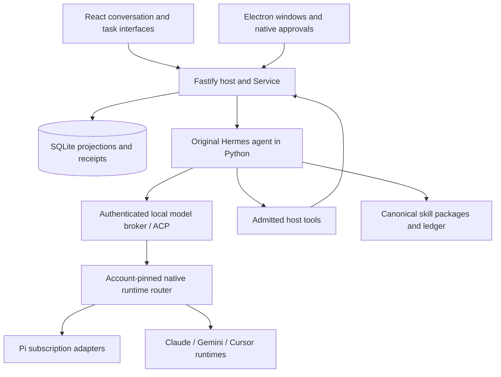

# Architecture

Last updated: 2026-11-01.

Gen V1 has one local application host, a React interface and a native Electron shell. The production primary agent is the pinned original Hermes Python engine. Native provider adapters supply model text; the host owns application capabilities and durable projections.

## Execution flow

[apps/server/host.ts](../apps/server/host.ts) acquires the profile lease, starts both loopback origins and recovers durable state. [apps/server/hermes-service.ts](../apps/server/hermes-service.ts) selects the production Hermes composition. Tests and embedders can inject a runtime without changing that default.

## Module map

| Area | Responsibility |
| --- | --- |
| [apps/web](../apps/web) | Conversation, task views, settings, draft journals and desktop bridge client |
| [apps/desktop](../apps/desktop) | Native windows, isolated remote browser, sign-in consoles and owned backend lifecycle |
| [apps/server](../apps/server) | HTTP/SSE, session/CSRF checks, startup and widget mounts |
| [packages/core](../packages/core) | Commands, run ownership, tools, actions, approvals and projections |
| [packages/storage](../packages/storage) | SQLite transactions, command receipts and workspace event sequence |
| [packages/runtime-hermes](../packages/runtime-hermes) | Python transport, source skill library and authenticated native-model broker |
| [packages/runtime](../packages/runtime) | Selected account routing and account-profile ownership |
| [packages/runtime-pi](../packages/runtime-pi) | Pi subscription authentication, model selection and owned worker execution |
| [packages/runtime-official](../packages/runtime-official) | Published Claude/Gemini/Cursor runtime protocols and session validation |
| [packages/ui-catalog](../packages/ui-catalog) | Trusted components, schemas, composition examples and renderer definitions |
| [packages/widgets](../packages/widgets) | Opaque generated-app workers, DOM validation and watchdog control |
| [third-party](../third-party) | Pinned original/adapted source, manifests and upstream notices |

## Ownership and persistence

One thread is a durable task. Each run has a run ID and revocable epoch. Tool calls, native callbacks and artifact publications must still belong to the active run when they arrive. Stop, archive and disposal revoke that authority; a late callback cannot revive it.

The host is the only SQLite writer. Commands atomically update projections and their event sequence. Retried command IDs return their prior receipt. A persisted input outbox separates accepted user input from native entry and completed handling, so a pipe write is not mistaken for delivery.

Original Hermes skill packages and their filesystem ledger are canonical. SQLite projects the skill library into the interface and preserves legacy history. Original Hermes conversation state is saved in the app-owned Hermes session area. Pi/official sessions remain owned by their native adapters where those paths are used. The app does not substitute projected UI messages for native delivery evidence.

Drafts use IndexedDB with local write-ahead staging and generation-based compare-and-swap. Revision checks and edit leases protect shared artifact state. Conflicts retain local edits for review. Expanding an artifact preserves its mounted identity; acknowledged state survives reload.

## Hermes integration

The Python worker imports the pinned `run_agent.AIAgent` and original skill/review/curator implementations. Retained upstream files remain byte-identical; the source manifest records hashes and sizes. The host wrapper supplies a provider/ACP extension rather than rewriting the algorithms.

For each model request, an authenticated loopback broker captures the exact model/account binding. The native adapter is a tool-free text transport: Hermes interprets the returned text and executes only the admitted host capabilities. Native provider tools cannot bypass that outer authority.

Original `/learn`, background review, skill writes and curator behavior use the same source-owned library. Approval settings and protected/disabled skill names are captured for the run. Account use remains held until foreground/background work and native teardown are confirmed.

See [the original-source integration notes](2026-11-01-hermes-source-integration.md) and [upstream manifest](../third-party/hermes-agent/UPSTREAM_MANIFEST.json).

## Accounts and native runtimes

Saved accounts use private hashed namespaces. Existing chats retain the account chosen at their first accepted message; changing defaults applies to new tasks. Native login and credential changes require exclusive account ownership. A timeout, dead console or missing acknowledgment alone cannot establish cleanup.

The runtime router selects Pi or the official adapter by the captured model and account. There is no automatic account rotation or app-side API-billing fallback. Model discovery can be cached; native startup still validates authentication and the selected model.

Cursor stages login and verifies a native authenticated user ID before replacing credentials. Claude checks authenticated metadata at process initialization; its SDK caches `accountInfo()` and does not provide an immutable subject. Pi/Gemini do not expose verified person identity through the installed APIs. Local labels and credential presence do not replace these missing proofs.

## Composer predictions and auxiliary work

Predictions have an independent runtime and bounded, non-durable eligibility slots created by accepted foreground settlement. They use recent canonical chat text and the selected model/account. At most one prediction runs globally; context/output are bounded, and the generation deadline is fifteen seconds.

Pi predictions use an in-memory conversation with no tools, retries or compaction. Official prediction sessions refuse existing conversation manifests. New real work, credential changes and cancellation wait for optional runtime teardown; no prediction row is added to the task conversation.

The frontend displays suggestions outside the draft journal. Tab acceptance writes through the normal draft path. Typing, IME, selection changes and late responses retain generation/ownership checks. A whole suggestion must fit before it can be accepted.

Planning readers use separate read-only native sessions under the parent run's grants. They cannot mutate resources, approve operations or finish the parent. Side conversations also have separate read-only authority. These helpers do not create independent mutating primary agents.

## Trusted and generated interfaces

Trusted task views use catalog schemas, versioned data bindings and declared actions. Accepting an agent action persists its immutable envelope and input outbox item. Privileged operations still require native review of exact resources and preconditions.

Generated apps are enabled after actual-host isolation, checkpoint, reload, continuation and responsiveness checks. A one-use mount ticket identifies the trusted receiver on a separate loopback origin. That receiver creates an opaque-origin worker for model JavaScript. Only validated, bounded DOM snapshots and bridge messages reach the receiver; host messages check source, token, artifact, mount and schemas.

The controller terminates an unresponsive worker through a watchdog. This is application isolation, not a hard operating-system memory quota. Approved project tests and native runtimes still execute with local-user privileges.

## Native desktop and recovery

Electron uses a real Node sidecar for the host and narrowly typed preload methods for trusted application windows. Remote browser content has no application bridge or Node access. Conversations can detach into pinned native windows. The original workspace releases the conversation while the child owns it, and edit handoff runs before the conversation moves. Canvas panel detachment remains retired. Child surfaces retain their identities, placements and edit-handoff acknowledgments for recovery.

Restart recovers durable tasks, artifact state and draft journals. Interrupted work remains visible and is not automatically repeated. Resume uses saved native/source evidence and receipts; it does not turn an uncertain operation into a completed one.

The [acceptance report](2026-11-01-product-completion.md) distinguishes fixtures, source checks, genuine OpenAI runs, packaged native checks and remaining provider/hardware gates.
