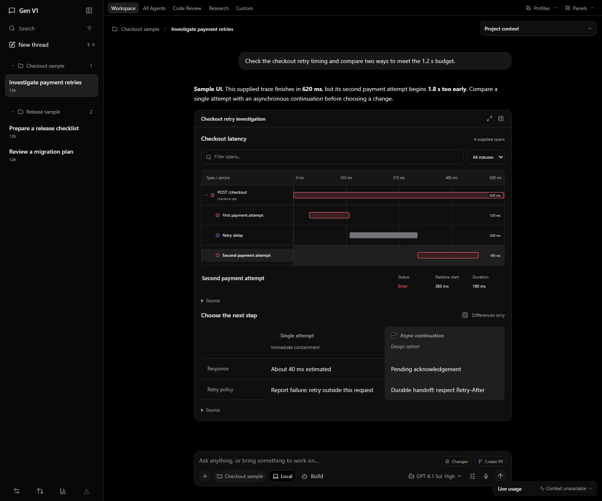
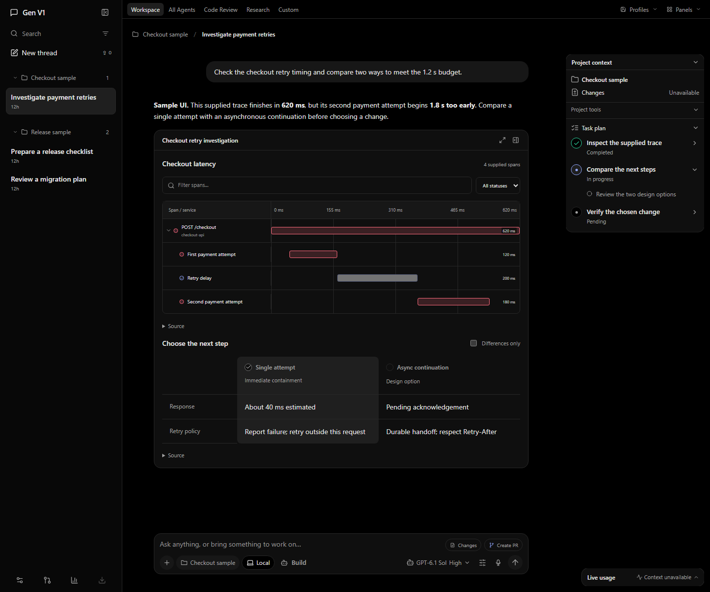
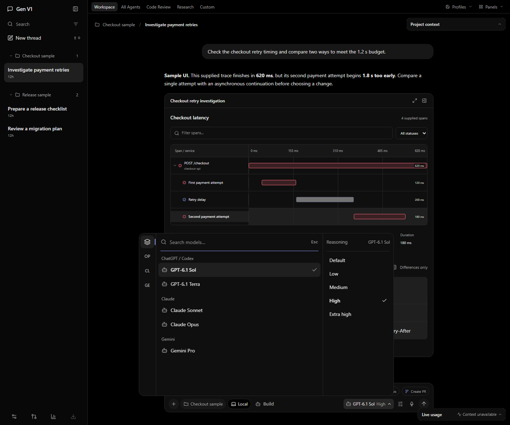
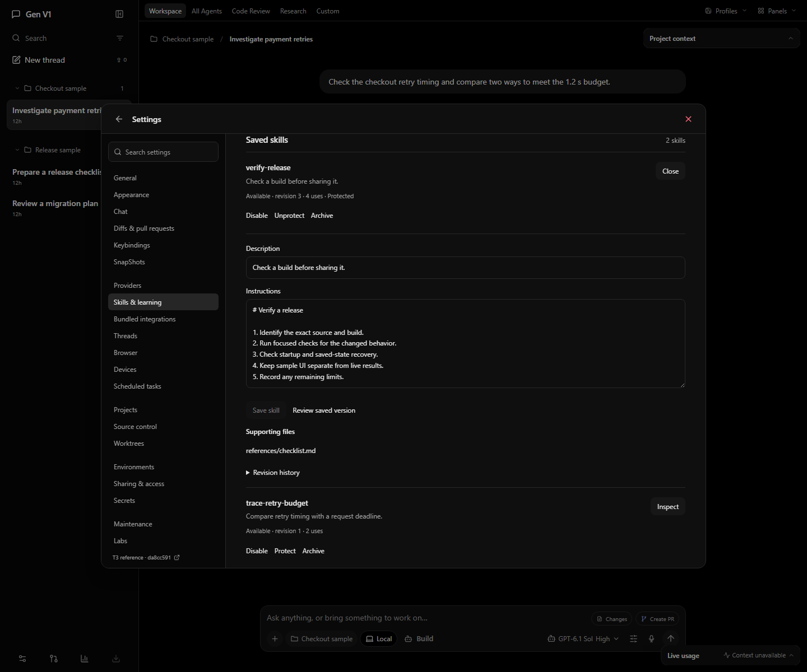
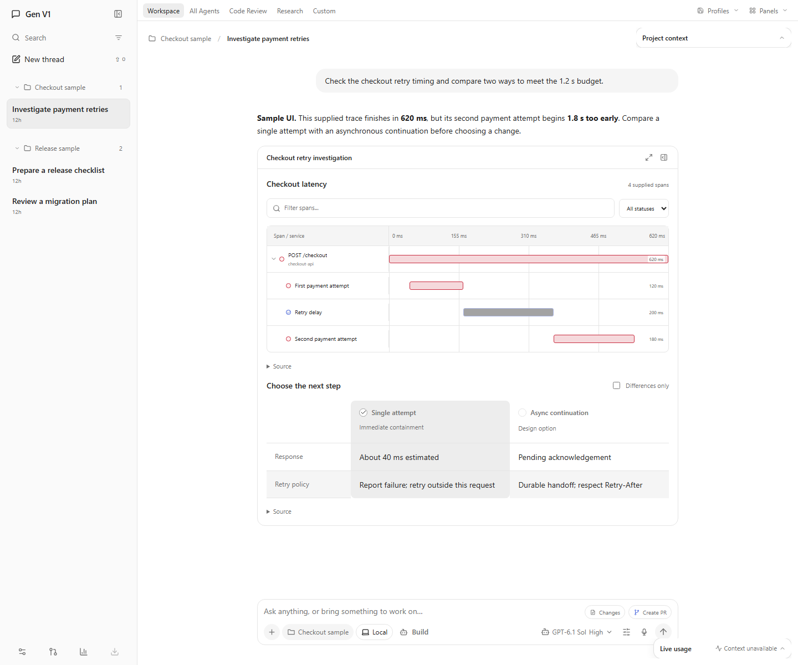
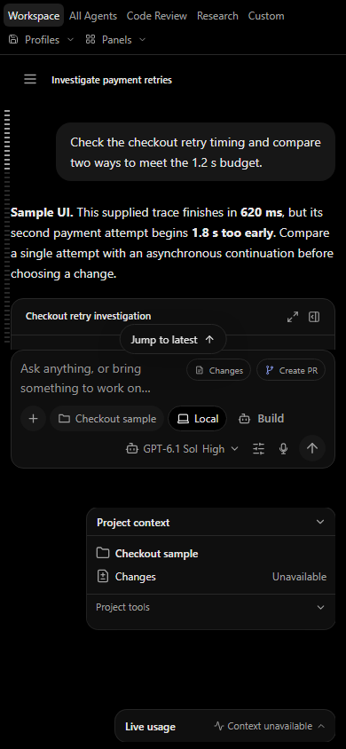

# A workspace shaped by the task

Gen keeps the conversation at the center. A task interface adds a way to inspect, edit or decide without replacing the discussion that explains the work.

[Get started](getting-started.md) · [Watch the demos](media/README.md#demos) · [Release status](release-notes.md)

## Interactive work, inline

The trusted catalog has 48 components for task-specific compositions: trace waterfalls, comparisons, document review, typed editing, workflows, diagrams and more. The agent supplies the data, structure and declared actions. A comparison and a trace can sit together in one persistent working object.

*Authored sample UI, not a live diagnosis or an executed code change.*

Generated-code applications use a separate opaque worker, validated messages and a termination watchdog. Those controls do not establish a hard OS memory quota or guarantee the quality of generated code. The broader generation-quality pilot remains open.

## Conversation and working state

Conversations, artifacts, accepted actions and saved state persist. Draft journals protect newer local edits, and revision checks retain conflicts for review. Interrupted work stays visible rather than being automatically repeated. The host keeps receipts so accepted input and completed execution remain distinct.

Optional composer predictions use the selected account/model in a separate tool-free session and are off by default. **Tab** accepts a suggestion; **Escape** dismisses it. Sending remains a separate action.

## A focused shell

Projects and threads live in the left navigation. The compact composer holds project selection, Build/Plan mode, model/reasoning selection and Send/Stop. A validated plan opens automatically; context and usage minimize when you want the space back. Closed tools leave no empty rail.

In the Windows desktop app, open a conversation’s sidebar menu and choose **Detach thread** to move it into a pinned window. Use **Return to workspace** to bring it back. Canvas panels do not detach; context and usage minimize in the workspace. `/btw` and `/side` remain available for side conversations. See [the preview notes](release-notes.md) for current limits.

## Model choice with account continuity

The model picker is searchable and exposes only the selected model’s advertised reasoning levels. Nine connection IDs route through Pi subscription adapters, native official runtimes, OAuth or dedicated plan keys. Saved accounts have separate local profiles; an existing task retains its captured account.

*The media catalog is illustrative. OpenAI has recorded live acceptance; other providers require independent account and entitlement checks. No automatic account rotation or API-billing fallback is enabled.*

Read the [connection reference](../subscription-connections.md) before relying on a particular runtime or model. Gemini/Cursor native compaction, the separate OpenCode agent runtime and Meta/Muse access are unavailable.

## Skills you can inspect

The original Hermes engine supplies conversation execution, skill tools, `/learn`, background review and curation. Saved skills have visible instructions, files and revision history. Approval preferences and protected or disabled skills remain part of the host’s authority checks.

Learned text does not grant permissions. Review skill changes and consequential actions before accepting them.

## Dark, light and smaller windows

Gen uses neutral black/gray and white/gray themes. Task interfaces share the conversation’s alignment, and navigation can close to make room in smaller windows.

The narrow capture is a browser layout demonstration. It does not establish a mobile release or physical mixed-DPI acceptance.

## An optional public extension boundary

Plug-in API v1 supports separately versioned packages, declared capabilities and their own durable state. The host checks compatibility and file manifests; data stays outside application updates. Gen builds and opens without an installed plug-in.

The API requires Gen 0.6.4; packages declare supported versions. See [the public API and packaging contract](../plugin-api.md) for manifests, install/update behavior and bridge boundaries. No particular external service or plug-in’s live authority is implied.

## Local application, connected inference

The React UI and Windows Electron shell share a loopback Fastify host. SQLite stores application projections and receipts. The pinned original Hermes engine owns conversation state and source skill packages. Credentials and working state remain in local app-owned directories.

Model requests still leave the machine for the connected provider. Approved project tests and native runtimes run with local-user privileges. Read [architecture](../architecture.md), [security](../../SECURITY.md) and [preview limits](release-notes.md) for the practical boundaries.
