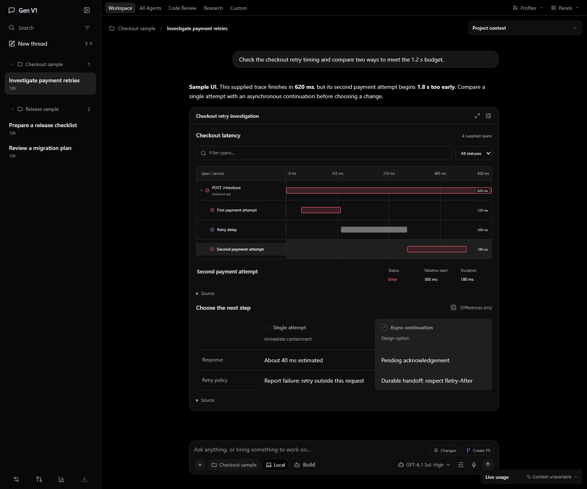

# Get started with Gen

Gen runs a local application host and a Windows desktop or browser interface. You connect your own supported provider account. The application stores its working state locally; model requests go to that provider.

[Back to Gen](../../README.md) · [Features](features.md) · [Preview status](release-notes.md)

## Try the published preview

Open the [v0.6.1 preview release](https://github.com/Skytuhua/Gen-V1/releases/tag/v0.6.1). It contains an unsigned Windows x64 installer and `SHA256SUMS.txt`. Check the release notes and compare the installer’s SHA-256 with that file:

```powershell
Get-FileHash -Algorithm SHA256 -LiteralPath .\Gen-V1-Setup-0.6.1-win-x64.exe
```

This is a prerelease. There is no published stable 0.6.4 installer yet. The current source and the [gallery](media/README.md) include later changes, including plug-in API v1; they may differ from the published preview. Installed upgrade acceptance remains incomplete.

## Develop from a fresh checkout

Use Windows x64 with Node.js **24.10.0 or newer**, pnpm **10.30.3** and CPython **3.14** with pip. Desktop verification targets Windows; macOS and Linux desktop acceptance are not established.

The commands below use the current main branch, v0.6.1. The newer interface and plug-in API shown in the gallery are still under review in [PR #1](https://github.com/Skytuhua/Gen-V1/pull/1).

From PowerShell:

```powershell
git clone https://github.com/Skytuhua/Gen-V1.git
cd Gen-V1
pnpm install --frozen-lockfile
py -3.14 -m pip install --no-cache-dir --no-compile --target .harness-hermes-python-deps -r third-party/hermes-agent/runtime-requirements.txt
```

The Python command installs pinned Hermes requirements into an ignored, isolated repository directory. If the Windows `py` launcher is unavailable, use your CPython 3.14 executable and set `HARNESS_HERMES_PYTHON` to its absolute path. See the [runtime setup details](../getting-started.md#install-development-dependencies).

For a separate development data directory, set this before **both sign-in and startup**:

```powershell
$env:HARNESS_DATA_DIR = Join-Path $env:LOCALAPPDATA 'GenV1-Development'
```

Choose one entry:

| Interface | Command | Address |
| --- | --- | --- |
| Windows desktop | `pnpm desktop:dev` | Native app window |
| Browser development | `pnpm dev` | `http://127.0.0.1:5173` |
| Built browser interface | `pnpm build`, then `pnpm start` | `http://127.0.0.1:4317` |

Development starts the backend on loopback port 4317 and the generated-app receiver on 4318. Keep ports distinct and avoid sharing a profile between active instances. Remote or multi-user hosting is not an accepted deployment mode.

### Inspect the newer source preview

To inspect the 0.6.4 source used for the gallery, select its review branch after cloning and before installing dependencies:

```powershell
git fetch origin feat/restore-harness-private-plugin-boundary
git switch --detach FETCH_HEAD
```

Then follow the dependency and isolated-profile setup above. This is an application source preview, separate from the published v0.6.1 installer; its merge and installed-update acceptance remain pending. The following navigation tour describes that newer interface.

## Connect an account

1. Open **Settings → Providers** and add a local account label.
2. Choose **Connect** for that account and complete its native sign-in flow.
3. Check readiness, refresh models and choose one available to your account.
4. Start a new conversation and send a small task you can verify.

Desktop opens the sign-in console. Browser development shows the exact command to run from the checkout; use the saved account ID when one is supplied. Enter secrets through the supported private sign-in flow, never through a prompt or command argument.

Only the OpenAI route has recorded live task acceptance. Other routes still need their own sign-in, entitlement and inference checks. A saved label, configured credential or model catalog is not proof of access. Existing tasks keep their chosen account; changing the default affects new tasks.

[Connection mechanisms and known limits](../subscription-connections.md) · [Detailed account setup](../getting-started.md#connect-a-provider)

## Find your way around

- Use the left navigation to return to a project or conversation.
- Use the composer’s project control to select a local project, and the model picker to choose a model and its available reasoning effort.
- Interactive task cards appear in the conversation. Their controls depend on the task; review consequential actions before accepting them.
- A validated task plan opens automatically. Project context and usage tools minimize within the workspace.
- Open **Settings → Skills & learning** to inspect saved procedures and revisions.
- `/btw` and `/side` remain available for side conversations. New native detachment is unavailable in the current source.



*Sample UI from the current source. [Media scope](media/README.md).*

## Keep your data recoverable

The default backend data directory is `%LOCALAPPDATA%\GenerativeHarness`. The desktop session/window profile is `%APPDATA%\GenerativeHarnessDesktop`. These names preserve compatibility with existing installations.

Application data may include credentials, conversations, attachments, skills and receipts. Keep it out of Git. Close the app fully before taking a backup. Do not remove profile guards or copy credentials between account folders to bypass a blocked connection.

After an interruption, inspect the saved task state and receipts before resuming. A draft is local text until you send it; an uncertain operation is not a completed operation. Recovery behavior is described in the [architecture guide](../architecture.md).

## If something is missing

| Symptom | Next step |
| --- | --- |
| Hermes dependencies are missing | Run the pinned Python `--target` installation from the repository root. |
| Python cannot start | Confirm CPython 3.14, or set `HARNESS_HERMES_PYTHON`. |
| Profile or port is already owned | Close its owning instance or select a separate development profile and ports. |
| No models appear | Finish sign-in in the same profile, check readiness and refresh models. |
| Cleanup is unconfirmed | Preserve the blocked state and investigate shutdown; do not clear ownership guards. |
| A source feature differs from the installer | Compare the [source/preview release notes](release-notes.md). |

Building an installer also needs pinned integration and Git/GitHub CLI bundles. A JavaScript install alone is insufficient; follow the [full packaging instructions](../getting-started.md#build-a-windows-installer). No private plug-in checkout or real profile is required.

For bugs, follow [CONTRIBUTING.md](../../CONTRIBUTING.md). Report sensitive findings through [SECURITY.md](../../SECURITY.md). The first-party code remains governed by [LICENSE](../../LICENSE).
