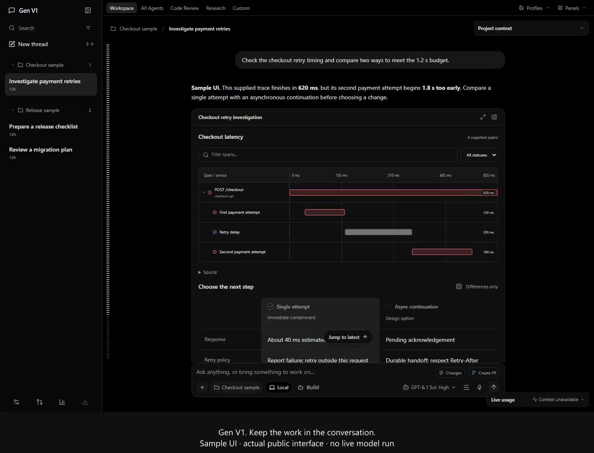
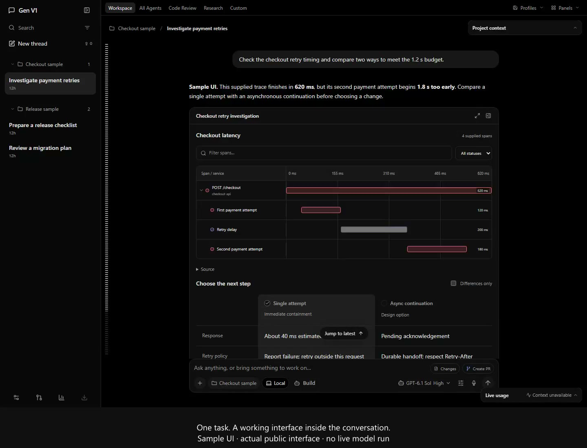
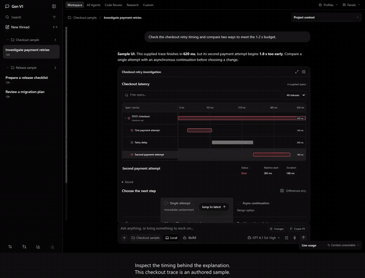

# A look around Gen

These screenshots and recordings show the actual public Gen interface, rendered in Chromium from source commit `cb504d0e392fde9e70883b7b7c2e808e13488b7c` (0.6.4 source). The conversations, project labels, model catalog, trace, checklist and skills are **authored sample data**.

That application source is under review in [PR #1](https://github.com/Skytuhua/Gen-V1/pull/1). The current main branch and published installer are v0.6.1, so the gallery is a preview of the upcoming interface.

No personal conversation, account, credential or application profile was used. The examples make no live model requests and execute no external changes. Model entries demonstrate the picker; they do not establish account entitlement or provider availability. The browser captures do not establish native installation or updater acceptance.

[Back to Gen](../../../README.md) · [Feature tour](../features.md) · [Preview limits](../release-notes.md)

## Demos

### The workspace in a minute

[MP4](workspace-tour.mp4) · [WebM](workspace-tour.webm) · [Captions](workspace-tour.vtt) · [Transcript](workspace-tour.md)

A short tour of the conversation, model controls, task interface, checklist, skills and light theme. Captions are visible in the video; no audio is required.

### From a trace to a decision

[MP4](task-walkthrough.mp4) · [WebM](task-walkthrough.webm) · [Captions](task-walkthrough.vtt) · [Transcript](task-walkthrough.md)

Inspect supplied timing data, compare two options and leave an unsent draft. This demonstrates UI interaction, not model reasoning, backend recovery or an executed change.

If GitHub opens a file page rather than playing the clip, choose **View raw** or download the MP4. The WebM and text transcript offer alternatives.

A small animated preview

## Gallery

| View | What it shows |
| --- | --- |
| [Dark workspace](workspace-dark.png) | Project/thread navigation, conversation, trace and comparison |
| [Light workspace](workspace-light.png) | The same task in the light theme |
| [Model picker](models.png) | Searchable illustrative model catalog and reasoning controls |
| [Skills](skills.png) | Instructions, supporting files and revision history for a sample skill |
| [Plan and context](plan-context.png) | A validated sample checklist and compact project context |
| [Project selection](projects.png) | Local sample project choices from the composer |
| [Narrow window](narrow.png) | A 390 × 844 browser window with navigation closed and project context expanded |

Desktop images are 1440 × 1200; the narrow image is 390 × 844. Screenshots are unedited application captures. Videos record a 1440 × 1000 viewport; editing adds a caption band outside the recorded interface and encodes web-friendly copies. Posters are extracted from the captured UI; no application interface was generated or redrawn.

## How the samples were made

The capture uses the public application’s original `DesktopEntry`/`App` frontend and synthetic API fixtures, following the repository’s `scripts/capture-repository-screenshots.ts` and actual-App browser tests. A separate loopback server serves only the public frontend and the authored fixture. It never launches the native app, application backend, login console or model runtime. External browser requests are blocked.

The demonstration has no music, voice-over, stock media or generated UI. It uses the application’s own appearance and bundled assets. Gen and retained third-party material remain subject to [LICENSE](../../../LICENSE) and [third-party notices](../../../THIRD_PARTY_NOTICES.md).

The [machine-readable provenance file](provenance.json) records the source, scope, dimensions, durations, sizes and SHA-256 values. Public media descriptions explain what is shown; sample values are not production measurements.
